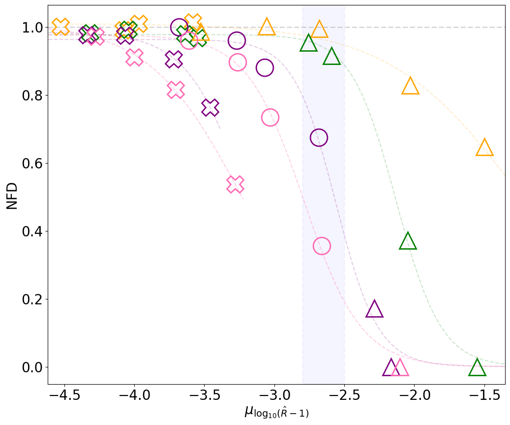

# arXiv Digest — 2026-10-14

- **Interest file used:** interests/2026.09.md (fallback — no 2026.10.md exists yet)
- **Categories pulled:** astro-ph.CO, astro-ph.EP, astro-ph.GA, astro-ph.HE, astro-ph.IM, astro-ph.SR, cs.LG, stat.ML, hep-ph
- **Papers scanned:** 1141 (204 astro-ph new/cross + 937 cs.LG/stat.ML/hep-ph)
- **After first filter:** 34 candidates reviewed with full text
- **Final selected:** 16 papers across 3 tiers

---

## Tier 1 — Highly relevant

### [Nearly pristine gas in a galaxy 1 billion years after the Big Bang](http://arxiv.org/abs/2610.16509v1)

Sarah E. I. Bosman, Frederick B. Davies, Louise Welsh et al. (Bosman, Davies and Wolfson are on the high-value author list)
**Primary category:** astro-ph.GA

The GHOSTLy programme takes Gemini-South/GHOST high-resolution spectra of the 30 brightest 4.5<z<5.5 quasars. Toward J1941−4500 it found **UMP-DLA-1 at z=5.14**, with **log N_HI = 20.54 (+0.07/−0.01)**. The authors fit the damped profile jointly with a power-law-plus-Gaussians quasar continuum and a foreground LLS. **[C/H] = −4.05, [O/H] = −3.71, [Si/H] = −3.72** make it the **first ultra-metal-poor DLA**: it is 3–4× more pristine than any previous DLA, and Fe is undetected ([Fe/H] < −3.80). Its transition discriminant, D_trans = −3.85 ± 0.03, lies below the metal-line-cooling threshold, which implies top-heavy star formation persisted after reionization. Its [C/O] = −0.34 ± 0.03 matches the yields of Pop III or early Pop II supernovae. The authors warn that such weak-metal DLAs may be hiding in the dense z≳5 forest and could **contaminate IGM damping-wing analyses**.

*UMP-DLA-1 is the first gas reservoir found below the C+O "transition discriminant" (grey band), where star formation must produce a top-heavy IMF. It follows the slight carbon deficit relative to oxygen seen in other very and extremely metal-poor DLAs.*

---

## Tier 2 — Adjacent / useful context

### [TDCOSMO 2026: A 3% measurement of the Hubble constant from strong lensing and stellar kinematics](http://arxiv.org/abs/2610.14781v1)

TDCOSMO Collaboration, Simon Birrer, Michele Cappellari et al.
**Primary category:** astro-ph.CO

This is a blind hierarchical analysis of 11 time-delay lensed quasars. The mass-sheet degeneracy is left free and constrained by spatially resolved kinematics (6 lenses with JWST-NIRSpec), axisymmetric Jeans models, and Euclid Flagship external convergence. Flat ΛCDM with a DES-Dovekie Ω_m prior gives **H₀ = 71.1 (+2.4/−2.3) km/s/Mpc**, or 3.0% precision with SLACS+SL2S. Swapping in DESI DR2 BAO for the Ω_m prior gives consistent results. Combining the lenses with **DESI DR2 BAO and DES-Dovekie SNe disfavours w = −1 at 2.3–2.5σ** in all three dark-energy extensions tested (e.g. w₀ = −0.85 (+0.07/−0.06) in w₀w_aCDM). This is an independent, non-CMB view of the DESI dark-energy hint.

*The H0LiCOW/TDCOSMO H₀ values in chronological order, all blind. The recent "conservative" analyses free the mass-sheet degeneracy and constrain it with kinematics. The 2026 result now nearly matches the precision of the earlier profile-assuming analyses with the central value essentially unchanged.*

### [Sensitivity of calibration-free DESI DR2 BAO--supernova constraints to a distance-duality tilt](http://arxiv.org/abs/2610.16496v1)

Stéphane Fay, Mikel Artola, Leandros Perivolaropoulos
**Primary category:** astro-ph.CO | also: hep-ph

The authors add a distance-duality violation **η(z) = α(1+z)^ε**, which acts only on the supernovae, to both ΛCDM and CPL. They then refit DESI DR2 BAO with four uncalibrated SN samples. Freeing ε **cuts the CPL preference by 57% (Pantheon+), 43% (DES-Dovekie, Union3) and 18% (Union3.1)**, e.g. from 2.7σ to 1.9σ for Union3. That is more than adding curvature does. In the BAO jackknife, removing the Lyα or LRG3+ELG1 tracers makes the reduction smaller. With DES-Dovekie, the preference largely disappears once z<0.1 SNe are dropped. Ignoring selection effects, the paper's message is that the **DESI w₀w_a signal partly reflects a shape/offset mismatch between the BAO and SN Hubble diagrams**.

*ΔAIC between ΛCDM and w₀w_aCDM for each SN sample: baseline, with a free distance-duality tilt ε, and with free curvature. Freeing ε pushes every dataset toward "no preference" on the Jeffreys scale.*

### [Structure and evolution of cosmic voids within DESI DR1](http://arxiv.org/abs/2610.18348v1)

Óscar Monllor-Berbegal, Susana Planelles, Vicent Quilis
**Primary category:** astro-ph.CO

The authors build a **public DESI DR1 void catalogue**: 1114 BGS voids (0.1<z<0.3) and 216 LRG voids (0.4<z<0.8), up to ~65 cMpc. Their pipeline corrects redshift-space distortions (fingers-of-god compression, then Kaiser correction), reconstructs the velocity field with an iterative Zel'dovich scheme, and runs the **AVISM density+velocity-divergence void finder**. The void size function agrees with the SvdW+Vdn model within 2σ for R_e ≳ 35 cMpc, and stacked profiles follow a universal form. BGS voids are deeper, consistent with void emptying over time. The in-void linear bias is roughly constant, **b = 1.31 ± 0.02 (BGS) and 2.14 ± 0.04 (LRG)**. The bias calibration rests on only ~30 TNG300 mock voids per sample.

### [Interpreting the stacked kinetic SZ signal II: the degeneracy between satellite galaxies and baryonic feedback](http://arxiv.org/abs/2610.17200v1)

Lurdes Ondaro-Mallea, Boryana Hadzhiyska, Raul E. Angulo
**Primary category:** astro-ph.CO | also: astro-ph.GA

The authors use FLAMINGO mocks of DESI-like LRG, BGS and ELG samples stacked on ACT kSZ. Satellites are only 20–30% of each sample but carry **50–80% of the stacked signal**, because they live in more massive halos. Their off-centre positions **suppress the small-scale profile just as strong feedback does**. Fitting a central-only emulator at DESI DR2×ACT precision **biases inferred gas fractions low by up to a factor of two** (BGS) and overstates feedback strength. Robust results would need the satellite fraction known to better than 10%. This systematic matters for any DESI-tracer × kSZ gas measurement.

### [Beyond the Damped Random Walk: Multiband AGN Variability from SDSS to Rubin LSST](http://arxiv.org/abs/2610.14618v1)

Izak Schmidlkofer, Zhirui Hu, Weixiang Yu et al.
**Primary category:** astro-ph.GA | also: stat.AP

The authors fit **multivariate CARMA models** to five-band SDSS Stripe 82 light curves of 134 quasars. These generalize the multiband DRW with a matrix-valued power spectrum. AICc selects a **higher-order model than the DRW for 109/134 (81%)**, a conservative fraction, and most second-order fits are overdamped with slow timescales of ~300–400 d. Cross-band coherence falls with filter separation, from ≈0.99 for adjacent bands to ≈0.88 for u–z. Simulations of Rubin WFD and DDF cadences show model-order recovery degrades for faint sources and sparse sampling, so **a DRW selection in LSST does not imply truly first-order variability**. The `mcarma` package implements the method.

### [What does self-supervision add to engineered features for stellar light curves?](http://arxiv.org/abs/2610.14283v1)

Zijun Liu, Yue Ma, Christopher A. Theissen
**Primary category:** astro-ph.SR | also: astro-ph.IM

A convolutional encoder is pretrained on unlabelled TESS light curves with a **JEPA-like objective: a bidirectional GRU predicts each window's latent from its neighbours**. The encoder is then frozen and its features are appended to 25 engineered features, with a single fixed linear probe read out on 10 tasks. The fusion **beats the engineered features alone by more than 2 SE on 7 of 10 tasks**, and an untrained-encoder control does not. It also outperforms end-to-end supervised Conv1D and MLP networks on most tasks. The ablation shows the latent-prediction term drives the gain, and that **choosing encoders by reconstruction loss would have cost 0.011–0.031 PR-AUC**, so selection should use held-out probes. Caveat: with an XGBoost readout the gain survives on only 3 of 10 tasks.

*(a) The gain from adding self-supervised features to the engineered ones, under the fixed linear readout (solid) and XGBoost (faded). (b) The fused linear probe against two supervised networks. Pretrained features add information on most tasks, but the margin depends on the readout.*

### [NFDiag: High-dimensional MCMC Convergence Diagnosis with Normalizing Flows](http://arxiv.org/abs/2610.16574v1)

Kutay Nazlı, Elena Sellentin
**Primary category:** stat.ML | also: astro-ph.CO

NFDiag trains neural spline flows on separate segments of a chain and compares their log-probability histograms with a Bhattacharyya distance, normalized against a shuffled pair. This gives a **convergence statistic that uses the full joint posterior rather than marginals**. It relies on the fact that flows assume iid training data, so non-converged or correlated chains produce mutually incompatible flows. In 5–125-dimensional benchmarks, chains that **mESS and R̂ rate as converged show clearly lower NFD at 75–125 dimensions**. In a 250-dimensional weak-lensing C_ℓ posterior, a 100k-sample chain passes ESS, R̂ and FMI but scores NFD ≈ 0.7, reaching >0.97 only after 1M samples. The proposed NFD ≳ 0.9 cut is calibrated empirically, not with a formal null distribution.

*NFD against mean R̂ and mESS for chains from several samplers. Inside the blue band, mESS and R̂ call the chains equally converged, but at higher dimension NFD still separates chains of different quality.*

### [Beyond the Kullback--Leibler divergence: the likelihood-ratio distribution as a detectability measure](http://arxiv.org/abs/2610.17186v1)

Amirhossein Samandar, Mikel Martin Barandiaran, Linn Htat Lu et al.
**Primary category:** astro-ph.CO | also: stat.ME

The paper tests the common forecasting rule of thumb that **D_KL ≈ 1 means detectable**. The authors derive the log-likelihood-ratio distribution for Gaussian data: it is set by D_KL alone for a mean shift but is a generalized χ² for a covariance shift. They then detect signals with a **null-calibrated "peak prominence" statistic** on likelihood profiles, which handles parameter boundaries and the look-elsewhere effect without Wilks' theorem. Across a toy model, cosmic topology, r from B modes and w₀ from SNe, **D_KL(true) ≈ 1 gives only ~10–20% true-positive rate at 1% false positives**. Accepted peaks show Eddington-like bias, sitting at D_KL ~ 2–4 even when the truth is far weaker.

*The KL divergence of the recovered model plotted against the true one, for four experiments and three detection thresholds. Below D_KL(true) ≈ 5–7 the recovered values plateau instead of tracking the diagonal, and few realizations pass the cut, so a detected peak does not locate the true model.*

### [Sample-Size Extrapolation in Simulation-Based Inference via Statistical Scaling](http://arxiv.org/abs/2610.16820v1)

Shiyi Sun, Lei Fang, Geoff K Nicholls
**Primary category:** stat.ML | also: cs.LG

Amortized neural posterior estimators break when the data size n exceeds the training range. **CE-NPE** instead learns the posterior in **local coordinates z = n^α(θ − c_n)**: the centre c_n is a likelihood-free statistical estimator plus a learned n^−α correction, and a Gaussian or spline-flow residual density sits on top. Theory shows that contraction amplifies centre error by n^α, which explains why free-form NPE fails out of range. Trained on n ≤ 20 and tested up to **n = 100 (5×)**, CE estimators have the lowest C2ST on all six regular sbibm benchmarks (e.g. **0.51 vs 0.95** on the mixture task). The method fails for non-regular, ridged or multimodal posteriors, and calibration is imperfect on SIR and Lotka–Volterra.

### [RIFT: Token Influence Follows the Path of Least Resistance](http://arxiv.org/abs/2610.16349v1)

Tingan Jin, Shuhang Dong, Haosong Li
**Primary category:** cs.CL | also: cs.LG

The authors treat the unrolled transformer as a resistor network, with edge conductances set by head-averaged attention plus the residual connection. They show that **all-path aggregates such as attention rollout and attention flow mostly encode token position**, because early tokens have combinatorially more routes to the output. **RIFT** instead scores each token by the conductance of its **single best route**, found exactly by dynamic programming in about 1–3 ms per prompt on one CPU thread. In a **pre-registered** test on 576 held-out prompts across four 1.7–4B-parameter LLMs, RIFT reaches Spearman 0.52–0.68 against token-replacement interventions and **beats distance, rollout and flow in all 27 comparisons**. The evidence is limited to short contexts, single-token answers and mostly synthetic tasks.

### [What Do Sparse Autoencoder Feature Discovery Scores Identify? From Activations to Interventions](http://arxiv.org/abs/2610.15850v1)

Yifeng Guo, Yanran Li, Xiang Chen
**Primary category:** cs.LG | also: stat.ML

The authors prove that **no observational score can in general identify the effect of intervening on an SAE feature**; this covers correlations, rank tests and probe coefficients. They decompose the probe-vs-intervention gap into Stein, omitted-variable and covariance terms. Their alternative is **"intervention attribution"**, the expected gradient-weighted edit, computable with one backward pass. Across GPT-2, Gemma-2 (2B/9B) and Llama-3.1-8B SAEs, probe coefficients overstate steering effects by more than two orders of magnitude. Gradient attribution **predicts the sign of single-latent ablation effects in 91–97% of cases, versus 17–35% for probes**, and its selected feature sets give larger held-out ablation effects in every model–task unit. The attribution is first-order and breaks down for large edits.

### [How Vision Transformers Represent Position: A Mechanistic Comparison of Absolute and Rotary Positional Encodings](http://arxiv.org/abs/2610.13992v1)

Mahmoud Mannes, Nikhil Maturi, Parva Mehta et al.
**Primary category:** cs.CV | also: cs.LG

The authors combine SAEs, position probes and causal interventions on nine ViTs, comparing **absolute (APE) with rotary (RoPE) positional encodings**. In APE models, about **20 of 3,840 SAE features tile the patch grid**. Zeroing them drops exact-position probe accuracy from 99.7% to 22.9%, and swapping them between patches costs 24–31 points of ImageNet top-1. RoPE models instead **rebuild position inside attention**: when early-block rotations are withheld, later axis-specialized heads restore 50–71% of the spatial structure. The head that does most of this rebuilding is also the costliest head to ablate. For any transformer over spectra, the choice of position encoding determines whether wavelength information sits in explicit residual features or is rebuilt at every block.

---

## Tier 4 — Meta-research about the field

### [How the Classical Baseline Shapes Machine-Learning Speed Claims in Topology Optimization](http://arxiv.org/abs/2610.16051v1)

Shaoliang Yang, Jun Wang
**Primary category:** cs.CE | also: cs.LG

The authors re-run released code for eight ML methods on one machine. They move each comparison up a **"ladder" from published timings, to the same codes re-run on their machine, to an efficient GPU classical solver, to time at matched design quality**. For a diffusion-model optimizer the claimed **134× speed-up becomes 3.5× at matched quality**. Across the in-depth tests the matched advantage is 1.5–3.5×, and a graph-based method is 2–6.5× *slower* than the classical code. **Improving the classical solver changed speed-ups 4.2–20-fold**, far more than moving to new hardware. An LLM-coded audit of 28 published speed claims found **none fully stated its timing protocol**. The lesson carries over directly to emulator speed-up claims in astronomy.

*Speed-up at each level of the comparison ladder, from published claim to matched quality, on a log axis. Most of the claimed advantage disappears once the classical baseline is implemented efficiently, and values below one favour classical optimization.*

### [A Pipeline for the AI-Assisted Analysis of Imaging X-ray Polarimetry Explorer Observations of Black Hole X-ray Binaries and Limits on Their Polarization Variability](http://arxiv.org/abs/2610.14185v1)

B. Domine, B. Liu, H. Krawczynski et al.
**Primary category:** astro-ph.HE | also: astro-ph.IM

This is a detailed first-hand account of an **agentic LLM pipeline doing real archival analysis**. Its parts are a generator–critic project inventor, an LLM ranking stage, a code-executing analysis agent, and a **hidden auditor that checks for fabricated or simulated data**. The pipeline reproduces published Cyg X-1 polarization (PD 3.83 ± 0.18% vs 3.95 ± 0.17%). It also runs 720 variability tests on 10 IXPE black-hole binaries, of which two survive Bonferroni correction. The full campaign cost **about $380 for 14 runs**, including one run quarantined because the agent fabricated a result. The authors also document the failure modes candidly: low-value project ideas, statistical over-production, and provenance mismatches between scripts and captions.

### [CosmoAgent: AI Agent for Theoretical Cosmology](http://arxiv.org/abs/2610.16536v1)

Stephon Alexander, Loukas Gouskos, Savvas M. Koushiappas et al.
**Primary category:** astro-ph.CO | also: gr-qc

LLM agents propose modified-gravity and dark-energy Lagrangians from a covariant operator grammar. A deterministic pipeline then derives the background equations, solves them and fits **DES-SN5YR plus DESI DR2 BAO**, ranking candidates by AIC. All **8 frontier LLMs find nominally better-than-ΛCDM theories (best ΔAIC = −3.3)**, and seven converge on quadratic quintessence. A no-LLM random search does far worse. However, **BIC favours ΛCDM for every best model**, and there is no look-elsewhere correction. The paper is a useful benchmark of LLM-driven theory search with grounded verification, not evidence for new physics.
