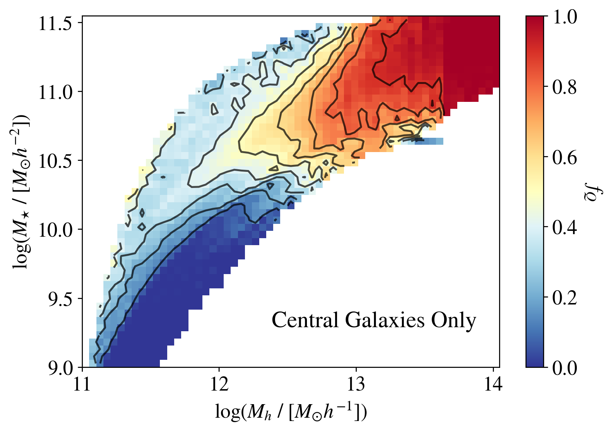

# arXiv Digest — 2026-10-16

- **Interest file used:** interests/2026.09.md (fallback — no 2026.10.md exists yet)
- **Categories pulled:** astro-ph.CO, astro-ph.EP, astro-ph.GA, astro-ph.HE, astro-ph.IM, astro-ph.SR, cs.LG, stat.ML, hep-ph
- **Papers scanned:** 453 (137 astro-ph new/cross + 316 cs.LG/stat.ML/hep-ph)
- **After first filter:** 30 candidates reviewed with full text
- **Final selected:** 13 papers across 4 tiers

---

## Tier 1 — Highly relevant

### [Disentangling geometry & growth in cosmic neutrino mass constraints: a more physical split and diagnostic](http://arxiv.org/abs/2610.20977v1)

Fei Ge, Frank J. Qu, Hanyue Wang et al.
**Primary category:** astro-ph.CO | also: hep-ex

The authors split the neutrino mass sum inside CAMB into **$\sum m_\nu^{\rm geo}$, which sets $H(z)$ for distances, and $\sum m_\nu^{\rm growth}$, which sets $H(z)$ in perturbation evolution**, and allow both to go negative. Planck primary CMB + Planck/ACT/SPT lensing + DESI BAO give **$\sum m_\nu^{\rm geo} = -0.07\pm0.10$ eV and $\sum m_\nu^{\rm growth} = -0.13^{+0.10}_{-0.12}$ eV**. Both channels therefore show a similar mild "negative mass" preference, and their difference passes a ΛCDM null test at 0.4σ. With non-negative priors neither channel alone excludes 0.058 eV; the tight standard bound comes from their different $H_0$ degeneracy directions intersecting. Forecasts for Advanced SO + DESI DR3 show the split is also a diagnostic: **an incorrect dark-energy model biases the geometry channel (3.1–4.2σ), while a wrong reionization τ biases the growth channel (2.7–3.6σ)**.

*Real-data posteriors: both mass channels sit at negative values but stay consistent with each other (the $\sum m_\nu^{\rm geo}=\sum m_\nu^{\rm growth}$ line), and the BAO Ω_m band is what pins the geometry channel.*

### [The Radius-Luminosity Relationship for Active Galactic Nuclei with Hierarchical Bayesian Reverberation Mapping](http://arxiv.org/abs/2610.22096v1)

Hugh McDougall, Tamara M. Davis, Benjamin J. S. Pope et al. (incl. Paul Martini)
**Primary category:** astro-ph.GA | also: astro-ph.CO, astro-ph.IM

Instead of fitting lags source by source and keeping a "gold" subset, this paper builds **an end-to-end hierarchical Bayesian model that fits every OzDES quasar's lag jointly with the R–L relation**. It reweights per-source nested-sampling chains by importance sampling and adds a "reverberating fraction" parameter to absorb sources with no real lag or with aliased seasonal lags. The approach **more than doubles the constraining power on R–L and raises the effective number of lags and SMBH masses from 24 to ~297**. It gives an Hβ slope of 0.63$^{+0.22}_{-0.20}$, excluding zero slope at about 2σ. One striking result is that **only ~9% of Mg II sources show reverberation**, versus ~91% for Hβ. The framework is set up for DESI-RM and 4MOST/TiDES-scale samples.

*Hβ R–L parameter posteriors from the hierarchical method versus the traditional gold-sample fit: the new contours are about twice as tight and exclude a flat (α = 0) relation.*

---

## Tier 2 — Adjacent / useful context

### [Self Calibrated Galaxy Groups from the DESI DR1 Bright Galaxy Survey](http://arxiv.org/abs/2610.20919v1)

I. Williams, J. Tinker, K. Wang et al.
**Primary category:** astro-ph.GA | also: astro-ph.CO

The Self-Calibrated Group Finder is run on **2.23 million DESI DR1 BGS galaxies** over ~2680 deg². Its ten free parameters are calibrated by MCMC against the sample's own $w_p(r_p)$ and satellite-luminosity measurements rather than against simulations. Every galaxy is classified as a central or satellite with a halo-mass estimate. The resulting non-parametric HODs fit standard forms with **satellite slopes α ≈ 0.75 for star-forming and ≈ 1.1 for quiescent galaxies**. Above $M_\star \approx 10^{10.3}$ and $M_h \approx 10^{12.2}\,h^{-1}M_\odot$, **the central quenched fraction depends mostly on halo mass, not stellar mass**. An appendix gives a hybrid nearest-neighbour scheme for fibre-incompleteness that yields unbiased occupation statistics.

*Quiescent fraction of centrals across the stellar-mass–halo-mass plane: contours turn vertical above ~10^12.2 h⁻¹M☉, the signature of halo-mass-driven quenching.*

### [Thermal Sunyaev-Zel'dovich Effect in the circumgalactic medium - III: does richness matter?](http://arxiv.org/abs/2610.21628v1)

Sanskriti Das, Yi-Kuan Chiang, Smita Mathur
**Primary category:** astro-ph.GA | also: astro-ph.CO

The authors stack ACT+Planck Compton-y maps on **~7 million DESI Legacy Survey galaxies and groups** ($M_{200c}=10^{12-14}M_\odot$, $z\le1$), split by both halo mass and richness for the first time. They **detect the one-halo tSZ term down to $10^{12.2}M_\odot$ at 5.8σ**. Some mass–richness bins prefer flatter or miscentred pressure profiles than the standard GNFW, and some require super-virial temperature floors. The **thermal energy–mass slope of the CGM falls 7.3σ below self-similar**, while group gas is consistent with self-similarity. As a result, low-mass, low-richness halos dominate the z ≤ 1 thermal-energy budget. The per-bin physical interpretation outruns what stacked profiles can constrain, but the scaling result is robust.

*Thermal energy within R_vir against halo mass for isolated-galaxy CGM and low/high-richness group gas: the CGM relation is clearly shallower than self-similar, while group gas follows it.*

### [Model-independent parameters from DESI DR1 LRG2 with an explicitly varying power-spectrum shape](http://arxiv.org/abs/2610.21235v1)

Yong-Seon Song, M. Icaza-Lizaola, Minji Oh et al.
**Primary category:** astro-ph.CO

The authors build a **hybrid model: perturbation theory for the model-independent parameters plus a Gaussian-process emulator of N-body residual templates over $(\omega_c,\omega_b,n_s)$**. This lets $\alpha_\perp$, $\alpha_\parallel$ and $f\sigma_8$ be fitted while the power-spectrum shape varies, which an emulator built directly in those variables cannot do. On DESI DR1 LRG2 they obtain $\alpha_{\rm iso}=0.950^{+0.017}_{-0.016}$ and $f\sigma_8=0.444^{+0.050}_{-0.047}$. Under the tight Planck shape prior, **letting the shape vary moves the results by less than 1/20 σ**, so this is mainly a validation of the method. The flat-ΛCDM projection to $h=0.724\pm0.017$ deserves the authors' own caveats, and the model fits mocks poorly at large volume.

### [Properties and limitations of linear models for mutual coupling in 21 cm arrays](http://arxiv.org/abs/2610.22197v1)

Vincent MacKay, Robert Pascua, Eleanor Rath et al.
**Primary category:** astro-ph.IM | also: astro-ph.CO

Using full-wave simulations of a 37-element HERA-like array, the authors split mutual coupling into an **"antenna mode" that linear re-radiation models can remove and a "structural mode" that they cannot**. The antenna mode carries **only ~1% of the beam-perturbation power**. Still, sky-weighting makes correcting it remove more than half the coupling power in simulated visibilities, and relaxing the re-radiation coefficient constraints reaches an **order-of-magnitude suppression** in noiseless, perfectly redundant arrays. Fits to known isolated visibilities go deeper but transfer poorly between fields. In practice, separating coupling from the unknown sky will need extra constraints.

### [Conditional Mean Flows: Few-Step Densities for Simulation-Based Inference](http://arxiv.org/abs/2610.21657v1)

Jonas Arruda, Jan Hasenauer, Stefan T. Radev
**Primary category:** stat.ML | also: cs.LG

The paper extends **MeanFlow (learning average velocities between two times) to conditional posterior and likelihood estimation**. This gives few-step, even one-step, samplers whose densities stay tractable. The authors prove the objective identifies the conditional flow maps, and that independent masking yields correct marginal likelihoods when data are missing. In a drift-diffusion model, **one-step likelihoods match 200-step flow matching in accuracy while making MCMC ~200× faster**. With 30% missing observations, the masked transformer beats a normalizing flow on posterior-predictive error (0.055 vs 0.159). The benchmarks are low-dimensional, and adding more steps can destabilize MCMC.

*Two-moons posteriors from competing estimators: a single mean-flow step already gives clean samples and a near-normalized density, whereas the normalizing flow shows folding artifacts.*

### [Complete or Sparse: A Tale of Two Identifiabilities](http://arxiv.org/abs/2610.20851v1)

Junze Zhou, David Klindt
**Primary category:** stat.ML | also: cs.LG

This is an identifiability theory for supervised representations: **when the representation has at least as many dimensions as the true latents, optimal encoders are linear in them; with fewer dimensions, identifiability generically fails**. With non-negative activations and an energy constraint, each neuron encodes exactly one latent (a "grandmother cell"). With sparse latents and a spark condition, **the encoder inherits compressed-sensing structure, so sparse dictionary learning recovers individual latents**. The authors claim this is the first identifiability result for undercomplete nonlinear ICA. It gives a principled account of when SAE-style feature recovery should work. Validation is synthetic at toy scale, and the real-network checks are correlational.

### [Learn Only Where You Can't Compute: Structured Corrections to Gaussian Process Posteriors](http://arxiv.org/abs/2610.21977v1)

Tobias Weber, Carla Sagebiel, Philipp Hennig
**Primary category:** cs.LG

The method starts from **an analytic Gaussian posterior, such as a physics-informed GP**, and corrects it in stages: a learned mean shift, a covariance recalibration, then **a diffusion model trained only in a low-dimensional subspace where the Gaussian fails**, leaving the complement Gaussian. An exact KL decomposition into location, covariance and non-Gaussian terms motivates the staging. On a smoke-plume inverse problem it **closes ~90% of the CRPS gap to the exact posterior while correcting ~38 of 1024 coordinates**, and on a three-body problem it halves the solver's CRPS. Experiments are small-scale, and full conditional diffusion still wins on the plume task.

---

## Tier 3 — Outside my area but notable

### [Testing the inelastic dark matter interpretation of the LZ event with heavy-element experiments](http://arxiv.org/abs/2610.21041v1)

Peter W. Graham, Juan P. Luengas, Harikrishnan Ramani et al.
**Primary category:** hep-ph | also: astro-ph.CO, astro-ph.GA, hep-ex

The paper takes seriously **LZ's single 248 keV nuclear-recoil event** and fits it with inelastic dark matter, showing that the viable parameter space hinges on **the high-velocity tail of the local DM distribution boosted by the LMC**. The thermal 1.1 TeV Higgsino fits only if that tail is reduced by ~100×, which puts it in tension with the solar-neutrino bound. The alternative is a tail extended to ~1100 km/s at fluxes below current simulation resolution. The authors propose **lead-bearing paleodetectors and lead-loaded neutrino detectors** to determine the DM mass and splitting and to test an LMC origin. It rests on one event, but it is a concrete roadmap if xenon experiments confirm it.

### [An Attenuation Bump at z=9.3: Probing Dust Diversity at Cosmic Dawn](http://arxiv.org/abs/2610.20722v1)

Giulia Rodighiero, Santiago Álvarez-Córdoba, Michele Catone et al.
**Primary category:** astro-ph.GA

In the "Black Pearl" ($z_{\rm spec}=9.3335$), NIRSpec reveals **the highest-redshift UV attenuation bump yet, ~500 Myr after the Big Bang**. It is well fitted by a Drude profile centred at **2132 ± 17 Å** with 0.21 ± 0.02 mag peak attenuation. SED fits with a free attenuation law recover it independently, in a low-mass ($\log M_\star = 8.35$), actively star-forming galaxy without a dominant AGN. The centre is offset by 43 ± 17 Å (~2.5σ) from the Milky Way 2175 Å feature and by 127 Å from the known z ~ 7 bumps. The authors take this as evidence for **diverse bump carriers (PAHs or small graphite grains) already at cosmic dawn**. It is a single object at PRISM resolution, so the offset's significance is modest.

*The rest-UV PRISM continuum with power-law and power-law+Drude fits: the broad depression near 2130 Å is visible directly, and adding the bump removes the structured residuals.*

---

## Tier 4 — Meta-research about the field

### [Athanor: An Agent-Native System for Autonomous Post-Training Research](http://arxiv.org/abs/2610.21055v1)

Yufa Zhou, Yichen Wang, Jiakun Fan et al.
**Primary category:** cs.AI | also: cs.CL, cs.LG, cs.MA

The authors build a sandboxed research environment with managed GPU jobs, frozen evaluators, decontaminated data and a persistent research record, then let **four frontier LLM agents autonomously post-train Qwen3-4B-Base for 104 hours with no research advice**. The agents lift it **from 15.9 to 67.3 on the development suite and from 9.2 to 48.2 on a held-out suite they never saw**, roughly level with the vendor's own instruct model, for ~$11,800 of compute. They did it by **recombining known methods** (SFT on public reasoning data, GRPO, weight merges, self-distillation) rather than inventing new ones, and converged early on one recipe. The "matches the official model" margins are within errors and this is a single campaign. It is still a concrete data point on how close autonomous agents are to running end-to-end ML research.

*Best-so-far development score over the 104-hour campaign: most of the climb to instruct-model level happens within the first day, followed by slow refinement.*

### [The Mission Market: Flying NASA's Vetted, Unflown Science](http://arxiv.org/abs/2610.22159v1)

Blakesley Burkhart
**Primary category:** astro-ph.GA

A short policy proposal for **an advance market commitment that escrows full funding for NASA Explorer-class missions already judged selectable but left unfunded**. Payment is milestone-based, on the COTS/CLPS model. The main funders would be **AI companies seeking frontier scientific data for foundation models**, buying a ~6–12-month proprietary window before public release, alongside philanthropy. Decadal and NASA peer review would still set the science. The proposed pilot is 2–3 missions under ~$60M. It is argument by analogy rather than analysis, but it is a pointed sign of how AI capital is starting to enter discussions of space-science funding.
