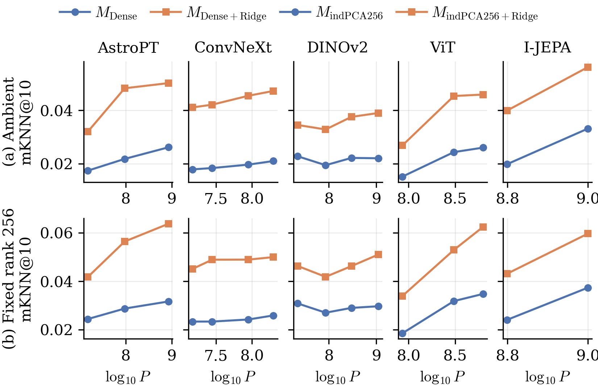
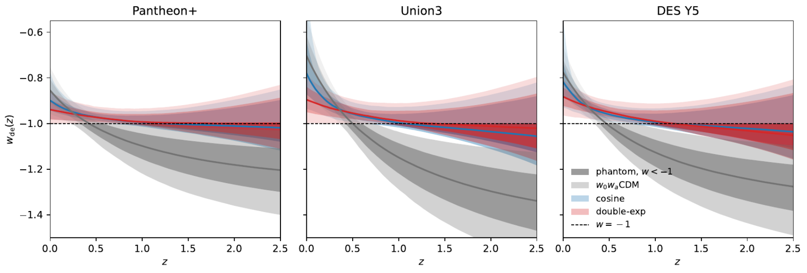

# arXiv Digest — 2026-10-19

- **Interest file used:** interests/2026.09.md (fallback — no 2026.10.md exists yet)
- **Categories pulled:** astro-ph.CO, astro-ph.EP, astro-ph.GA, astro-ph.HE, astro-ph.IM, astro-ph.SR, cs.LG, stat.ML, hep-ph
- **Papers scanned:** 342 (98 astro-ph new/cross + 244 cs.LG/stat.ML/hep-ph)
- **After first filter:** 31 candidates reviewed with full text
- **Final selected:** 12 papers across 4 tiers

---

## Tier 1 — Highly relevant

### [Native Geometry vs. Linear Recoverability: How Alignment Changes Platonic Scaling](http://arxiv.org/abs/2610.22749v1)

Angus Hoy, Austin Lutterbach, Jasper Chong et al. (incl. Michael J. Smith)
**Primary category:** cs.LG | also: astro-ph.IM

This paper tests the Platonic Representation Hypothesis on astronomy. It embeds matched galaxies seen by both the **Legacy Survey and HSC** using five model families (AstroPTv2, ConvNeXtv2, DINOv2, ViT, I-JEPA; 16 size tiers) and checks whether larger models agree more on which objects are nearest neighbours across the two surveys. **Native cosine-neighbourhood agreement barely improves with model size, but agreement after a supervised Ridge alignment does**, in all five families and at a fixed PCA dimension of 256. The learned maps are strongly anisotropic, yet **~5% of their singular directions carry 90% of the neighbour recovery**. SAE and block-sparse features give no advantage over dense embeddings. In short, larger models become more linearly recoverable into each other, but not more geometrically alike.

*Cross-survey nearest-neighbour agreement vs. model size: the Ridge-aligned curve rises more steeply with size than native cosine agreement does, and still does when both embeddings are cut to 256 PCA dimensions, so the effect is not just extra width.*

### [ENFR: Evidence Networks with Flow-Matched References for Amortized Simulation-Based Model Inference](http://arxiv.org/abs/2610.23825v1)

Kai Lehman, Jameson Dong, Carolina Cuesta-Lazaro et al. (incl. Niall Jeffrey, Benjamin D. Wandelt)
**Primary category:** stat.ML | also: astro-ph.CO

ENFR gives **amortized estimates of the absolute Bayesian evidence $\mathcal{Z}=p(x|\mathcal{M})$** for simulation-based inference, not just Bayes factors. It first trains a flow-matching density as a reference, then trains an evidence-network classifier to learn the Bayes factor against that reference. A multi-model version uses a new pairwise loss that provably recovers all Bayes factors jointly. MultiENFR is the most accurate estimator across GMM, ODE, Hodgkin–Huxley and galaxy-assembly-bias benchmarks, and its correction helps most when simulations are scarce. Because evidence is now cheap to evaluate, it works as a goodness-of-fit statistic: **on DESI DR2 BAO it reproduces the nested-sampling evidences, and a prior-predictive test gives p = 0.46 for ΛCDM (no misspecification)**.

*ΛCDM evidence for 1000 prior-predictive simulations against the DESI DR2 value: the real data sit in the bulk of the distribution, while a deliberately misspecified toy w(z) dataset falls below every simulation.*

---

## Tier 2 — Adjacent / useful context

### [Does the inverse distance ladder rule out late-time solutions to the Hubble tension? A model-independent test using DES-Dovekie supernovae and DESI DR2 BAO](http://arxiv.org/abs/2610.23657v1)

José Antonio Nájera, Indranil Banik, Harry Desmond
**Primary category:** astro-ph.CO

The authors build an inverse distance ladder from **uncalibrated DES-Dovekie SNe Ia plus DESI DR2 BAO with a Planck $r_d$ prior**, with $H(a)$ written as a fourth-order cosmographic polynomial. DES SNe alone give **$H_0 = 76.25 \pm 2.87$ km/s/Mpc**, consistent with SH0ES. Adding the low-z legacy SNe drops this to $67.98 \pm 0.69$. In ΛCDM mocks, **only 1.24% reproduce an 8.27 km/s/Mpc shift that large**, which points to a calibration offset of about 0.065 mag in the legacy sample rather than sample variance. So the claim that the inverse ladder rules out late-time solutions depends on the legacy SNe. With the homogeneous DES sample, a low-z enhancement of $H(z)$ is still allowed.

*Joint H₀–q₀ posteriors: DES-only (black) lies away from the CMB ΛCDM star and toward SH0ES, DES+legacy (red) collapses onto ΛCDM, and the two 2σ regions barely overlap even though one sample contains the other.*

### [Can coupled thawing quintessence reproduce DESI DR2? A test with two potentials](http://arxiv.org/abs/2610.23497v1)

Jhananii Yuvaraj Babu, Luca Amendola
**Primary category:** astro-ph.CO | also: gr-qc

A dark matter–dark energy coupling, analysed as if the two sectors were conserved separately, produces an **apparent phantom crossing without a phantom field**. The authors fit cosine and double-exponential thawing potentials to DESI DR2 BAO, Planck PR4 and three SN compilations. Both models beat ΛCDM by Δχ² = 5–15, recovering 64–92% of the $w_0w_a$CDM improvement. However, they **cross $w=-1$ near z ≈ 1 rather than z ≈ 0.4–0.5**, so they miss the steep high-z descent of the CPL fit. The coupling bound **$|\beta| < 0.073$ (95%)** agrees to 0.15σ between potentials, while the reachable $w(z)$ does not: the cosine tracks CPL better. Neither the $H_0$ nor the $S_8$ tension is eased.

*Reconstructed effective w(z): both coupled models follow the w₀wₐCDM band (grey) out to z ≈ 0.4, then cross into the phantom regime (dark shading) only near z ≈ 1 and stay within ~0.04 of −1.*

### [Learning without relearning physical symmetry: an SO(3)-equivariant convolutional network (CNN) on the sphere](http://arxiv.org/abs/2610.23821v1)

Joshua Williamson, Niall Jeffrey, Lorne Whiteway
**Primary category:** stat.ML | also: astro-ph.CO, cs.LG

The authors build a **gauge-equivariant convolution directly on the HEALPix grid**, using steerable filters, parallel transport of local frames and spin-weighted features. It is provably exactly SO(3)-equivariant up to a band limit and never needs a full-sky harmonic transform. Rotating the input changes trained-network outputs by about 1%, the smallest deviation among the planar, DISCO and DeepSphere baselines. It gives the most accurate dense gradient regression and competitive CMB denoising. The point is simulation efficiency: as an SBI compressor for weak-lensing maps, it gives **the tightest and most accurate $\Omega_m$–$S_8$ posteriors at a fixed number of training simulations**. A fixed budget can therefore go into more faithful simulations rather than more of them.

*Ω_m–S₈ SBI posteriors from weak-lensing maps at matched simulation count: the SO(3)-equivariant compressor gives the tightest contours around the truth, and the planar CNN the broadest.*

### [Is a Linear Probe Evidence of a Linear Representation?](http://arxiv.org/abs/2610.22655v1)

Nadir Kutluozen, Christian Internò, David Klindt
**Primary category:** stat.ML | also: cs.CV, cs.LG

The paper argues that high linear-probe accuracy is weak evidence. **Any sufficiently rich feature map, including a random one, is asymptotically forward-decodable**, so a probe cannot tell a true "linear world model" from a kernel machine whose latents sit inside a large curved manifold. The authors propose three asymmetric diagnostics: **reverse predictivity, spectral concentration and out-of-distribution transfer**. They validate these in a fully observed simulation and on SVG-World, a new deterministic two-style benchmark. On six pretrained ViTs, plus dSprites, 3D Shapes, MPI3D and CelebA, **pretraining adds latent-aligned structure beyond a random kernel, yet the probed factors take at most ~53% of the achievable variance**. Within a model family, larger encoders decode better while giving those factors a smaller share of their variance.

*A linear world model maps the latent grid to a flat plane and a kernel machine to a curved surface; forward probes score both highly, while reverse prediction (latents → features) separates them.*

### [Learning smooth dynamics via Kinematic Interpolants](http://arxiv.org/abs/2610.22519v1)

Yiheng Jiang, Youssef Marzouk, Avishek Joey Bose et al.
**Primary category:** cs.LG | also: stat.ML

Positions alone leave many dynamics consistent with snapshot data. This paper **extends stochastic interpolants to phase space** so that velocity measurements can be used too. Kinematic Interpolants connect unpaired, time-indexed (position, velocity) snapshots with kinematically consistent cubic-Hermite paths and **learn the acceleration field with a simulation-free regression objective**. The framework supports several noise schedules and stochastic dynamics. On ocean-vortex, Boids flocking and mouse erythroid single-cell data, it **reconstructs the dynamics more accurately than the baselines at a fraction of their training time**. The current version encodes no physical priors and is tested mainly on interpolation, not forecasting.

### [Normalizing Flow Maps](http://arxiv.org/abs/2610.22711v1)

Francesco M. Ruscio, Timothy James Hitge, Fred Zhangzhi Peng et al.
**Primary category:** cs.LG

NFMs are **exactly invertible pushforward maps that learn the integrator of a flow (few-step generation) while keeping exact change-of-variables likelihoods**. That combination is usually lost when diffusion and flow models are distilled into flow maps. Training uses two self-distillation consistency objectives: pointwise ℓ₂ flow-map matching and distributional matching of the pushforward marginals. NFMs reach **state-of-the-art FID among parameter-matched normalizing flows on CIFAR-10 and ImageNet-64**. Their exact likelihoods allow direct RL-style post-training. As Boltzmann generators they beat earlier continuous flows on single-system and transferable peptide sampling. The pointwise variant gives the best samples but can become numerically non-invertible.

### [Escaping Parameter Space: Tight Generalization Bounds via Representation Quality](http://arxiv.org/abs/2610.23729v1)

Niclas Göring, Shuofeng Zhang, Branton DeMoss et al. (incl. Ard A. Louis)
**Primary category:** cs.LG

The authors derive a generalization certificate from **last-hidden-layer representations, scored with a parameter-free k-NN classifier**. It uses no weight norms, KL-to-posterior terms or compression arguments. The bound is tight: **an 8.0-point gap to test error for ResNet-18 on CIFAR-10, the first non-vacuous certificates on CIFAR-100, and 1.4% (CIFAR-10) / 23.1% (ImageNet) with frozen DINOv2 features**. It splits additively into local class geometry, decoder–network agreement and training stability. Interventions show the geometry term is causal: **destroying local class geometry eliminates generalization while leaving memorization intact**. Networks with 10⁵ and 10⁸ parameters that induce the same feature geometry get the same bound.

### [Clustering of JWST LRDs. Implications for PBHs and other early-forming seeds](http://arxiv.org/abs/2610.23806v1)

Gert Hütsi
**Primary category:** astro-ph.CO | also: astro-ph.GA, astro-ph.HE, gr-qc

This paper confronts two origins for JWST little red dots with their abundance and their **large-scale clustering bias b ≈ 3–8 over z = 4–8**. A minimal halo model, with every halo above $M_{\rm low}\sim10^{10.5}$–$10^{12}\,h^{-1}M_\odot$ hosting an LRD at some duty cycle, reproduces both without fine-tuning. Matching the abundance with PBH seeds requires **$f_{\rm pbh}\sim10^{-13}$–$10^{-10}$**, and such a dynamically negligible Poisson population has **b ≈ 1 at z ≈ 5**, far below what is observed. The same argument rules out any randomly activated population of early-forming seeds. They survive only if their activity is tied to massive host halos, in which case clustering cannot tell them apart from astrophysical seeds.

---

## Tier 3 — Outside my area but notable

### [Foreground dependence of the 20 GeV Galactic halo gamma-ray excess and its proposed connection to the LUX-ZEPLIN event](http://arxiv.org/abs/2610.23713v1)

Kevork N. Abazajian, Youyou Li, Oscar Macias
**Primary category:** astro-ph.HE | also: hep-ph

This is a stress test of the recently claimed 20 GeV Fermi-LAT halo excess, which was linked to the LZ high-energy nuclear-recoil event as **≳200 GeV dark-matter annihilation**. With 15 years of data, 281 Galactic diffuse models and several Fermi-bubble, Loop I and eROSITA-bubble templates, an NFW-correlated component does persist: **4–16σ outside the bubbles, falling to 1–7σ once the updated bubble boundaries are masked**. However, its amplitude and spectrum depend strongly on the foreground model, **no foreground gives a single NFW normalization across the sky**, and simulations show foreground mismodeling can produce spurious NFW-like excesses of the same size. This disfavors reading the whole excess as smooth-halo annihilation and weakens the link to LZ, though a partial dark-matter contribution is not excluded.

---

## Tier 4 — Meta-research about the field

### [What can a uniform reflection pipeline establish about supermassive black hole spin? An audit and a corrected analysis of 57 AGN with XMM and NuSTAR](http://arxiv.org/abs/2610.23081v1)

K. Balasubramaniam, H. -K. Chang, Ł. Stawarz
**Primary category:** astro-ph.HE

This is a replication audit of an automated relxill pipeline that reported spins for 57 AGN. **Its constraints were artifacts of data handling, not physics**: unsubtracted Small-Window pn backgrounds, nearest-in-time pairing that picked mismatched or empty spectra, and single-start fits that never reached the minimum. After the fixes, 18 of 41 eligible sources pass all quality checks, but **10 of those 18 have best fits at i ≥ 75°, implausible for type-1 AGN**, and most of those constraints disappear when i ≤ 60° is imposed. **Only 2 of 15 constrained spin sets survive both that limit and a 3–10 keV-only pn fit.** Injection–recovery shows the method is sound when the model is right, yet still gives a false lower bound in about one in six high-inclination low-spin simulations. The general lesson for automated spectral-fitting pipelines is that optimizer and data-pairing checks come before any population claim.
