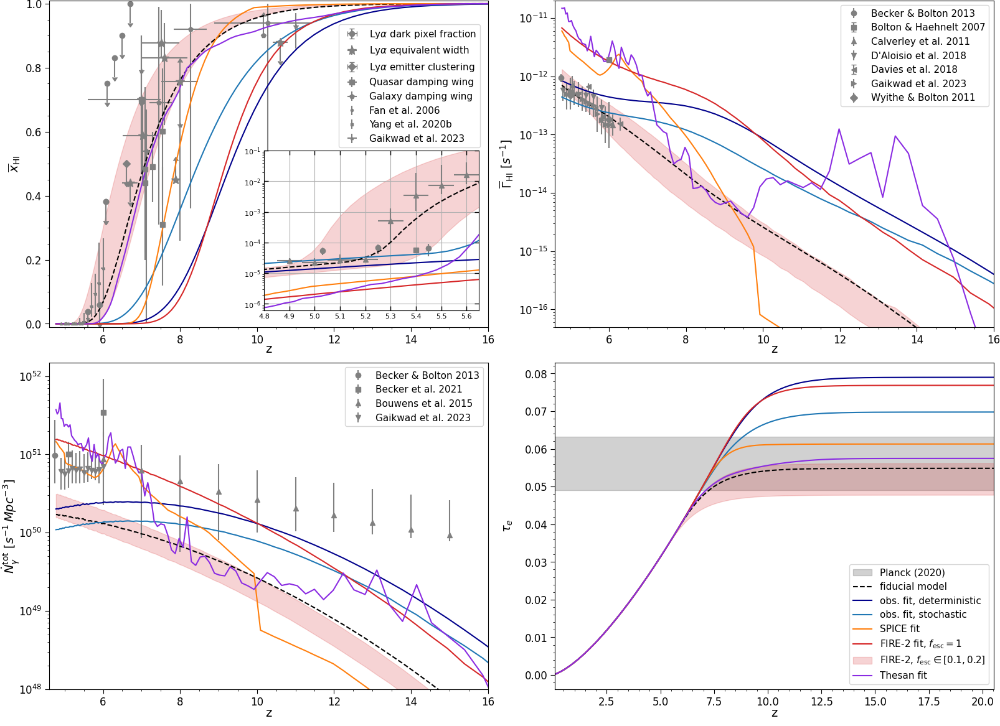
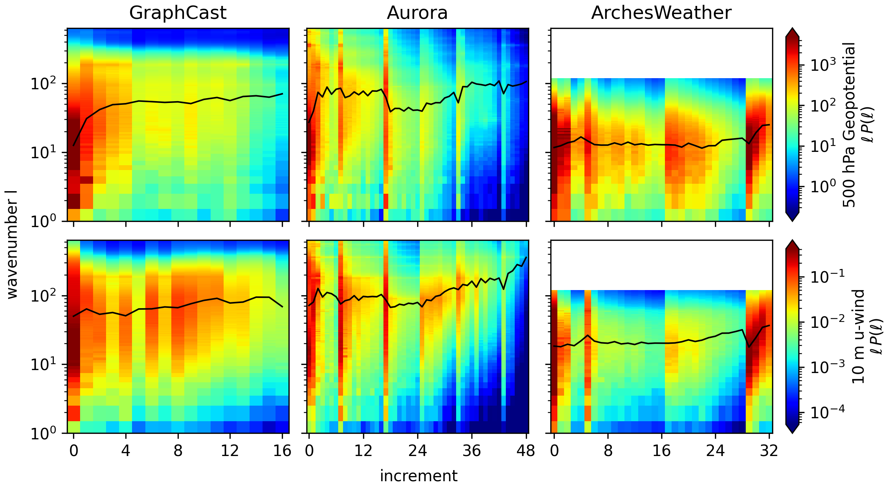

# arXiv Digest — 2026-10-20

- **Interest file used:** interests/2026.09.md (fallback — no 2026.10.md exists yet)
- **Categories pulled:** astro-ph.CO, astro-ph.EP, astro-ph.GA, astro-ph.HE, astro-ph.IM, astro-ph.SR, cs.LG, stat.ML, hep-ph
- **Papers scanned:** 684 (116 astro-ph new/cross + 568 cs.LG/stat.ML/hep-ph)
- **After first filter:** 35 candidates reviewed with full text
- **Final selected:** 15 papers across 4 tiers

---

## Tier 1 — Highly relevant

### [Consistently Reproducing Early Galaxy Observations and 21-cm Signal during the Epoch of Reionization](http://arxiv.org/abs/2610.24064v1)

Michele Bianco, Sambit K. Giri, Arghyadeep Basu et al.
**Primary category:** astro-ph.CO

The authors add a **stochastic UV-magnitude source model with a mass- and redshift-dependent escape fraction** to the GPU radiative-transfer code pyC²Ray, run on a 2048³ Pkdgrav3 box. They calibrate it by MCMC against JWST UV luminosity functions (out to z > 13) and Lyman-continuum leakage data. The calibrated stochastic model needs about half the mean escape fraction of a deterministic one and gives a more fragmented ionisation topology. However, **when total photon output is matched to 2%, x_HI differs by only ~10⁻³ and the 21-cm statistics are indistinguishable**. They also port source prescriptions from SPICE, FIRE-2 and THESAN into the large box. These give distinct topologies despite similar global histories, and **no model matches x_HI, Γ_HI, Ṅ_ion and τ_e at once, in particular the rapid z ≈ 5.2–5.6 evolution inferred from the Lyα forest**.

*All source models compared with reionisation data: neutral fraction (with a z < 5.6 zoom), photoionisation rate, ionising emissivity and τ_e. Each model fits some panels but none tracks the steep late-time drop in x_HI and rise in Γ_HI seen in forest measurements.*

### [Cross-Fitting for Neural Posterior Estimation](http://arxiv.org/abs/2610.26733v1)

Jeffrey Regier
**Primary category:** cs.LG | also: stat.ML

With multi-epoch training, standard NPE fits the posterior mean and its spread to the same in-sample residuals. The spread therefore shrinks as the network overfits, so **the variance overfits while the mean still underfits**, and early stopping can only trade one against the other. CF-NPE uses **K-fold cross-fitting**: K mean regressors are trained, then a conditional density (Gaussian or neural spline flow) is fit to their out-of-fold residuals. On a 200-D Gaussian problem with 10k simulations, held-out log-likelihood improves from −169.7 (standard NPE) to −126.2, against −122.8 for the analytic posterior, with **χ²_d ≈ 1.000 calibration**. CF-NPE with 10k simulations beats standard NPE with 30k. On 16×16-pixel lensed-source reconstruction, median test log-likelihood rises from 2.6 to 88.1 and posterior-mean MSE roughly halves, at about 10× the training cost. The gain disappears in low dimension or when fresh simulations are drawn every step, so it matters most for **high-dimensional, simulation-limited SBI**.

*Standard NPE training on the 200-D problem: held-out MSE of the posterior mean keeps improving for hundreds of epochs while calibration (χ²_d) steadily worsens. Early stopping lands at a compromise that is bad for both, which is why the two fits should be decoupled.*

### [Neutrino self-interactions in light of DESI and CMB-SPA](http://arxiv.org/abs/2610.26654v1)

Hernán E. Noriega, Josue De-Santiago, Gabriela Garcia-Arroyo et al.
**Primary category:** astro-ph.CO | also: hep-ph

This paper updates constraints on heavy-mediator neutrino self-interactions, parameterised by **the effective coupling G_eff**. It uses DESI DR1 full-shape + BAO, **the DESI DR1 Lyα P1D**, DR2 BAO, and the combined Planck+ACT+SPT CMB likelihood, via profile likelihoods, MCMC and nested-sampling evidence. The FS+BAO profile is bimodal between moderate and strong interactions. **Adding Lyα P1D penalises the strong mode by Δχ² ~ 5** and opens a narrow intermediate mode at log₁₀(G_eff MeV²) = −3.04, which is neither preferred nor disfavoured relative to the weak mode (ln B = −0.28 ± 0.36). The strongest exclusion of the strong mode comes from **FS+BAO+CMB-SPA (ln B = −9.91, odds ~5:100000)**. The authors note that the Lyα conclusions depend on which P1D likelihood is used (PRIYA vs EFT-based).

*Profile likelihood of log₁₀ G_eff relative to ΛCDM for DESI FS+BAO with and without the Lyα P1D. Adding the forest raises the strong-interaction minimum near −1 and carves out a new narrow minimum near −3.*

---

## Tier 2 — Adjacent / useful context

### [PRISMS/U13151. A Glimpse into the Earliest Phases of Galaxy Formation through an Ultra-Faint System ≈ 500 Myr after the Big Bang](http://arxiv.org/abs/2610.26560v1)

Pierluigi Rinaldi, Javier Álvarez-Márquez, Alejandro Crespo Gómez et al.
**Primary category:** astro-ph.GA

The target is a strongly lensed (μ = 12.8) **ultra-faint galaxy at z = 9.7995 with M_UV = −17.4**, observed with NIRCam, NIRSpec/PRISM and MIRI imaging and spectroscopy. It is tiny (log M* ≈ 6.7, R_e ≈ 122 pc), young (~5.5 Myr) and metal-poor, with low C/O and no nitrogen, which points to core-collapse enrichment. It has **log ξ_ion = 25.64 ± 0.12** and f_esc = 0.19 ± 0.17. The Lyα break needs a **damping wing with log N_HI ≈ 21.4**, attributed to the galaxy or its CGM. This also revises the earlier redshift (9.88), which the wing had biased. A toy duty-cycle model suggests such short bursts could supply a few percent or more of the escaping ionising budget of low-mass galaxies. Both that estimate and the IGM neutral-fraction reading are explicitly indicative only.

*U13151's PRISM spectrum around the Lyα break, compared with two other z ≳ 9 galaxies (one with N_HI ≈ 2.5×10²² cm⁻²). Even this faint system shows a damping wing, fit with N_HI ≈ 2.2×10²¹ cm⁻².*

### [Can Blue UV-Bright Galaxies Drive Reionization at Cosmic Dawn? An M_UV = −19.6 Galaxy with f_esc ≈ 0.85 at z = 9.244](http://arxiv.org/abs/2610.24092v1)

Yunjing Wu, Sijia Cai, Yongda Zhu et al. (incl. Yongda Zhu)
**Primary category:** astro-ph.GA | also: astro-ph.CO

The authors took 14 hr of NIRSpec G235M spectroscopy of EBG-1, a lensed galaxy at z = 9.244 with **β = −2.99 ± 0.15**. Its nebular lines are weak for its UV slope: [O III] EW = 883 ± 181 Å, a marginal Hβ, and a CIII] upper limit. These give 12 + log(O/H) = 7.16 ± 0.25. Comparison with BEAGLE β–EW tracks favours **f_esc ≳ 0.75, best match ≈ 0.85**. The escaping ionising efficiency, log(f_esc ξ_ion⁰) ≈ 25.75, sits about 0.5 dex above the Matthee et al. relation. The result is one object, and f_esc is inferred indirectly from β plus a ~2σ Hβ under fixed model assumptions, so it suggests rather than shows that UV-bright galaxies could matter for late-reionization emissivity budgets.

*EBG-1 in the β–EW(Hβ), β–EW(CIII]) and β–EW([O III]) planes against BEAGLE tracks at its metallicity. Only tracks with f_esc ≳ 0.75 reproduce such a blue slope with such weak lines; f_esc ≲ 0.5 fails in all three planes.*

### [Impact of Residual Gain Errors on the Detectability of Ionized Bubbles during Reionization with SKA 21-cm observations](http://arxiv.org/abs/2610.24843v1)

Arnab Mishra, Kanan K. Datta, Iffat Nasreen et al.
**Primary category:** astro-ph.CO

This is a simulation of **100 h of SKA-Low AA\* data on a 23.5 Mpc ionized bubble at z = 7.1** (x_HI = 0.88). It includes foregrounds removed by GPR, noise, and **residual antenna gain errors of 1% amplitude and 1° phase**, correlated in time and/or frequency. A **visibility-space matched filter stays robust**: the SNR still peaks at the true radius and the errors mainly add realization-to-realization scatter. MCMC recovers R_b = 24.9 ± 0.9 Mpc and x_HI = 0.81 ± 0.09. The same gain errors bury the bubble in reconstructed images and **bias the 21-cm power spectrum by up to 2.7× at k ≈ 0.05 Mpc⁻¹** and by orders of magnitude at k ~ 1 Mpc⁻¹. Time-correlated errors are the more harmful kind; frequency-correlated ones are partly removed along with the foregrounds.

### [Galactic warps constrain equivalence-principle violation in the dark sector](http://arxiv.org/abs/2610.24618v1)

Harry Desmond, Pedro G. Ferreira
**Primary category:** astro-ph.CO | also: astro-ph.GA

Interacting-dark-energy models that could explain the DESI phantom-like w(z) imply a **fifth force acting only on dark matter**. Such a force would offset halo and stellar-disk centres and bend edge-on disks into cup-shaped warps. The authors measure warps in **3968 edge-on SDSS disks** and forward-model the signal from a reconstructed density field plus baryonic effects. They find no correlation. The bound is **ΔG/G_N < 7.7×10⁻⁴ (95%)**, or 1.7×10⁻³ once systematics are inflated, for ranges ≥ 8 Mpc. In the infinite-range limit this is 3× tighter than the best cosmological bound and about two orders of magnitude below other astrophysical limits. It **disfavours the couplings preferred by DESI-based interacting-dark-energy fits at 2–3σ** unless screening is invoked.

*Exclusion in fifth-force strength versus range, with the cosmological bound and the couplings preferred by DESI interacting-dark-energy fits for comparison. The warp limit, including the conservative systematics-inflated version, lies below most of the DESI-preferred points.*

### [Exploring the Evidence for Evolving Dark Energy with the Jeffreys prior](http://arxiv.org/abs/2610.26493v1)

Joshua Layton, Alex Hall, Naomi Clare Robertson
**Primary category:** astro-ph.CO

The authors re-run DESI DR2 BAO + Planck 2018 ± four SN compilations (DES-SN5YR, DES-Dovekie, Pantheon+, Union3) with the **Jeffreys prior instead of uniform priors**. The pipeline is fully JAX: CosmoPower-JAX emulators, NUTS and JAX nested sampling, about 30 min on 32 CPUs per run. The w₀–w_a posteriors barely move, but **the Bayes factors flip**. For BAO+CMB+DESY5, ln B goes from +3.65 for w₀w_aCDM to −5.52, and every combination ends up favouring ΛCDM by about ln B ≈ −5 to −12. The cause is the **larger Occam penalty**: the Jeffreys prior puts its mass where the data have Fisher information. The authors do not claim dynamical dark energy is ruled out, only that evidence-based claims for it are prior-driven.

### [Evolving only the observed spacetime region: perfectly parallel lightcone simulations with sCOLA](http://arxiv.org/abs/2610.26639v1)

Mayeul Aubin, Florent Leclercq, Guilhem Lavaux
**Primary category:** astro-ph.CO

Spatial COLA tiles the volume into independent boxes with buffers. Here it is combined with **on-the-fly lightcone building**, so each tile stops once the past lightcone has left it and only tiles inside the survey are run. Two upgrades fix earlier large-scale errors and allow smaller tiles: an LPT buffer that models particle inflow, and a second-order boundary potential. Against Gadget4 in a 3.84 h⁻¹ Gpc box with 3840³ particles, they get **1% on P(k), 1.5% on the velocity-divergence spectrum and 2% on the equilateral bispectrum up to k ≈ 0.4 h/Mpc**, for **1,300 CPU-hours, 2,600× cheaper**. Only matter statistics are validated so far. The target use is thousands-strong mock ensembles for covariance and SBI.

*Matter power-spectrum ratio and cross-correlation of sCOLA (and monolithic tCOLA) relative to Gadget4. With just 10 time steps the tiled lightcone stays within the 1% band to k ≈ 0.4 h/Mpc, with no artefact at the tile scale.*

### [Inducing Fourier Geometry: A Smoothness Prior Imposes Approximate Translation Equivariance in Multimodal Stellar Embeddings](http://arxiv.org/abs/2610.24292v1)

Ilay Kamai, Alex M. Bronstein, Hagai B. Perets
**Primary category:** cs.LG

The authors align frozen encoders for six surveys (LAMOST, APOGEE, GALAH and Gaia XP spectra; Kepler and TESS light curves). They use a Perceiver-IO module with a VICReg-trained shared stream and per-survey residual streams. They add a **graph-Laplacian smoothness penalty in (T_eff, log g) label space**, which in the continuum limit predicts Fourier-mode geometry. The shared latent becomes **Toeplitz along T_eff (R² = 0.92 vs 0.63 without the prior)** with ordered eigenmodes. Linear probes improve on every label, including age from 50 labelled stars. Only the stationarity prediction survives: mode quantization and error-scaling predictions fail, and a permuted graph destroys both the geometry and the gains. It is a short workshop paper, and the prior uses labels, so this is weakly supervised rather than pure SSL. It is a concrete example of **shaping a spectral foundation model's latent geometry with physical structure**.

*Shared-latent eigenmodes along T_eff with the smoothness term (top) and without it (bottom). With the prior, the modes are ordered Fourier-like oscillations and the principal-component manifolds trace Lissajous curves; without it, neither structure appears.*

### [Physics-Aware Self-Supervised Pretraining on Multi-Domain Raman Spectra](http://arxiv.org/abs/2610.23955v1)

Charalampos Davalas, Georgios Levantinos, Anastasios Dimitriou et al.
**Primary category:** cs.LG | also: eess.IV

A transformer **masked autoencoder for 1D spectra** is pretrained on ten Raman datasets. The decoder has three heads: pixel reconstruction, a **sparse Voigt-profile head with differentiable peak centres, widths and amplitudes**, and denoising. Fine-tuning helps most on small, noisy tasks: macro-F1 rises from 0.33 to 0.65 on 30-class low-SNR bacteria. It is neutral on large or saturated tasks. Gains grow with encoder size, and **attention probing beats linear probing on 10 of 11 tasks**, so linear probes understate representation quality. The downstream sets also supplied pretraining spectra, so this is not a held-out-domain transfer test. The parameterised line-profile pretext task carries over directly to absorption-line and quasar spectra.

### [Interpretability of AI weather models via intermediate decoding](http://arxiv.org/abs/2610.24110v1)

Matthias Beylich, Kirsten I. Tempest, Tobias Selz et al.
**Primary category:** physics.ao-ph | also: cs.LG

This is a **tuned-lens analogue for scientific foundation models**. Learned affine translators map intermediate latent states of GraphCast, Aurora and ArchesWeather into the decoder's input basis, so every processor block yields a decodable forecast (48 forecasts from 2020, scored against ERA5). Forecast error falls roughly linearly with depth. The encoder–decoder pair alone already does substantial forecasting, reaching 30–85% of the persistence error. Per-block increments show the forecast is **refined from coarse to fine scales** (e.g. the Z500 spectral centroid moves from ℓ ≈ 13 to 71 in GraphCast). **Large scales stay in physical balance throughout, while small scales become balanced only progressively.** The method carries over directly to emulators of cosmological fields.

*Power spectra of each block's forecast increment against depth for Z500 and 10 m wind in the three models, with spectral centroids overlaid. In every model, early blocks change large scales and later blocks add progressively finer structure.*

### [Reading Between the Lines: How Much Information Remains After Fitting a Stellar Spectrum?](http://arxiv.org/abs/2610.25583v1)

Sven Buder, Tomasz Różánski
**Primary category:** astro-ph.SR | also: astro-ph.GA, astro-ph.IM

The authors audit the residuals left after fitting 7087 GALAH DR4 spectra. **4.5% of pixels exceed 3σ, against 0.3% expected for Gaussian noise**, and 380 recurrent residual regions are catalogued. 62% are line-strength or profile mismatches; the rest are missing lines, interstellar bands, sky or reduction structure. Cannon models trained **on the residuals alone recover T_eff to 80–150 K and [Fe/H] to 0.06–0.09 dex**. The 6% of pixels excluded from the DR4 fit carry more label information than the other 94%. The broader lesson is that **structured fit residuals are a measurable information channel and a systematics map**. That applies directly to quasar-continuum and forest-model residuals.

---

## Tier 3 — Outside my area but notable

### [Maestro: Agentic Formal Proof Development by Coordination](http://arxiv.org/abs/2610.25920v1)

Haoyu Li, Zeren Shui, Yuhao Zhang et al.
**Primary category:** cs.LG

Maestro is an open Lean prover harness. Parallel workers return **structured failure diagnoses** (routes tried, facts needed, suspected counterexamples). A **global coordinator** then chooses a response: guide a retry, add a shared lemma, falsify a target, or retract and replan a subtree. This replaces purely local recursive decomposition. Without web access it proves **34/48 research-level arXivLean theorems (vs 19 for the native agent on the same backbone), 669/672 PutnamBench, 59/60 Lean-IMO-Bench and 6/6 IMO 2026**. On the same GPT-5.4 backbone as the prior best system it also leads on verified-code benchmarks (188/189 Verina). Most cross-system comparisons use different base models.

---

## Tier 4 — Meta-research about the field

### [An important Bottleneck in LLM Optimizers: Principle-Level Local Optima](http://arxiv.org/abs/2610.24291v1)

Nian Ran, Tianhe Jia, Zhengyang Mu et al.
**Primary category:** cs.LG

The paper defines **principle-level search collapse**: LLM-driven optimizers used for discovery (ExLLM, ReEvo, MCCE, PiEvo across several frontier models) converge on a few design ideas even while their candidates look diverse. Across molecular design, sensor placement and GPU-kernel search, **78% of 161 runs show collapse (55% strongly)**. In molecule runs the number of distinct scaffolds falls from ~40 to 1–3 while fingerprint diversity stays moderate. **Diversity injection (temperature, web search, mixed LLMs) barely helps**, and hints pointing to the reference design principle help inconsistently. The takeaway for AI-assisted science: output diversity is not search breadth, and agentic optimisation loops need checks at the level of ideas, not candidates.
