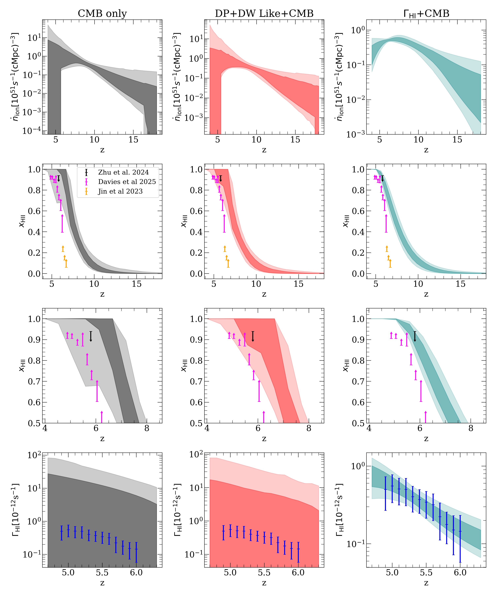
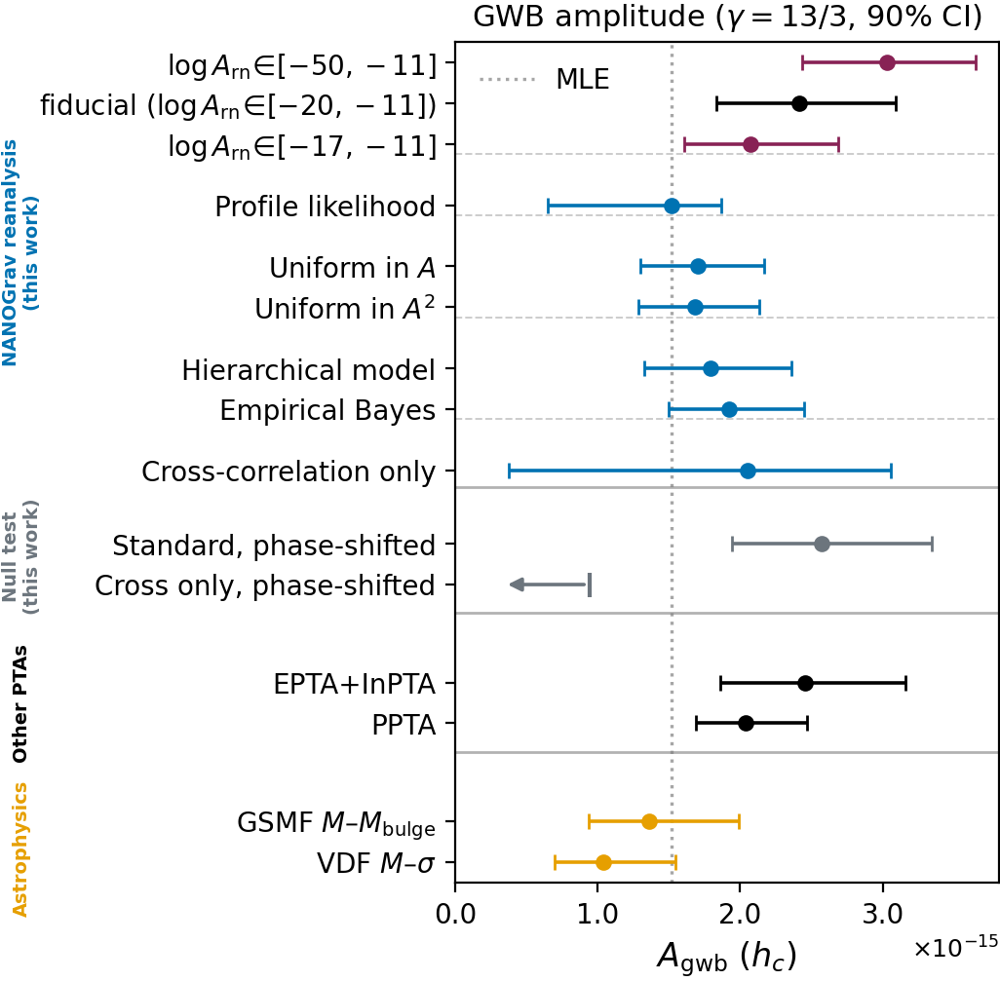
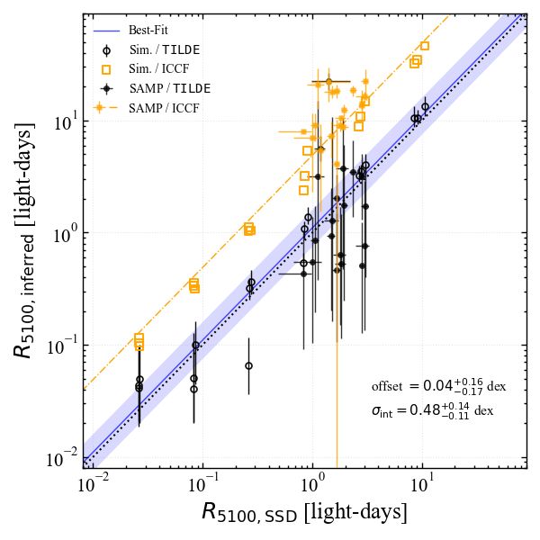
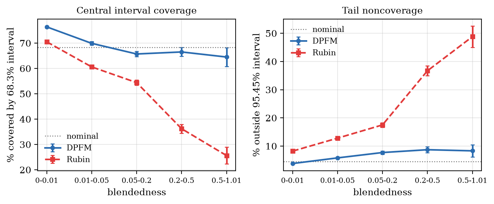

# arXiv Digest — 2026-10-22

- **Interest file used:** interests/2026.09.md (fallback — no 2026.10.md exists yet)
- **Categories pulled:** astro-ph.CO, astro-ph.EP, astro-ph.GA, astro-ph.HE, astro-ph.IM, astro-ph.SR, cs.LG, stat.ML, hep-ph
- **Papers scanned:** 331 (111 astro-ph new/cross + 220 cs.LG/stat.ML/hep-ph and cross-lists)
- **After first filter:** 27 candidates reviewed with full text
- **Final selected:** 13 papers across 4 tiers

---

## Tier 1 — Highly relevant

### [Constraints on Reionization from Planck Low-ℓ EE Polarization and the Lyman-Series Forests](http://arxiv.org/abs/2610.28765v1)

Garett Lopez, Anson D'Aloisio, Christopher Cain (D'Aloisio: high-value forest/IGM group)
**Primary category:** astro-ph.CO | also: astro-ph.GA

The authors run joint fits of the full Planck likelihoods and Lyman-series forest data, with parametric and FlexKnot reionization histories. The forest data are dark-pixel upper limits on $x_{\rm HI}$ at $4.9 \lesssim z \lesssim 6.9$ and a damping-wing-like lower limit at $z = 5.8$. These constraints **leave $\tau_{\rm es}$ and the ΛCDM parameters unchanged and mostly move ionization around in redshift**, giving $z_{50} = 7.7^{+0.7}_{-0.8}$ and $\Delta z_{90} < 11.4$ (95%). Adding the forest-derived $\Gamma_{\rm HI}(z)$ at $4.9$–$6.0$ through a new semi-analytic RT model is far more constraining: **$z_{50} = 7.4^{+0.2}_{-0.3}$, $\Delta z_{90} = 6.0^{+0.8}_{-1.0}$, $A_z = 2.4^{+0.3}_{-0.7}$** (model-dependent, with mean-free-path parameters held fixed). The fit also favors an **ionizing emissivity that peaks at $z \sim 7$–8 and then declines**, and the authors call for forest likelihood products and fast forward models of transmission statistics.

*Columns go from CMB only, to CMB plus neutral-fraction limits, to CMB plus Γ_HI (rows: emissivity, $x_{\rm HII}(z)$, zoom on the end of reionization, Γ_HI). Only the forest Γ_HI data pin the end of reionization to z ≈ 6–8 and force a declining emissivity. These histories still agree with the independent $x_{\rm HI}$ limits, which this fit does not use.*

---

## Tier 2 — Adjacent / useful context

### [Prior volume effect inflates the gravitational-wave background in pulsar timing arrays](http://arxiv.org/abs/2610.28739v1)

Biwei Dai, Matias Zaldarriaga, Yacine Ali-Haïmoud
**Primary category:** astro-ph.HE | also: astro-ph.CO, astro-ph.IM, gr-qc

The authors split the NANOGrav 15-yr GWB posterior into a profile likelihood and a prior-volume term. Marginalizing over **each pulsar's red noise under the standard log-uniform prior adds a volume term that favors a larger GWB**, because the GWB and red noise are degenerate in the auto-correlations. This **pulls the amplitude >2σ above the maximum-likelihood value**: the fiducial $A_{\rm gwb} = 2.4^{+0.7}_{-0.6}\times10^{-15}$ falls to 1.5–1.9 × 10⁻¹⁵ under the profile likelihood, priors uniform in power, hierarchical or empirical-Bayes priors, or a cross-correlation-only model. Those values agree with SMBHB predictions, give a slope closer to 13/3, and weaken the case for new-physics sources. The same high-dimensional nuisance-marginalization mechanism applies to any analysis with many per-object noise parameters.

*With the standard prior, the inferred amplitude moves with the arbitrary lower bound on the red-noise prior. Every volume-free or reweighted method (blue) lands near the MLE and overlaps the galaxy-scaling-relation predictions (orange).*

---

### [The Balmer Absorber Strength Problem of Little Red Dots](http://arxiv.org/abs/2610.28720v1)

Hanpu Liu, Eliot Quataert, Bingjie Wang et al.
**Primary category:** astro-ph.GA

Some LRDs, such as RUBIES-EGS-49140, show **weaker Hα than Hβ absorption (per unit wavelength)**, which no standard curve of growth allows. The authors argue that **the absorbing gas's own source function partly fills in the troughs**, which the standard attenuation model neglects. Cloudy photoionization models show that **radiative trapping overpopulates n = 3, so the Hα source function exceeds Hβ's** when the gas is optically thick to Hα but not to Paα. This can invert the EW ratio and implies that optical depths and covering factors fitted with the standard model should not be taken at face value. The size of the effect depends on where the absorber sits, so it becomes a new diagnostic of the gas around LRDs.

*Standard (solid) and source-function-corrected (dashed) Hα/Hβ curves of growth against RUBIES-49140's measured EWs (bands). At high n = 2 column, the corrected curves reach the inverted Hα < Hβ ordering that is observed.*

---

### [Discovery of a Broad-Line Active Galactic Nucleus at z = 9.98](http://arxiv.org/abs/2610.28735v1)

Xingyao Cai, Akio K. Inoue, Masafusa Onoue et al.
**Primary category:** astro-ph.GA

A blind search of 1,247 archival NIRSpec PRISM spectra at $6 \le z \le 10.3$, with no photometric preselection, finds MoM-BL-z10, **the highest-redshift broad-line AGN known at $z = 9.98$**. Broad Hβ is detected at only **S/N = 3.87** (FWHM ≈ 3500 km/s; ΔBIC = −15.6 against narrow-only). High [Ne III]/[O II] and [O III]/Hβ ratios, a compact morphology, and LRD-like continuum slopes support the AGN reading. The **first virial BH mass at z ≈ 10 is $3.6^{+5.8}_{-1.7}\times10^7\,M_\odot$** with $\lambda_{\rm Edd} \approx 0.1$, or ~2 × 10⁶ M☉ under LRD-specific assumptions with $\lambda_{\rm Edd} = 1$. Either way, the mass requires super-Eddington growth or a heavy seed. The authors note that z ≈ 10 is near the practical limit for finding broad Balmer lines with JWST.

---

### [Unveiling Accretion-Disk Reverberation Beneath BLR Contamination with TILDE](http://arxiv.org/abs/2610.29173v1)

Sungho Jung, Jong-Hak Woo
**Primary category:** astro-ph.GA

TILDE is a two-stage Bayesian model that writes each broad-band AGN light curve as **a static part, a damped-random-walk disk continuum, and a delayed BLR component**. A single-epoch spectral decomposition sets the line-to-continuum ratios in each filter. It recovers input lags on mock spectral time series and, on the SAMP sample, reproduces spectroscopic Hβ light curves and lags to **0.09 dex intrinsic scatter**. Once BLR contamination is removed, **disk sizes match thin-disk predictions ($R/R_{\rm SSD} = 1.12^{+0.50}_{-0.37}$)**, which suggests that much of the "oversized disk" problem comes from contamination in ICCF lags. The method allows photometric BLR and disk reverberation mapping with ZTF and LSST.

*ICCF lags (orange) put disks several times above thin-disk sizes. After BLR decomposition, the TILDE sizes (black) sit on the 1:1 line for both mocks and SAMP AGN.*

---

### [HETDEX [OII] galaxies at z ≤ 0.48: Growth of structures from power spectrum multipoles](http://arxiv.org/abs/2610.29591v1)

Jeongin Moon, Eiichiro Komatsu, Robin Ciardullo et al.
**Primary category:** astro-ph.CO | also: astro-ph.GA

The authors fit **monopole and quadrupole power spectra of HETDEX DR1 [O II] emitters up to $k_{\max} = 0.7\,h$/Mpc** with a simulation-based model built on Mucho-Uchuu mocks, and goodness-of-fit tests match the Sellentin–Heavens expectation. With AP parameters fixed, they find **$\gamma = 0.55 \pm 0.05$**, matching GR. With AP free, they find **$\gamma = 0.60 \pm 0.07$**, which agrees with both GR and the suppressed-growth value of Nguyen et al. (0.633), showing how RSD–AP degeneracy sets the error budget. This establishes an independent low-z growth probe that uses a different target selection from DESI.

---

### [Dual-Phase Flow Matching for Probabilistic Source Detection and Measurement in Astronomical Images](http://arxiv.org/abs/2610.28919v1)

Yicun Duan, Jeffrey Regier
**Primary category:** stat.AP | also: astro-ph.IM

DPFM approximates the **posterior over whole source catalogs** in blended LSST-depth images with a continuous-time Markov process trained by **generator matching** (flow matching extended to mixed discrete–continuous states). It works in two phases, first deciding occupancy and then sampling types, positions and fluxes. On simulations it is better calibrated than two MCMC samplers, two neural-posterior-estimation methods, and a single-phase ablation. On Rubin DP1 (ECDFS) it recovers small-scale galaxy clustering that matches Hubble, while **Rubin's pipeline intervals cover the Hubble reference only ~¼ of the time for strongly blended sources**. The detect-then-measure split is the main gain over the single-phase ablation.

*Checked against Hubble photometry, DPFM's 68% and 95% intervals stay near nominal at all blendedness levels. The Rubin pipeline's coverage collapses as blending grows.*

---

### [Data-driven characterisation of variable source light curves with multimodal representation learning](http://arxiv.org/abs/2610.29412v1)

M. Madarász, G. Marton, M. Audard
**Primary category:** astro-ph.IM | also: astro-ph.SR

The authors train a **label-free, survey-agnostic embedding of light curves**. A Transformer encoder on the raw observations and a CNN on a generalised Lomb–Scargle periodogram are trained jointly with **VICReg, using two temporal halves of each light curve as views**. On 37,006 ZTF sources, a linear probe on the frozen 64-d embeddings reaches **77.1% balanced accuracy over 14 classes and 90.5% over 4 broad categories**. The two branches together beat the best single branch by up to 14.9 points. Individual dimensions encode amplitude, period and asymmetry, and concatenating g/r/i embeddings raises accuracy to 86.1%. It is a worked example of the time-split SSL recipe for irregularly sampled 1-D astronomical data.

---

### [Tropical Cyclone Attributes in Sparse Autoencoder Features of an AI Weather Model](http://arxiv.org/abs/2610.28904v1)

Jiapei Liu, Ruidong Li, Ting Sun et al.
**Primary category:** physics.ao-ph | also: cs.LG

The authors **train sparse autoencoders on GraphCast hidden states** and relate the features to the position, intensity and pressure structure of 205 tropical cyclones across 16 processor layers. **Each physical attribute is spread over several features**, and position and pressure structure share a small overlapping subset. This organization **recurs across independently trained SAEs and layers even though individual features do not align**. In deeper layers the leading features track the cyclone's state six hours ahead better than its current state. For SAE interpretation of any scientific foundation model, the lesson is to look for stable attribute-level structure rather than a single "cyclone neuron".

---

### [Conditional Flow Models Convert Epistemic Uncertainty into Apparent Aleatoric Variance](http://arxiv.org/abs/2610.29172v1)

Navodita Sharma, Abhishek Shetty, Max Simchowitz et al.
**Primary category:** cs.LG | also: cs.AI

When conditional flow-matching models stand in for regressors, **their samples routinely have more variance than the true conditional distribution, even for nearly deterministic targets**. The authors trace this to **smoothing bias in vector-field learning**: wherever the model has not yet resolved the dependence on the conditioning variable, that epistemic error shows up as spread in the samples. The excess variance shrinks with more training or data. In an idealized smoothing model they prove the effect, and they show empirically that **predictive sets built directly from CFM samples reach roughly nominal coverage** before overfitting. In practice, sample scatter from a conditional flow (e.g. a continuum reconstructor) mixes model error with intrinsic variability and should not be read as pure aleatoric noise.

---

## Tier 3 — Outside my area but notable

### [PSR J0653+0443: An Eclipsing Millisecond Pulsar in an Extremely Eccentric Double Neutron Star System](http://arxiv.org/abs/2610.29838v1)

Z. L. Yang, J. L. Han, L. G. Hou et al.
**Primary category:** astro-ph.HE

FAST timing reveals a Galactic-field double neutron star with two ~1.4 M☉ components, **$e = 0.992387$**, and $P_{\rm orb} = 79.1$ d. The pulsar sweeps from true anomaly −90° to +90° in 46 minutes and is eclipsed for 85 s at conjunction. Short-term periastron-advance variations modulate the pulse arrival times by **−2.9 to +2.5 ms**, at least ten times more than in any other DNS. The orbit requires a **large natal kick in the second supernova**, and binary-evolution models give a detection probability of **≲5 × 10⁻³** for such a system. It emits periodic GW bursts peaking at 0.36 mHz, below the LISA, Taiji and TianQin sensitivity curves but plausibly detectable by LISAmax or Folkner-class concepts.

---

### [The renormalization-group running of neutrino mixing is undetectable](http://arxiv.org/abs/2610.28744v1)

Gabriela Barenboim, Mauricio Bustamante, Qinrui Liu
**Primary category:** hep-ph | also: astro-ph.HE

A growing literature claims that a neutrino produced or detected at momentum transfer Q carries the mixing matrix evaluated at μ = Q. Proposed signatures include zero-distance flavor change, shifted CP phases and anomalous flavor ratios of high-energy astrophysical neutrinos. The authors show this is wrong: **the mixing is fixed by the neutrino's on-shell self-energy, not by the production or detection process**. Setting μ = Q is legitimate, but large logarithms in the self-energy then rotate the mixing back. **Up to small vertex and box corrections, every experiment measures the same mixing.** They demonstrate this in the MSSM, two seesaw models and SMEFT, and short-baseline data already limit any change in a mixing angle to below 0.7°–2.4°.

---

## Tier 4 — Meta-research about the field

### [Automating ML for Science: Can Frontier Agents Climb Scientific Hills in the Wild?](http://arxiv.org/abs/2610.28763v1)

Ming Zhong, Stacy Li, Nicholas Carlini et al.
**Primary category:** cs.AI | also: cs.CL, cs.LG

Agent4Sci is a human-verified testbed of **20 scientific-ML benchmarks across 11 domains**, including two astronomy and one cosmology benchmark (e.g. dark-matter denoising). It asks whether frontier coding agents can beat the published best models unsupervised. They can: **Claude Opus improves on every benchmark, by 10.4% on average**, with no runs flagged for misconduct. However, the **gains come almost entirely from ML-engineering tricks rather than domain insight**. Trajectories show miscalibrated novelty, under-used compute, and a quick collapse into local hyperparameter sweeps. Lightweight skills for research ideation and experiment management roughly double the gains (Opus 10.4% → 20.1%).
