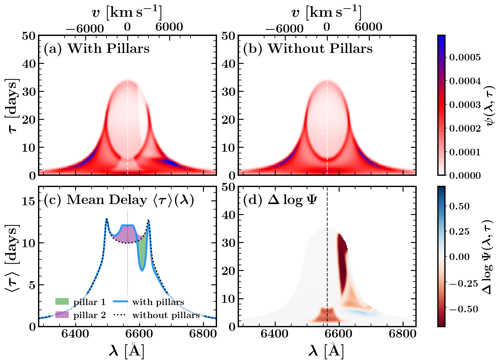
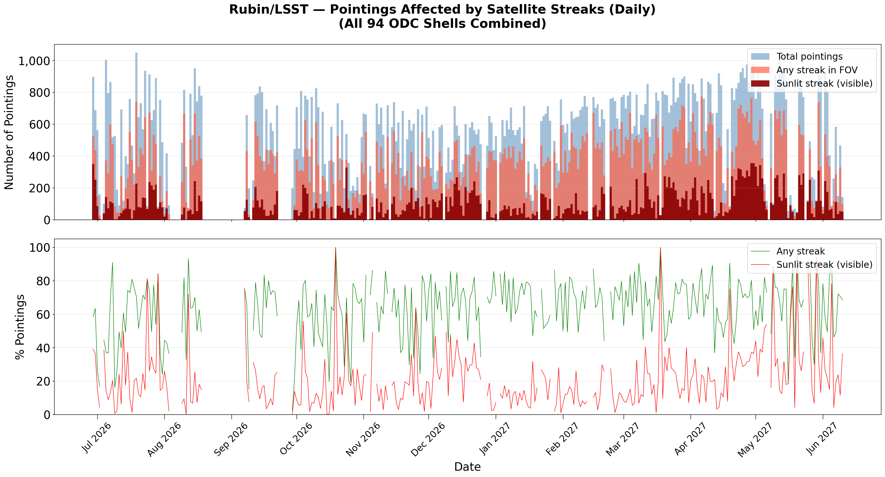

# arXiv Digest — 2026-10-26

- **Interest file used:** interests/2026.09.md (fallback — no 2026.10.md exists yet)
- **Categories pulled:** astro-ph.CO, astro-ph.EP, astro-ph.GA, astro-ph.HE, astro-ph.IM, astro-ph.SR, cs.LG, stat.ML, hep-ph
- **Papers scanned:** 279 (69 astro-ph new/cross + 210 cs.LG/stat.ML/hep-ph and cross-lists)
- **After first filter:** 32 candidates reviewed with full text
- **Final selected:** 14 papers across 3 tiers

---

## Tier 1 — Highly relevant

### [Local Analogs of Little Red Dots: Clues to the X-ray Weakness](http://arxiv.org/abs/2610.32430v1)

Shi-Jiang Chen, Jun-Xian Wang, Zhen-Ya Zheng et al. (incl. Luis C. Ho)
**Primary category:** astro-ph.GA | also: astro-ph.CO

The authors use Einstein Probe/FXT to observe six **"local little red dots"**: V-shaped, broad-line green-pea galaxies at z ~ 0.3, where a given X-ray signal-to-noise costs ~10³–10⁴ times less exposure than for JWST LRDs at z ~ 4–8. The sample splits in two. Two sources are "X-normal" and look like ordinary type-1 AGN, variability included. The other four are "X-weak", show no optical variability, and have redder continua whose SEDs come closer to high-z LRDs. The X-weak stack lies **~0.5–0.7 dex below the unobscured-quasar scaling relations** and is still detected at **~3.3σ, mostly in rest-frame 2–3 keV photons**. That detection is hard to square with either a standard unobscured super-Eddington model or a local Compton-thick geometry. The simplest consistent picture is **a mildly X-ray-weak corona (Δα_ox ~ −0.1 to −0.2) behind Compton-thin gas, N_H ~ 10²²–²³ cm⁻²**, which also matches the Balmer decrement and Balmer-break diagnostics. With six objects and a marginal stack, this is a pilot study.

*In X-ray versus broad-Hα and L_2keV versus L_2500, the X-weak local LRDs (green) fall well below the type-1 AGN relations, where the high-z LRD stacked limits also lie. The X-normal local analogues (blue) sit on the AGN relations.*

### [Modelling kNN-CDFs of biased tracers in redshift space using hybrid Lagrangian bias expansion](http://arxiv.org/abs/2610.32837v1)

Eishica Chand, Arka Banerjee
**Primary category:** astro-ph.CO

The paper builds a redshift-space model of **k-nearest-neighbour CDFs**, a statistic sensitive to all N-point correlations. It combines **a hybrid Lagrangian bias expansion (b₁, b₂, b_s², b_∇², b₃) with an RSD and Fingers-of-God model** and is validated on Quijote. For an LRG-like HOD sample the model holds down to r = 10 Mpc/h for the 1NN-CDF, and the minimum reliable scale grows with neighbour order. Bias parameters fitted to the kNN-CDFs also describe P(k) up to k = 0.6 h/Mpc, so the two statistics can be analysed jointly. In a Fisher forecast, combining P(k) with the kNN-CDFs tightens **σ₈ by 3.5× and Ω_m by 1.7×** over P(k) alone, and **4.2× and 1.7×** once galaxy–matter cross-clustering is added. These are Fisher forecasts on simulations, not a data analysis.

*kNN-CDFs and P(k) constrain the bias and cosmological parameters along different degeneracy directions, so their combination (maroon) is tighter than either alone. The gain is largest for the higher-order bias b₃.*

### [Earth embeddings are decomposable records of the land surface](http://arxiv.org/abs/2610.32617v1)

Robin Young, Srinivasan Keshav
**Primary category:** cs.LG | also: cs.CV

The authors **train TopK sparse autoencoders on two public global Earth-embedding products (Tessera and AlphaEarth)**, which are annual 128-d foundation-model embeddings per 10 m pixel. They then test whether the recovered features mean what they appear to, using independent reference data. A 32-feature "burn family" picks out the Dixie Fire scar with **AUC 0.914**. Across 3,940 disturbance events in 16 settings on six continents, the feature families date **85% of held-out disturbances to the expected year**, and every dated setting beats random-feature nulls. The two embedding models retain different physics, which aggregate benchmarks miss: small, fast-recovering fires show up in Tessera but not AlphaEarth, while AlphaEarth separates corn from soy better. The same workflow transfers directly to embeddings from a spectral foundation model: SAE decomposition, then validation of features against external ground truth.

*A sparse autoencoder splits each pixel's embedding into features. The selected burn family reproduces the Dixie Fire burn-severity map and peaks in the year after the fire, including for three other fires it was never screened on.*

### [Controlled Evaluation of EEG Foundation Models: Random Initialisation, Band-Power and Validation-Selected Probes](http://arxiv.org/abs/2610.32067v1)

Mingyu Jeon, Suwan Cho, Jae Young Suh
**Primary category:** cs.LG

Five public EEG foundation models and an in-house JEPA-style model are re-evaluated with three controls that published protocols usually omit. The controls are **the same encoder at random initialisation, a five-band log-power baseline, and a probed layer chosen on validation rather than test**. Choosing the layer by test score inflates the layer-wise peak by +0.034 on average and flips the conclusion in 9 of 36 cells. With validation selection, **random initialisation matches or beats pretraining for half the models** on sleep and emotion tasks. **No model beats band-power on emotion or motor imagery.** After full fine-tuning, only 5 of 30 model–task pairs gain more than twice their seed spread. The random-twin and simple-spectral-baseline controls apply directly to judging whether a quasar-spectrum foundation model has learned anything beyond its architecture.

### [Sparse Bayesian Neural Networks via Sticky Piecewise Deterministic Markov Processes](http://arxiv.org/abs/2610.32753v1)

August Arnstad, Geir Olve Storvik, Filippo Pagani et al.
**Primary category:** stat.ML | also: cs.LG

The paper samples BNN posteriors with **ZigZag and Boomerang piecewise-deterministic Markov processes**, using a cheap rate bound so that sampling is asymptotically exact whenever the numerically constructed bounds hold. **Sticky versions sample a spike-and-slab prior directly**, so weights are set exactly to zero during sampling rather than pruned afterwards. On regression tasks the sticky samplers match or come close to NUTS while zeroing roughly two-thirds to ~89% of weights, and they beat a variational sparse-BNN baseline throughout. On MNIST, accuracy stays within 0.8 points of SGD with **92–98% of weights at zero**. The convergence diagnostics are reported candidly: ZigZag chains agree, but effective sample sizes are low, and Boomerang fails to converge on the medium network.

---

## Tier 2 — Adjacent / useful context

### [Introducing the GION Lightcone Simulation Suite for Multi-Wavelength Large-Scale Structure Cosmology](http://arxiv.org/abs/2610.32388v1)

Ken Osato, Satoshi Tanaka, Tomoaki Ishiyama et al.
**Primary category:** astro-ph.CO

GION is **ten full-sky N-body lightcones, each with 6144³ particles in (1.5 h⁻¹ Gpc)³ out to z = 5**, run with GINKAKU on Fugaku. Halos are resolved down to ~10¹¹ h⁻¹ M☉. Released products include halo catalogs, **DESI-like LRG/ELG mocks**, weak-lensing convergence maps and tSZ/kSZ maps, all on the same lightcone. Validation against emulators gives a few-percent match for the matter power spectrum and κκ, and ~5% for the halo mass function. Halo–κ cross-spectra show ~50% excesses at ℓ ~ 10³ from nonlinear bias. The simulations are dark-matter-only with gas pasted onto halos, a single cosmology, and too few realisations for converged covariances.

### [Non-Axisymmetric Pillar Structures due to Embedded Stars in AGN Accretion Discs](http://arxiv.org/abs/2610.31751v1)

Jiamu Huang, Douglas N. C. Lin, Keith Horne
**Primary category:** astro-ph.GA

Massive stars forming in the gravitationally unstable outer AGN disc could heat **localized vertical "pillars"** in the region that emits the broad lines. The authors forward-model what these would do to **velocity-resolved reverberation mapping**, using lamp-post irradiation and Cloudy photoionization grids. A single pillar produces a hotspot in the velocity–delay map and an S-wave pattern in the time-evolving line profile, and the signature survives, diluted, for ~100 pillars. The key discriminant from purely kinematic features is that **Mg II/Hβ rises while C IV/Hβ drops** in pillar shadows. Shadowing also lengthens optical continuum lags enough to reach the magnitude of the observed lags. This is a theory paper with no data fit.

*With two pillars at 4 light-days, the Hα velocity–delay map gains localized hotspots on the Keplerian envelope that are absent for a smooth bowl-shaped disc. This is the signature a velocity-resolved RM campaign would look for.*

### [Galaxy Luminosity Functions at z~7-10 from Four Years of JWST Observations](http://arxiv.org/abs/2610.32307v1)

Bangzheng Sun, Haojing Yan
**Primary category:** astro-ph.GA

A dropout search over nine public NIRCam fields (~1,045 arcmin²) yields the largest z ≈ 7.4 and z ≈ 10 candidate samples to date: 3,733 and 2,396 objects. Of these, 338 and 99 have NIRSpec redshifts, which are used to correct for magnitude-dependent contamination as well as incompleteness. At z ≈ 7.4 the UV luminosity function is Schechter-like but with a **faint-end slope α = −1.70 ± 0.16, significantly shallower than most previous α ≈ −2 results**, which matters for the ionizing-photon budget of reionization. At z ≈ 10 the LF is better fit by **a power law with slope β = −2.36 ± 0.16**, driven by high number densities at the bright end. Both results need deeper spectroscopy to confirm.

### [A Mathematical Theory of the Jacobian Lens](http://arxiv.org/abs/2610.31955v1)

Mitchell Ostrow, Daoyuan Qian, Toni Liu et al.
**Primary category:** cs.LG | also: q-bio.NC

The paper gives a theoretical account of the recently introduced **Jacobian lens** (Gurnee et al. 2026), which finds linear directions in LLM hidden states using the Jacobian averaged over tokens and prompts. Using Lyapunov-mode analysis, the authors show **the lens preferentially selects "coherent" directions: perturbations that grow across layers and stay consistent across token positions and contexts**. They validate this on an analytic Bayes filter and on toy transformers trained on a hidden Markov model. Tuning task parameters reorders the recovered features as predicted, and the theory exactly predicts the crossover point in the Bayes filter. They also introduce ω-J-lenses that target different temporal scales. The experiments are toy-scale.

### [Shared Is Not Enough: Predictor Width and Factor Readability Under Masked Latent Prediction](http://arxiv.org/abs/2610.32562v1)

Nilotpal Kakati
**Primary category:** cs.LG | also: physics.data-an

The author uses a simulator in which every generating factor of an image is known, trains small encoders with **I-JEPA, SimCLR and BYOL on identical view pairs**, and probes how readable a factor shared by both views remains. With I-JEPA's default predictor (half the encoder's width and depth, as in ViT-B), shared-factor readability was only **~40% of SimCLR's**. **Widening the predictor to the encoder's width reversed the ordering for every seed**, putting I-JEPA above both other methods. This is a concrete, cheap design knob for anyone running JEPA-style masked latent prediction on noisy scientific data. The caveats are one simulator, 0.7M-parameter models, and every trained encoder scoring below the untrained-encoder median on this probe.

*Readability of the shared factor by objective and predictor size. The default narrow I-JEPA predictor trails SimCLR and BYOL, while the encoder-width predictor overtakes them at every seed.*

### [Forecasting Associations, Not Interventions: A Preregistered Causal Audit of Covariate-Aware Time Series Foundation Models](http://arxiv.org/abs/2610.31869v1)

Zong-Han Bai
**Primary category:** cs.LG

The paper asks whether covariate-aware time-series foundation models (Chronos-2, TiRex-2, TabPFN-TS, TimesFM-2.5) answer what-if queries with the conditional slope or the interventional effect. It derives **a closed-form "confounding gap" for in-context least squares** as a parameter-free reference. **All four models track this line (R² 0.90–1.00) and are even more confounded than regression itself (slopes 1.3–1.8).** Linear probes nonetheless decode the data-generating regime (94–96%) and the true effect (R² 0.7–0.9) from the models' embeddings, so the information is there but unused. Brief interventional post-training cuts the gap by up to 83%, and with replay plus LoRA it meets the preregistered criterion at +1–3% forecasting cost.

---

## Tier 4 — Meta-research about the field

### [The Impact of Orbital Data Centers on the NSF-DOE Vera C. Rubin Observatory](http://arxiv.org/abs/2610.31772v1)

Nayan Jangid, Meredith L. Rawls, Peter Yoachim et al.
**Primary category:** astro-ph.IM

The authors simulate a **~1 million-satellite "orbital data center" constellation**, laid out according to recent filings, against one year of LSST pointings. The pipeline runs from orbit propagation through a brightness model to pixel loss. **Up to 80% of pointings on a given night contain an illuminated streak (yearly average ~20%)**, and Sun-synchronous shells contribute disproportionately. Specular glints reach 2–4 AB mag, and near twilight with no Moon the sky brightens by more than 1000%. Even with mitigation, typical **nightly mean pixel losses near twilight are 5–10%**, and a 10% deployment still produces widespread contamination.

*Over the simulated year, the fraction of LSST pointings crossed by a sunlit streak swings strongly with season, reaching up to ~80% on the worst nights.*

### [Tampered ML: Evaluating LLM Judgment of Machine Learning Research](http://arxiv.org/abs/2610.32114v1)

Soroush Ebadian, Parand A. Alamdari, Joe Benton et al.
**Primary category:** cs.CL | also: cs.LG

The benchmark has 1,858 item-pairs. Each pairs an experiment proposal reconstructed from a published ML paper with a minimally edited counterfactual carrying **one targeted methodological flaw**, such as confounding, an unfair comparison or a measurement mismatch. Human validation estimates 86% of items are valid. Models must pick the sound design in both presentation orders. Frontier models are well above chance (25%) but unreliable, with **the best at 77.9%**. They show strong position bias and **prefer flawed designs that look more specific, transparent or conventional**. Judging a proposal on its own, without the comparison, is 4–19 points worse, which bears directly on using LLMs to review methods.

### [PaperScorer: How Predictable Is Paper Acceptance?](http://arxiv.org/abs/2610.31791v1)

Sachin Konan, Jonathan Liu, Zhuang Liu
**Primary category:** cs.LG | also: cs.CV

The authors train 7B text and vision models to predict accept/reject decisions from anonymized papers, with author identity and formatting shortcuts removed. **Vision models reading page images do best: 68% on ICLR and 77% on ML papers from arXiv**, beating text-only models and frontier reasoning models. The authors estimate a ceiling of ~80% from the NeurIPS review-consistency experiments. Confidence is calibrated after temperature scaling. The signal is concentrated at the extremes: **papers with mid-range reviewer ratings remain near-chance for every model**, which suggests that decisions on borderline papers are not determined by the paper alone.

*Accuracy against reviewer-rating percentile. Frontier models catch only low-rated papers, PaperScorer is accurate at both tails, and all models are weak in the middle.*
