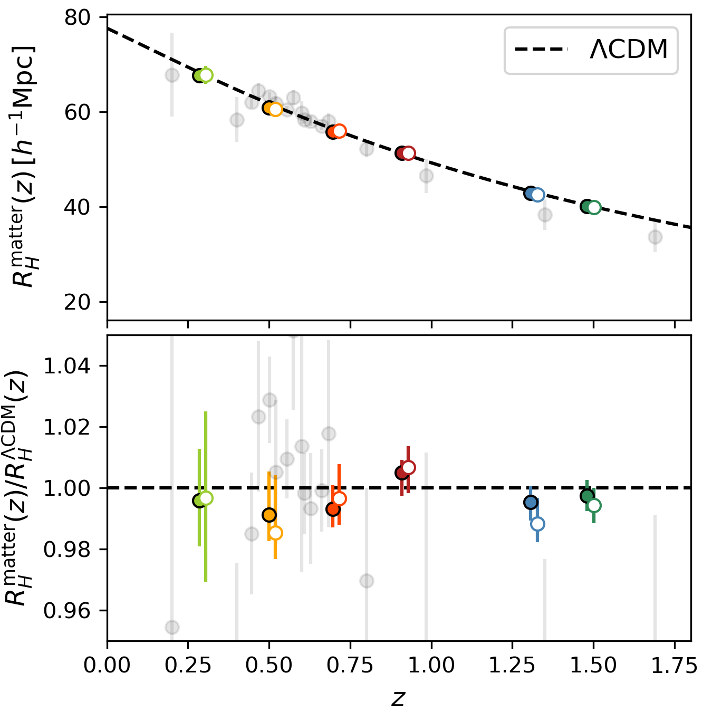
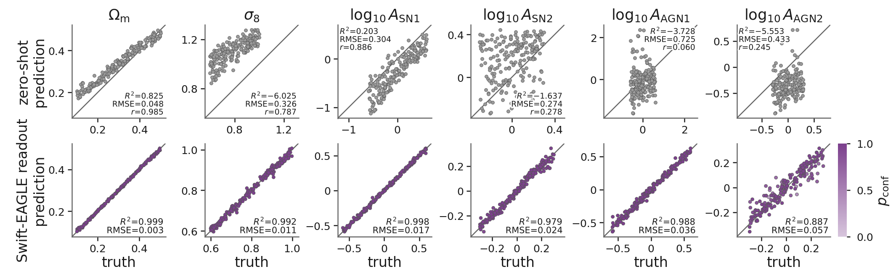

# arXiv Digest — 2026-10-30

- **Interest file used:** interests/2026.09.md (fallback — no 2026.10.md exists yet)
- **Categories pulled:** astro-ph.CO, astro-ph.EP, astro-ph.GA, astro-ph.HE, astro-ph.IM, astro-ph.SR, cs.LG, stat.ML, hep-ph
- **Papers scanned:** 657 (200 astro-ph new/cross + 457 cs.LG/stat.ML/hep-ph)
- **After first filter:** 32 candidates reviewed with full text
- **Final selected:** 16 papers across 4 tiers

---

## Tier 1 — Highly relevant

### [A GLIMPSE of Dark Matter: JWST Constraints on Early Structure Formation](http://arxiv.org/abs/2610.37751v1)

Julian B. Muñoz, John Chisholm, Seiji Fujimoto et al.
**Primary category:** astro-ph.CO | also: hep-ph

The authors use the UV luminosity function from GLIMPSE, the deepest JWST cluster-lensing program so far (reaching $M_{\rm UV}\sim-12$ behind Abell S1063), together with legacy HST and Subaru data, to measure **the amplitude of the matter power spectrum at $z\sim4$–8 on sub-Mpc scales**. Marginalizing over an empirical halo–galaxy connection, dust calibration and halo-mass-function uncertainties, they find P(k) **consistent with CDM to 0.2 dex at k = 3–9 Mpc⁻¹ and 0.5 dex at k = 9–27 Mpc⁻¹**. Translated to thermal-relic WDM, this gives **$m_{\rm WDM} > 3.2$ keV (95% CL)**, the strongest reionization-era limit and independent of lower-z probes. It is a direct cross-check on forest WDM bounds, with different systematics and from an epoch the forest does not reach.

*The new UVLF-based P(k) points (black squares) reach scales comparable to strong lensing, but at z ~ 7, and extend past earlier HST UVLF work. They sit on the CDM curve and exclude the 3.2 keV WDM suppression (red dashed) shown for reference against the Lyα and other probes.*

---

## Tier 2 — Adjacent / useful context

### [Going off the (momentum) grid: A simple implementation of noncold relics in linear Boltzmann solvers](http://arxiv.org/abs/2610.40275v1)

Arad Nasiri, Murali Saravanan, Caio B. de S. Nascimento
**Primary category:** astro-ph.CO | also: hep-ph

This paper implements two schemes in CLASS for noncold relics such as massive neutrinos or hot DM subcomponents. The **Dispersive Fluid Approximation (DFA)** captures their scale-dependent sound speed on small scales; it beats the default CLASS fluid approximation and cuts CDM power-spectrum errors by up to an order of magnitude for **only 1–4% extra runtime**. They also release the first open-source **Generalized Boltzmann Hierarchy**, which integrates out momentum dependence entirely. Combined with the DFA, it reproduces the matter power spectrum to **better than permille** and parameter constraints to < 0.05σ. The authors argue it is especially suited to non-thermal relics whose distribution function evolves, which is relevant to modelling WDM, mixed DM and neutrino-mass effects on small-scale power.

### [Disentangling constraints on $S_8$ from the high and low redshift CMB](http://arxiv.org/abs/2610.37752v1)

Joann Jones, Ualype de Andrade Uchôa, Scott Dodelson
**Primary category:** astro-ph.CO

CMB-based S₈ mixes primordial information with late-time lensing. The authors **marginalize over the lensing information with a principal-component analysis**, which lets them compare clustering at high and low z separately. The primordial CMB alone (Planck 2018 + ACT DR6 + SPT-3G D1) gives **$S_8 = 0.795\pm0.022$**, in agreement with DES ($0.789\pm0.012$), while CMB lensing prefers more clustering. How large that lensing excess is depends on the $\sum m_\nu$ prior, but **removing lensing moves the CMB toward DES in every case**. This matters for how forest-plus-CMB neutrino-mass combinations should be read.

### [The scale of homogeneity in DESI Data Release 1](http://arxiv.org/abs/2610.38083v1)

Cullan Howlett, L. Giani, Elizabeth G. O'Brien et al.
**Primary category:** astro-ph.CO

Using counts-in-spheres on nearly 5 million DESI DR1 galaxies and quasars in six bins over 0.1 < z < 2.1, the authors measure the correlation dimension $D_2(r)$. They define **the homogeneity scale $R_H$** as the radius where $D_2$ comes within 1% of 3. Galaxy samples reach homogeneity at **94–143 h⁻¹ Mpc** depending on tracer bias and redshift. The reconstructed matter homogeneity scale falls with redshift as ΛCDM predicts, and the constraints are much tighter than earlier WiggleZ and SDSS results. A ~10% NGC/SGC offset is traced to fiber assignment and completeness variations, which their mocks reproduce. The QSO and LRG3 bins show the largest (~2.5σ) data–simulation differences.

*DESI DR1 matter homogeneity scales (closed points NGC, open points SGC) follow the ΛCDM prediction (dashed) across 0.1 < z < 2.1 with much smaller error bars than the earlier WiggleZ and SDSS points (grey).*

### [Celia: Catalog Embeddings Learned from cosmologIcal simulAtions](http://arxiv.org/abs/2610.40218v1)

Xiaowen Zhang, Matthew Ho, Anshul Kumar et al.
**Primary category:** astro-ph.GA | also: astro-ph.CO

Celia is a **self-supervised transformer foundation model for subhalo/galaxy catalogs**. It is pretrained without labels on CAMELS IllustrisTNG, SIMBA and Astrid plus their N-body twins, using masked-property reconstruction and teacher-representation prediction in a JEPA/iBOT-like setup. **Linear readouts** of the embedding recover $Ω_m$ with **R² = 0.999**, and σ₈ and both SN-feedback amplitudes with R² ≥ 0.97, in all three suites. The embedding also **transfers zero-shot to Swift-EAGLE**, a code it never saw ($Ω_m$ correlation r = 0.985). This is a concrete example of the masked-token pretraining-and-probing recipe that the QGPT quasar-spectrum project uses, applied to cosmological data.

*Readouts on the unseen Swift-EAGLE code. A linear model fitted only on the three training suites already tracks the true parameters (top), and refitting the readout on Swift-EAGLE labels tightens this further (bottom). The embedding's response to cosmology is shared across galaxy-formation codes.*

### [Probing Cosmology with Diffusion Models: Memorization, Generalization, and Parameter Estimation](http://arxiv.org/abs/2610.37825v1)

Jiaming Pan, Nicholas Kern
**Primary category:** astro-ph.CO

The authors train diffusion models on CAMELS-TNG HI fields and vary training-set size at fixed model size. They track **memorization of training samples**, one- and two-point statistics, and $Ω_m$ inference from the generated fields. The key result is that **a surrogate can pass visual, one-point and power-spectrum checks while still memorizing**. A memorized model's posteriors are unbiased on average but about 2.5× too narrow, giving **overconfident, under-covering parameter estimates**. Only beyond a training-set size with enough information content does the model generalize and give calibrated SBI posteriors. Any diffusion emulator of forest or IGM fields used in an inference pipeline should get the same generalization test.

*Both the memorized (red) and generalized (blue) surrogates recover $Ω_m$ without bias. Only the generalized one has calibrated coverage; the memorized model's intervals are too narrow and under-cover the truth.*

### [Field-level inference under pressure: the information content of the thermal Sunyaev-Zel'dovich field](http://arxiv.org/abs/2610.40617v1)

Carmen Embil Villagra, Adrian E. Bayer, William R. Coulton et al.
**Primary category:** astro-ph.CO

This is the first field-level analysis of the tSZ Compton-y field. Using 10,000 simulated maps that jointly vary $Ω_c$, σ₈ and two pressure-profile parameters, it compares **a ResNet-18 compressor against Minkowski functionals and the power spectrum within one simulation-based inference framework**. All methods pass TARP coverage tests. The CNN gives the tightest constraints on noiseless maps, but **at Simons Observatory noise levels the MFs plus the power spectrum match the CNN**. That argues for interpretable non-Gaussian summaries over black-box field-level compression once noise is realistic, a trade-off that applies equally to forest summary statistics.

### [Beyond $χ^2$: Ensemble null tests for reliable scientific discovery](http://arxiv.org/abs/2610.40167v1)

Adrian E. Bayer, David N. Spergel
**Primary category:** stat.ME | also: astro-ph.CO, astro-ph.IM

Standard null tests average repeated measurements and reduce them to a single χ², which can hide structured systematics. The authors propose **ensemble null tests**, which compare the full multivariate distribution of per-observation measurements against a reference ensemble using the PQMass regional-count statistic. In CMB split-map simulations, **the ensemble test detects weaker contamination than coadd-plus-χ²** for six injected systematics. The same tool detects Gaia velocity asymmetry as sensitively as an informed search and catches a control mismatch in a CRISPR screen. It could be used directly for the per-chunk or per-exposure null splits in P1D and P3D analyses.

*At a fixed 5% false-positive rate, treating the CMB nulls as an ensemble of 100 spectra (orange) flags contamination at lower amplitude than coadding them into one null tested with χ² (grey). Coaddition throws away the variation between observations that carries the signal.*

### [UnEZ: A Fully Unsupervised Self-Templating Neural Network for Redshift and Line Strength Estimation](http://arxiv.org/abs/2610.38816v1)

Asha Abd, Karl Glazebrook, Colin Jacobs
**Primary category:** astro-ph.IM | also: astro-ph.GA, cs.LG

UnEZ is an **attention-based encoder** that predicts emission- and absorption-line amplitudes and widths. A **fixed, physics-only decoder** builds a template from them and fits the redshift, so training needs **no redshift, line or template labels**. On SDSS DR18 galaxies and quasars it reaches an **outlier fraction of 0.46% and NMAD of 1.2×10⁻⁴ at SNR > 10** (3.9% outliers at SNR > 3), competitive with template pipelines. The design, a learned encoder feeding an interpretable deterministic decoder, carries over to label-free quasar continuum and redshift models for forest samples.

### [Proving and Improving the Platonic Representation Hypothesis with JEPAs](http://arxiv.org/abs/2610.39302v1)

Randall Balestriero, Yann LeCun
**Primary category:** cs.AI | also: cs.CV, stat.ML

The authors **prove that separately trained JEPAs converge to the same representation up to a rotation**, for any number of modalities, provided the modalities agree on which world states count as positives. Positives that corrupt a single observation force the encoder to spend dimensions on modality-specific nuisance that no rotation can align. **Next-token prediction has the form of such a bad-view JEPA.** Empirically, good-view JEPAs align across modalities following a predictive scaling law, need 42× fewer samples than next-token prediction on the same corpus, and give a 109M text JEPA that beats every evaluated LLM up to 72B parameters on the hypothesis paper's own benchmark. For a quasar-spectrum foundation model, this is a direct argument about which pretraining objective and view construction produce transferable, alignable embeddings.

*None of the text encoders sees images during training, yet the one trained on good views (alternative captions as positives) becomes much more aligned with a separately trained image JEPA. The masked-span JEPA and next-token prediction nearly coincide well below it.*

### [Are Seismic Foundation Models More Than Glorified Feature Extractors?](http://arxiv.org/abs/2610.38003v1)

Laura Laurenti, David Liu, Brian Kulis et al.
**Primary category:** cs.LG | also: cs.AI

This is a controlled study of self-supervised foundation models for a continuous 1D scientific signal. **Nine checkpoints share one Mamba backbone and one corpus and differ only in pretraining objective**, and each is evaluated frozen on three seismology tasks under distribution shift. **Changing the objective moves downstream skill between tasks rather than raising it overall**, and no checkpoint generalizes without a trade-off. Pretraining helps mainly in the few-label regime. Controls rule out capacity, architecture and domain proximity as explanations. The authors trace one failure to a point target collapsing to a near-zero conditional mean and conclude that **whether the learning target is well posed** is the deciding factor. This applies directly to choosing pretraining targets for spectra.

### [Separability Is Not Alignability: Representations for Spectrum-to-Molecule Retrieval](http://arxiv.org/abs/2610.37979v1)

Karol Musielinski, Fanurs C. E. Teh, Takahiko Koyama et al.
**Primary category:** cs.LG

The paper audits the CLIP-style premise that independently pretrained spectrum and molecule encoders share enough geometry for lightweight frozen alignment, using MS/MS spectra. **Same-molecule clustering does not predict cross-modal alignability**: MS-JEPA has the best clustering but the worst frozen retrieval, and cross-modal agreement measured by mutual-kNN and CKA stays low. Spectrum-blind controls show that candidate-trained adapters keep substantial accuracy without the query spectrum. In contrast, **simulated paired spectra for 5.9M molecules double retrieval MRR (0.232 → 0.463)**. The caution applies to AstroCLIP/SpecCLIP-style alignment of spectra with other modalities: report spectrum-blind baselines, and expect paired coverage to matter more than encoder quality.

### [New Multiple Descent Phenomena Induced by Heterogeneous Data](http://arxiv.org/abs/2610.38002v1)

Mark-Anthony Moisescu-Pareja, Elvis Dohmatob
**Primary category:** stat.ML | also: cs.LG

The authors derive asymptotically exact, group-specific test-error formulas for linear random-feature models trained on mixtures of sources with different covariance scales or spectral exponents. They show that **covariance heterogeneity alone produces extra interpolation peaks (triple or multiple descent)**, with no label noise or nonlinearity required. Model scaling also creates **large group-wise error disparities**, with each source effectively getting its own learning scale. Experiments on synthetic mixtures and rescaled or transformed MNIST and CIFAR-10 confirm the predictions. This is relevant to training one model on heterogeneous survey data, such as quasar spectra pooled across instruments, SNR regimes or redshift ranges.

---

## Tier 3 — Outside my area but notable

### [A universal relation predicts the observed reversal of a supernova chirp](http://arxiv.org/abs/2610.39240v1)

Joseph R. Farah, Logan J. Prust, Hang Yu
**Primary category:** astro-ph.HE

The superluminous SN 2024afav showed light-curve modulations whose period shortened over time (a "chirp"), explained by a precessing disk falling onto a newborn magnetar. The authors derive a **normalization-independent universal relation between the period derivative and the dimming rate**. Fitting it only to the published chirp, they **predicted that the chirp would halt near ~133 d and reverse**. Continued follow-up found five new modulations with a period minimum at **132 ± 3 d (rest frame)** followed by a clear antichirp. Red noise from random CSM shells reproduces this in ≲0.1% of realizations. A pre-registered quantitative prediction confirmed this cleanly is rare in transient astrophysics, and the sharpness of the reversal also rules out radiatively cooled thin disks.

*Fitted only to the earlier chirp, the relation predicted a period minimum near 133 d followed by an antichirp (blue). The new late-time modulations (orange) land on that prediction within ≲1σ and rule out a continued linear period decline.*

---

## Tier 4 — Meta-research about the field

### [Identifying Scientifically Interesting Galaxies with Vision-Language Models](http://arxiv.org/abs/2610.37747v1)

Yixuan Cheng, Nolan Koblischke, Jo Bovy
**Primary category:** astro-ph.IM

The authors test whether **off-the-shelf vision-language models can rank survey images by scientific interest from a natural-language prompt**, with no training on the target data. On a 20,000-image HST sample containing 167 reference anomalies, Gemini 3.1 Flash-Lite places **98.2% of the anomalies in the top ~2,000 images** for about $5 per 10,000 images. The open-weight Qwen nearly matches it, at roughly $180 per million images. The authors are explicit about the limits. The benchmark is enriched with anomalies, and at a realistic ratio of 1 anomaly per 1,200 images, precision drops from 7.8% to 0.84% and top-2,000 recall falls to ~46%. It is a useful data point on where general-purpose AI already replaces bespoke anomaly-detection pipelines in astronomy, and on how much expert review remains.

### [Pinpointing Pivot Points: The DECIDE Framework for Data Analysis Decision Importances](http://arxiv.org/abs/2610.38797v1)

Zachary T. Rewolinski, Jan Simson, Frauke Kreuter et al.
**Primary category:** stat.ML | also: cs.LG, stat.ME

DECIDE treats an analysis pipeline's judgment calls (cleaning, feature selection, modelling choices) as a **multiverse**. It ranks **how much each decision, and each interaction between decisions, drives the variation in conclusions** by comparing universes that differ only in the decisions of interest, with no surrogate model. Its mean–variance version recovers Sobol' indices. Across real published multiverses it gives more stable importance rankings under ablation than surrogate-based approaches. It is a principled way to report which analysis choices (masking, continuum fitting, scale cuts) actually move a cosmological result, a reproducibility problem that the authors argue agentic analysis tools are making worse.
