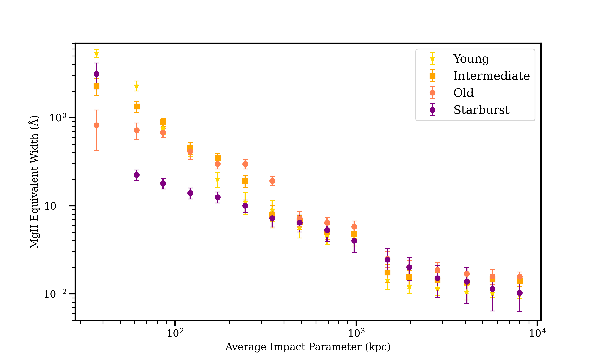

# arXiv Digest — 2026-11-02

- **Interest file used:** interests/2026.09.md (fallback — no 2026.11.md exists yet)
- **Categories pulled:** astro-ph.CO, astro-ph.EP, astro-ph.GA, astro-ph.HE, astro-ph.IM, astro-ph.SR, cs.LG, stat.ML, hep-ph
- **Papers scanned:** 330 (91 astro-ph new/cross + 239 cs.LG/stat.ML/hep-ph)
- **After first filter:** 29 candidates reviewed with full text
- **Final selected:** 14 papers across 4 tiers

---

## Tier 1 — Highly relevant

### [The Evolution of the Circumgalactic Medium after a starburst in DESI Post-Starburst Galaxies](http://arxiv.org/abs/2610.41681v1)

Zoe Harvey, Sahyadri Krishna, Rita Tojeiro et al.
**Primary category:** astro-ph.GA

The authors stack **Mg II absorption in ~1.98 million DESI DR2 quasar sightlines** behind luminous red galaxies at 0.4 < z < 0.76, giving ~143 million galaxy–quasar pairs (50–60× their earlier SDSS analysis), and split the foreground galaxies by spectral class with mean-field ICA. Post-starburst galaxies carry the most cool CGM gas of any class, **$W_{\rm MgII} = 1.58 \pm 0.32$ Å within 71 kpc**, compared with 0.69 Å for star-forming and 0.22 Å for quiescent galaxies of similar mass. Ordering the post-starbursts by time since the burst (checked independently with Bagpipes SFH fits) shows **inner absorption fading while absorption at ~300–1000 kpc grows**. They read this as feedback-driven winds of a few hundred km/s pushing cool gas outward. Methodologically, it is a DESI DR2 quasar-absorption stacking pipeline that sits right next to the forest analyses.

*The youngest post-starbursts have the steepest inner Mg II profiles and the highest small-radius equivalent widths; with age the profiles flatten and the inner–outer contrast weakens, as expected if expelled gas moves outward.*

### [Model-independent and reconstruction-free evidence for cosmic acceleration from DESI baryon acoustic oscillations](http://arxiv.org/abs/2610.40785v1)

Laura Herold, Graeme E. Addison, Adam G. Riess
**Primary category:** astro-ph.CO

Using only uncalibrated DESI DR2 BAO and the assumptions of homogeneity, isotropy and a standard ruler, the authors build **three test statistics, from the Alcock–Paczyński parameter, $D_V/r_d$ and $D_H/r_d$**, that check for acceleration against a coasting (q = 0) null. Unlike earlier model-independent BAO tests, these need no Gaussian-process or other reconstruction between the six or seven redshift bins. After a look-elsewhere correction they find **2.4σ–4.1σ evidence for acceleration within 0 ≤ z ≤ 0.934** assuming flatness, with the $S_{VH}$ statistic strongest. For any $|\Omega_k| \le 1$, at least two statistics stay at 2.4σ–3.5σ or above. This gives a gravity- and content-agnostic acceleration result from BAO alone, independent of supernovae.

*DESI DR2 BAO expansion speeds, normalised to the coasting speed inferred from the BGS bin, fall in the "accelerating" region (below the reference) and track ΛCDM and w₀wₐCDM. The lower panel shows each model's deceleration parameter q(z) and transition redshift.*

---

## Tier 2 — Adjacent / useful context

### [Two-loop matter power spectrum from FFTLog and kite integrals](http://arxiv.org/abs/2610.41914v1)

Paola Cappellazzi, Johannes M. Henn, Marko Simonović
**Primary category:** astro-ph.CO | also: hep-th

The paper extends FFTLog-based EFTofLSS codes from one loop to two. The linear spectrum is decomposed into complex power laws, which reduces the two-loop corrections to **cosmology-independent massless kite integrals**. The authors evaluate these with a **Mellin–Barnes representation summed on a uniform lattice**, reaching ~10-digit precision even for large imaginary powers. After the analytically regularised pieces are matched to counterterm-like terms with no free parameters, the result agrees with direct integration to **$10^{-4}$ of the spectrum up to k = 0.2 h/Mpc**, and a new cosmology then takes only a few milliseconds. The matrices and code are public, and the framework extends to biased tracers and redshift space, so it is a usable building block for two-loop full-shape modelling.

### [When precise inference is wrong: Diagnosing model misspecification with applications to cosmic dawn and reionisation](http://arxiv.org/abs/2610.40770v1)

Daniela Breitman
**Primary category:** astro-ph.CO | also: astro-ph.GA

This paper turns **the Handley–Lemos "suspiciousness" tension statistic into a model-criticism test**: it asks whether different subsets of the data (redshift ranges, observables) can be fitted by the same parameters. Using 21cmEMU emulators, so every inference runs on a laptop, it finds that the HERA upper limits are too weak to show anything, while **HST+JWST UV luminosity functions at z ≤ 10 and z > 10 are in 5.0σ tension** under the adopted galaxy model (2.1σ if the z > 10 errors are doubled). On a mock SKA-Low 21-cm power spectrum, a deliberately misspecified model fits well and passes χ² for most noise realisations but returns wrong astrophysics. Suspiciousness flags it at **~3.4σ without needing the true model**. The same check carries over to any forest or IGM inference that splits naturally by redshift or statistic.

### [Learning Clean Generative Processes from Noisy Measurements](http://arxiv.org/abs/2610.42036v1)

Fabian Kruse, Lorenzo Baldassari, Ivan Dokmanić
**Primary category:** cs.CV | also: cs.AI, cs.LG

The goal is a diffusion-type generative model of *clean* data trained only on noisy observations, for Gaussian and also **Poisson, binomial, Gamma and negative-binomial** noise. **Noise2Noise regression** on independent noisy views supervises the posterior predictions only at or above the data's own noise level. Below that level the authors impose a **consistency constraint**: a prediction must equal its expectation after sampling continues. They prove conditions under which this uniquely fixes the continuation to the clean distribution. On CIFAR-10, photon-counting microscopy and SAR data, the consistency loss is what keeps sample quality from collapsing below the training noise level. This is a principled self-supervised denoising-plus-generation recipe that could carry over to noisy spectra.

### [Frozen in Time: How a Physics Foundation Model Forgets Under Sim-to-Real Adaptation](http://arxiv.org/abs/2610.40857v1)

Haaris Mian, Miles Cranmer, Alessandro Favero et al. (Polymathic AI)
**Primary category:** cs.LG | also: physics.flu-dyn

The authors fine-tune **Walrus-1.3B**, a foundation model for continuum dynamics pretrained on The Well, first on simulated cylinder flow and then on experimental PIV of the same flow. They measure **catastrophic forgetting** at each stage: simulation fine-tuning raises one-step errors on the pretraining datasets by **up to 35× within 20 epochs**, and the real-data stage then erases the simulation skill as well. How much a task is forgotten depends on how similar its representation is to the fine-tuning task. **Replaying as little as 1% simulated data** during real-data fine-tuning recovers most of the lost performance while keeping adaptation to the experiment. This is a direct caution for the sim-pretrain/real-adapt pattern planned for spectral foundation models.

*Left: during real-PIV fine-tuning, rollout error on the real data falls, but skill on cylinder simulations is lost in the first 20 epochs and never comes back. Right: mixing even 1% replayed simulation data into that stage recovers most of the lost simulation performance.*

### [The Broad-Line Region Size-Luminosity Relation in AGN Constrained by the Viewing Angle with the FRADO Model](http://arxiv.org/abs/2610.41594v1)

Junhee Myong, Jong-Hak Woo, Mohammad-Hassan Naddaf et al.
**Primary category:** astro-ph.GA

The authors add an anisotropic-illumination phase factor to the **FRADO (failed radiatively accelerated dusty outflow) BLR model**. They then build a **Bayesian framework that infers each AGN's viewing angle** by matching model Hβ lags to 151 reverberation-mapped AGN. The model reproduces the slope and intrinsic scatter of the observed $R_{\rm BLR}$–$L_{5100}$ relation. The inferred angles are skewed below the isotropic type-1 expectation and roughly agree with velocity-resolved dynamical modelling. As a result, **viewing-angle-calibrated black-hole masses come out systematically larger than RM masses with an average virial factor**, which matters for single-epoch mass estimates across survey quasar samples.

### [Hints of self-interacting dark matter from strong gravitational lensing](http://arxiv.org/abs/2610.40766v1)

Daniel Gilman, Kalliopi Petraki, Thomas Pignard et al.
**Primary category:** astro-ph.CO | also: hep-ph

The authors start from a companion JWST analysis of **29 quadruply imaged quasars** whose flux ratios favour halo densities consistent with **gravothermal core collapse**, the signature prediction of SIDM. They recast the constraint on the collapse timescale as a constraint on elastic Yukawa scattering, using an improved gravothermal treatment combined with cluster and Milky Way satellite-evaporation upper limits. The favoured region has **DM masses of 20–80 GeV, MeV-scale mediators and couplings near $10^{-3}$**, giving $\sigma/m \sim 10^2$–$10^4$ cm²/g at 10 km/s. Cosmological and detection bounds then point to an invisibly decaying neutrinophilic mediator. It is a small-scale-structure dark-matter result complementary to forest WDM/FDM bounds, though it currently rests on hints rather than a detection.

### [OASIS I: Spectroscopy of Mini-Quenched and Lulling Galaxies Constrains the Quiet Side of Bursty Star Formation at z > 4](http://arxiv.org/abs/2610.41489v1)

Tobias J. Looser, Francesco D'Eugenio, William M. Baker et al.
**Primary category:** astro-ph.GA

A JWST Cycle 3 program uses deep 28-hour NIRSpec/PRISM spectroscopy to look deliberately for galaxies in the *suppressed* phase of bursty star formation at z > 4. It finds three mini-quenched galaxies (no Balmer emission, ≥1.2 dex below the main sequence), five "lulling" galaxies and 17 nearly-main-sequence ones. **Seven of ten photometric candidates were not actually suppressed**, so this regime needs spectroscopy. In the tiers not selected on star-formation state, suppressed galaxies make up **29% at z = 4–5.5 and $M_\star = 10^{8}$–$10^{9.5}\,M_\odot$**, about an order of magnitude more than TNG-like simulations predict. Their Balmer breaks show these quiet phases last ~100 Myr or longer. This bears on how the ionizing-source population is modelled in reionization.

---

## Tier 3 — Outside my area but notable

### [Missing Mergers: On the Unexpected Delay-Time Distribution of Binary Neutron Star Mergers](http://arxiv.org/abs/2610.40782v1)

Ryan J. Foley
**Primary category:** astro-ph.HE

Fitting broadband photometry and an integrated spectrum of NGC 4993, the host of GW170817, gives a **mass-weighted stellar age of $12.4^{+0.5}_{-0.7}$ Gyr**, which serves as the delay time of that merger. The canonical $t^{-1}$ delay-time distribution with $t_{\rm min} = 10$ Myr predicts ~16 mergers at ~100 Myr delay for every one at 10 Gyr, giving **only a ~1.8% chance of seeing even one merger as old as GW170817**. Together with GW190425, the data favour a $t_{\rm min} = 12.6$ Gyr DTD over the canonical one by a factor of 40–140, and over SGRB and Galactic double-neutron-star DTDs by 80–280. This is in direct tension with population synthesis. The explanations left are a very different separation distribution, a dominant long-delay channel, or a large population of BNS mergers missed by LVK.

*The likelihood in the (t_min, α) plane peaks at multi-Gyr minimum delay times. The canonical, SGRB and Galactic-DNS delay-time distributions (orange markers) fall outside the factor-of-10–1000 likelihood-ratio contours.*

---

## Tier 4 — Meta-research about the field

### [Demographics and growth of the astronomy and astrophysics community](http://arxiv.org/abs/2610.41535v1)

Jürgen Knödlseder
**Primary category:** astro-ph.IM

From ADS author records going back ~200 years, the paper estimates **about 100,000 ± 20,000 astronomers in 2025** (59,940 publishing authors that year, plus ~40% who did not publish). The community is 38% in Europe, 29% in Asia and 26% in North America. It has grown exponentially at **4.3% per year for 50 years (doubling every 16 years)**, speeding up to 5.1% in the last decade, driven by China (13%/yr) and India (10%/yr). Because headcount grows faster than paper output, **papers per astronomer are falling**, and half of today's authors have been publishing for seven years or less. If current rates hold, China will have the largest astronomy community by 2029 and India the second largest by 2043.

*Author counts since 1975 for the world and selected countries: steady exponential world growth, with China and India rising steeply in recent decades. The 1996 dip comes from missing ADS affiliation data.*

### [Automatic Construction of Strong Simple Baselines](http://arxiv.org/abs/2610.40700v1)

Caleb N. Ellington, Jiaqi Wang, Sohan Addagudi et al.
**Primary category:** cs.LG | also: q-bio.QM

The authors collected **36 supervised tasks from Nature-, Science- and Cell-family papers** that introduced new deep-learning methods. An LLM agent then built simple, non-deep baselines for each task automatically. They define *simple baseline strength* as the fraction of the published method's gain over a trivial predictor that the baseline recovers. It reaches a **median of 95.5% (mean 85.7%)**, and **in 12 of 36 studies the simple baseline matches or beats the published deep model**. They argue that automated baselines are a cheap check that reviewers could routinely request. This is directly relevant to how ML-for-astronomy claims are evaluated.

*Per-task simple baseline strength on a scale from trivial predictor (0) to the published deep model (1). Most tasks sit near or past 1, so much of the reported deep-learning gain is reachable without deep learning.*

### [An end-to-end CNN search for ultra-short-period planets in TESS: from the blend ceiling to the independent validation of TOI-6662 b](http://arxiv.org/abs/2610.42009v1)

Juan F. Pagés Navarrete
**Primary category:** astro-ph.EP | also: astro-ph.IM

This is a methodology critique of the standard transit-CNN benchmark. A detector scoring **AUC 0.97** against synthetic eclipsing-binary negatives **drops to 0.50, no better than random**, when the negatives are real false positives rejected by TESS follow-up. Pixel-level analysis shows **42% of those false positives are blends**, which caps any single-band light-curve classifier at **AUC_max = 1 − f/2 ≈ 0.79**. Retraining on real negatives reaches 0.80 ± 0.06, matching the cap. The author then builds a multi-stage vetting pipeline (centroids, scene modelling, Gaia) that independently validates the Earth-sized TOI-6662 b. The broader lesson: a benchmark built on synthetic negatives can measure a problem that does not exist.

*Two independent routes give the same limit. The AUC after retraining on real false positives lands on the ceiling predicted from the measured 42% blend fraction, within 0.19σ.*

### [Agentic Systems for Calibrating Cosmological Simulations](http://arxiv.org/abs/2610.40685v1)

Chaipat Tirapongprasert, Matthew Ho
**Primary category:** astro-ph.IM | also: cs.CL

AgenticTuner replaces Bayesian optimisation with **an LLM agent that proposes each parameter trial** when calibrating an expensive cosmological simulation. The agent is given informal human priors: the codebase, documentation, heuristic guides, and the option to run low-resolution probes. Across 20 runs it **calibrates at lower simulation CPU cost than the BO baseline in every run**. Its reasoning traces show it shifting from active tool use early in a run to synthesising earlier findings later. The evaluation is narrow (one simulator, a few observables, no context ablations yet), but it is a concrete early case of agents taking over a routine but expensive part of the cosmology workflow.
