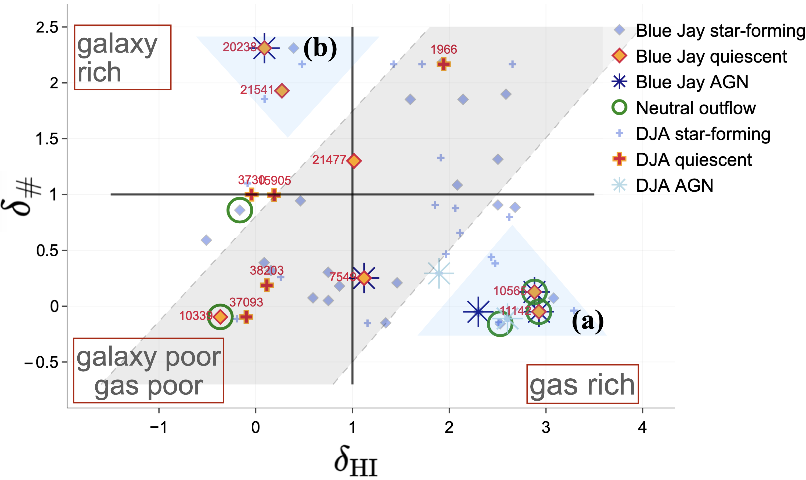

# arXiv Digest — 2026-11-03

- **Interest file used:** interests/2026.09.md (fallback — no 2026.11.md exists yet)
- **Categories pulled:** astro-ph.CO, astro-ph.EP, astro-ph.GA, astro-ph.HE, astro-ph.IM, astro-ph.SR, cs.LG, stat.ML, hep-ph
- **Papers scanned:** 791 (150 astro-ph new/cross + 641 cs.LG/stat.ML/hep-ph)
- **After first filter:** 31 candidates reviewed with full text
- **Final selected:** 13 papers across 4 tiers

---

## Tier 1 — Highly relevant

### [A Composite Rest-Frame UV Spectrum of Galaxies at $5.7 < z < 6.9$: Ionization, Outflows, and Implications for Intergalactic Metal Enrichment](http://arxiv.org/abs/2610.33154v1)

David DePalma, Robert A. Simcoe, Anna-Christina Eilers et al. (Eilers is a high-value author)
**Primary category:** astro-ph.GA | also: astro-ph.CO

The authors stack JWST/NIRSpec G140M spectra of **104 [O III]-selected galaxies at mean z = 6.50** from Lyα to C III] at R ~ 1000. The composite looks strikingly like the z ~ 3 Lyman-break galaxy stack, but its high-ionization lines (O III], C III], He II) are stronger and narrow, which argues against a broad-line AGN. Low- and high-ionization absorption lines are **blueshifted by ~170–200 km/s**, a clear sign of outflows. A ballistic wind model in the galaxies' NFW halos, run over their stellar ages, carries this gas only **~3–9 proper kpc**. Wind bubbles that size account for **under 1% of the metal absorbers seen in z ~ 6 quasar spectra**, so the authors conclude that early IGM enrichment must come mostly from undetected low-mass galaxies (M★ ~ 10⁵–10⁶ M☉) clustered around the JWST-detected ones.

*Modeled wind trajectories for each galaxy at 200 km/s. Most winds are still expanding when they are limited by travel time, a few stall and fall back, and nearly all stop well inside the mean R₂₀₀ of the halos, which is why these galaxies cannot enrich the IGM on the scales probed by quasar absorbers.*

### [Developing Environments: Formation and Quenching at Cosmic Noon Traced by the Large-scale Distribution of Gas and Galaxies](http://arxiv.org/abs/2611.00190v1)

Amir H. Khoram, Sirio Belli, Trevor Mendel et al.
**Primary category:** astro-ph.GA

Star-formation histories of ~200 galaxies at 1.7 < z < 3.5 come from JWST/NIRSpec spectra (Blue Jay and DJA). The authors compare them with two independent environment tracers: COSMOS-Web galaxy counts and **neutral-hydrogen overdensity δ_HI from the LATIS Lyα forest tomographic map**. In dense regions the quiescent fraction rises from ~10% to 40–50%, and massive quiescent galaxies there formed about twice as early. The star-forming galaxies, however, track cool-gas density rather than galaxy counts. About 35% of galaxies fall off the δ_#–δ_HI relation in spatially coherent groups. One group is a **gas-poor, galaxy-rich Hyperion protocluster core where the gas is plausibly fully ionized**. Another is a gas-rich, galaxy-poor "developing environment" next to it, full of recently quenched galaxies hosting AGN and outflows. The paper shows that **Lyα tomography picks up environmental information that galaxy counts miss**.

*Galaxy number density against Lyα-tomography HI density for massive galaxies at 2.2 < z < 2.8. About 65% follow a common trend, and the labeled outliers (a) and (b) are regions where gas and galaxies disagree; their assembly histories differ systematically from those on the trend.*

### [Recovering Missing Degrees of Freedom in Simulation-Trained Field-Level Generative Models](http://arxiv.org/abs/2611.02627v1)

Masato Shirasaki, Shiro Ikeda
**Primary category:** astro-ph.CO | also: cs.LG

A continuous normalizing flow trained on a finite set of weak-lensing convergence simulations (κTNG) reproduces their mean statistics but **underestimates realization-to-realization variance**. The authors read this "variance shrinkage" as a sign of missing effective degrees of freedom. They fix it by adding **physics-informed latent terms to the flow's velocity field**, with no new training simulations. One latent mode carries most of the recovered variance and turns out to act as a **growth-amplitude nuisance parameter**. In field-level inference on mocks with hydrodynamics or shifted source redshifts, the posterior moves this mode in the physically expected direction for every realization, and the inferred power-spectrum response moves closer to the truth. The technique carries over directly to simulation-trained flow or diffusion priors for Lyα fields, which face the same finite-simulation problem.

*(a) The latent-enhanced flow recovers most of the field-variance scatter that the baseline flow loses, and its dominant latent mode mainly rescales power. (b) Hydro and source-redshift mismatches push that mode in opposite, physically sensible directions. (c) The latent model reduces the out-of-distribution error metric for most realizations.*

---

## Tier 2 — Adjacent / useful context

### [SensOFormer: Foundation Models for Particle Accelerators](http://arxiv.org/abs/2611.02031v1)

Mahindra Rautela, Alexander Scheinker
**Primary category:** cs.LG | also: physics.acc-ph

SensOFormer is a **denoising masked transformer with a Perceiver-style set encoder/decoder**, pretrained self-supervised on telemetry from six accelerator facilities (LANSCE, LHC, SNS, LCLS, CEBAF, Booster). The design targets data that are noisy and incomplete, sampled at different rates, and come from different sets of sensors. One frozen backbone transfers to imputation (including **zero-shot imputation on a facility excluded from pretraining**), anomaly detection, and cavity and fault identification. On downstream classification it matches, rather than beats, the best task-specific baselines (84.8% on CEBAF cavity ID), and reconstruction improves with model and data size. It is a useful architectural reference for masked pretraining on irregularly masked, heteroscedastic quasar spectra.

### [Unimodal Augmentation-based SSL Objectives Induce Cross-Modal Alignment](http://arxiv.org/abs/2611.02917v1)

Zohar Mashiah, Nir Ben-Ari, Ronen Talmon et al.
**Primary category:** cs.LG | also: stat.ML

The paper asks why encoders trained separately on different modalities end up with aligned representations. The authors prove that **a low augmentation-based InfoNCE loss forces high local-CKA alignment** between modalities that share latent semantics, and that a high unimodal loss rules alignment out. In controlled experiments and across 53 frozen text, vision and audio encoders, **unimodal InfoNCE loss predicts image–text alignment far better than model or corpus size** (Spearman ~0.70–0.85, against |ρ| ≲ 0.3 for size). This is relevant to comparing a contrastively pretrained spectral model with photometric or image foundation models such as AstroCLIP and AION.

### [Generative diffusion in long-range correlated landscapes: Speciation cascade and the foam structure of the score](http://arxiv.org/abs/2611.02955v1)

Jerome Garnier-Brun, Giulio Biroli, Marc Mézard et al.
**Primary category:** cond-mat.dis-nn | also: cs.LG

The authors analyse the exact score of a diffusion model whose data come from a high-dimensional Gaussian random potential with long-range correlations, a tractable stand-in for hierarchically structured data. The single "speciation" threshold of earlier work becomes a **speciation window, in which the reverse process commits to ever-finer branches of the Parisi tree** of pure states. Using a Larkin-type argument, they describe the score as a **foam of cells separated by shock-like walls**, and the denoising error drops during the window with a profile set by the Parisi function alone. They argue that these walls are where errors in a trained score redistribute probability mass. That is a concrete prediction for where diffusion emulators of correlated fields such as cosmological density or flux fields will fail.

### [Contrastive Astromer: Two-Stage Contrastive Representation Learning for Astronomical Light Curve Classification](http://arxiv.org/abs/2611.00150v1)

Justin Minggan Wei, Pavlos Protopapas, Guillermo Cabrera-Vives
**Primary category:** astro-ph.IM | also: cs.CV

Starting from the masked-reconstruction ASTROMER 2 encoder, the authors add **unsupervised contrastive learning on augmented views of MACHO light curves, then supervised contrastive adaptation** on a labeled sample, without changing the architecture. With the encoder frozen, a downstream classifier reaches **macro-F1 = 0.794 with 500 labels per class, 5.1 points above the ASTROMER 2 fine-tune baseline**, and the gain is larger with 20 or 100 labels per class. Embedding diagnostics (k-NN, silhouette) show that masked-reconstruction pretraining alone leaves class information poorly organised in the mean-pooled representation. This bears directly on whether a masked spectral model needs a contrastive stage.

### [EMBER: A Little Red Dot Candidate at $z_{\rm spec}=10.36$ in the Seed Black Hole Era](http://arxiv.org/abs/2611.00195v1)

Takumi S. Tanaka, Hollis B. Akins, John D. Silverman et al.
**Primary category:** astro-ph.GA

A NIRSpec/PRISM spectrum confirms **z = 10.361 for a COSMOS-Web LRD candidate**, the highest-redshift LRD known. The redshift comes from a strong Lyα break plus tentative C IV and [O III]λ4363 lines (S/N ≈ 3.6–3.9). The spectrum shows the characteristic **V-shaped continuum turning over at the Balmer limit** (β_UV = −2.26, β_opt = 1.17), with M_UV = −20.2, among the most UV-luminous LRDs. Tentative Lyα emission may point to enhanced Lyα transmission at z ~ 10. The line evidence is still weak, and MIRI spectroscopy is planned to establish the source's AGN nature.

---

## Tier 3 — Outside my area but notable

### [Lightest and heaviest nuclei as keys to the origin of ultrahigh energy cosmic rays](http://arxiv.org/abs/2611.00205v1)

Anna M. Suliga, Glennys R. Farrar
**Primary category:** astro-ph.HE | also: hep-ex, hep-ph

In a binary-neutron-star-merger origin for UHECRs, there should be two light populations: protons accelerated in the jet, and protons produced by photodisintegration of heavy nuclei accelerated in the wider outflow. The authors fit Pierre Auger spectrum and X_max composition data and find that BNSM jet models beat the best no-jet model by **≥ 7.2σ**, robust to ±1σ shifts in the energy and X_max scales. Jet protons carry ~5–10% of the cosmic-ray energy above 10 EeV. The fits also **prefer a 5–10% r-process (A > 56) component at the source**, which would be a smoking gun for mergers, though the data do not require it. If the result holds, it is a strong case for solving a decades-old source problem.

### [Cometary impacts an unlikely pathway towards the origins of life on Earth](http://arxiv.org/abs/2611.02924v1)

Richard J. Anslow, Catriona H. McDonald, Amy Bonsor et al.
**Primary category:** astro-ph.EP

The authors combine impact simulations, comet–atmosphere interaction models and dynamical models of the short-period comet population in Monte Carlo realisations of Earth's bombardment history. They ask how often a comet delivered **HCN at the >10 mM concentration needed for prebiotic chemistry**. The median number of successful impacts is **zero, with 54% of realisations recording none**. Any successful impact most likely happened at ~4.41 Gya, before much subaerial land existed, and fewer than 5% of realisations deliver after 4.03 Gya. Even global delivery falls orders of magnitude below what the atmosphere could produce on its own, which undercuts a long-held idea about where prebiotic feedstock came from.

---

## Tier 4 — Meta-research about the field

### [Thirty years of primordial deuterium abundances: A provenance-aware statistical reanalysis](http://arxiv.org/abs/2611.02289v1)

Richard de Grijs, Giuseppe Bono
**Primary category:** astro-ph.CO

The authors build a database of **957 published primordial D/H values from 247 papers (1994–2026)** and trace each back to its quasar absorption system. **80% of the observational entries reuse earlier values** and only 11% are new absorber determinations. Eight absorbers make up 62% of all mentions, giving an **effective sample of only ~16 independent systems**. The consensus 10⁵ D/H ≈ 2.5 survives removing those eight systems, but its apparent precision depends more on repeated representation than the number of published values suggests. The paper is a sharp reminder, relevant to any quasar-absorption measurement, that a dense literature is not the same as independent data.

### [Are Fake Citations a Form of Reward Hacking? A Pre-Registered Study of Post-Training and Citation Cues](http://arxiv.org/abs/2611.01313v1)

Zain Naboulsi
**Primary category:** cs.AI | also: cs.CL, cs.LG

Four pre-registered experiments ask 900 frozen questions across 12–15 open-weight checkpoints spanning post-training stages. **Asking for citations raises fabrication sharply in post-trained models but not in base models**, a 47.8-point interaction (p = 2×10⁻³⁴). A length-matched control shows the effect is specific to the citation request, not to longer answers. Post-training raises the overall fabrication rate from **4.8% to 56.7%**, and a preference model trained only on surface citation features prefers post-trained output 86% of the time by rewarding citation count. The author does not claim causation: the pre-registered "targeted" prediction failed, and plain instruction-following could explain the same results.

### [Change the Funnel, Not Who May Submit: Engineering Peer Review for the Flood](http://arxiv.org/abs/2611.01076v1)

Mikhail L. Arbuzov, Lee Mosbacker, Sisong Bei
**Primary category:** cs.LG | also: cs.CY, cs.DL

NeurIPS received 30,709 submissions in 2026 and spent ~184,000 reviewer hours, three-quarters of them on rejected papers. In its consistency experiments, a second committee rejected half of what the first accepted. In a simulation calibrated to those experiments, **submission caps save little, select no better, and fall mostly on new authors**. A staged funnel (automated readiness check, then ranking from short summaries by reviewers each submission brings, then full reads only for finalists) **uses about half today's expert hours and accepts 95.5% of top-3–10% papers, against 74% now**. The same review-load pressure is building in astronomy journals and TAC processes.
