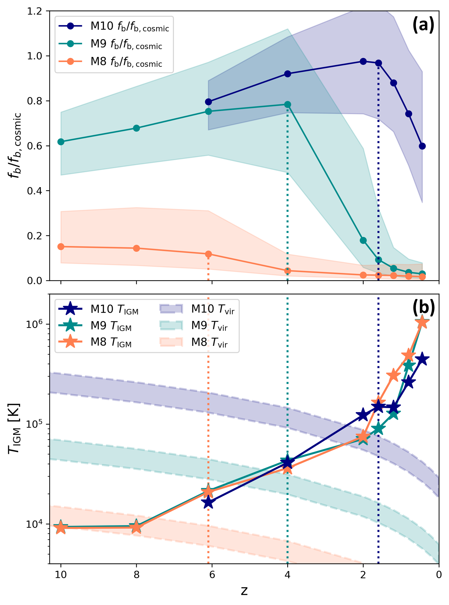

# arXiv Digest — 2026-11-04

- **Interest file used:** interests/2026.09.md (fallback — no 2026.11.md exists yet)
- **Categories pulled:** astro-ph.CO, astro-ph.EP, astro-ph.GA, astro-ph.HE, astro-ph.IM, astro-ph.SR, cs.LG, stat.ML, hep-ph
- **Papers scanned:** 400 (107 astro-ph new/cross + 293 cs.LG/stat.ML/hep-ph)
- **After first filter:** 27 candidates reviewed with full text
- **Final selected:** 14 papers across 4 tiers

---

## Tier 1 — Highly relevant

### [Measuring the ultraviolet background at $z\simeq3$ from the quasar proximity effect in DESI DR1](http://arxiv.org/abs/2611.04316v1)

Patrick Shaw, Rupert A. C. Croft
**Primary category:** astro-ph.CO

This is the first proximity-effect measurement of **the hydrogen photoionization rate of the UV background, Γ_HI**, in DESI. It stacks 6,245 DR1 quasars at 2.75 ≤ z < 3.25. Continua come from a PCA trained on HST/COS spectra that uses only red-side information, then mean-flux regulation against the forest outside the proximity zone. The stacked transmission profile is fit with **a halo model that includes both quasar radiation and extra absorption from the overdense quasar environment**, with the environment term pinned by independent DESI quasar clustering bias. Calibrating against matched Astrid mocks gives **Γ_HI = (1.376 +0.095/−0.076) × 10⁻¹² s⁻¹ at z ≃ 3**, about 17% below Dall'Aglio et al. (2009), as expected once environmental absorption is modeled. The **systematic error is roughly 8× the statistical one** (+0.84/−0.52 × 10⁻¹² s⁻¹). It is dominated by continuum reconstruction, mock calibration, the ionizing spectral slope and redshift offsets, so quasar-continuum modeling is now the limiting factor.

*Stacked DESI transmission in seven radial bins around the quasars, after continuum correction. The halo model, with radiation enhancement plus environmental absorption, fits the profile under both the clustering-based and profile-fit quasar bias.*

### [Ly$α$ in Compact Broad-Line Emitters, Including Little Red Dots, Is More Closely Linked to the Host Galaxy than to the Broad-Line Nucleus](http://arxiv.org/abs/2611.03801v1)

Yongda Zhu, Zheng Ma, Xiaojing Lin et al. (Zhu is a high-value author)
**Primary category:** astro-ph.GA | also: astro-ph.CO

Deep JWST/NIRSpec spectra from the DIVER program cover 12 compact broad-line emitters (LRDs, little blue dots and other broad-line AGN) at z = 4.2–5.5 in GOODS-N, and six are detected in Lyα. Lyα does not follow the broad-line region: strong-Hα/UV sources include non-detections, and **every detected Lyα line (FWHM ≈ 300–1000 km/s) is narrower than broad Hα (1100–3300 km/s)**. Instead, **observed Lyα tracks the Lyα predicted by an AGN-subtracted host-galaxy SED fit**, in both EW and luminosity, and exceeds it by a factor of 1.5–18. The **median effective Lyα escape fraction is only 0.09**, which suggests these objects typically leak few ionizing photons. That bears on how much JWST-era broad-line AGN contribute to the reionization photon budget.

*Observed Lyα against the Lyα of the dust-attenuated host SED model, in EW (a) and luminosity (b); the host model uses no Lyα data. The detections sit above the equality line (by 1.5–18×) but follow its trend, so Lyα follows the host better than it follows the broad-line nucleus.*

---

## Tier 2 — Adjacent / useful context

### [Revisiting the Missing Baryon Problem: Baryon Redistribution Across Halo Evolution](http://arxiv.org/abs/2611.03814v1)

Changjo Seo, Seyoung Jeon, Emanuele Contini et al.
**Primary category:** astro-ph.GA

The authors follow halo baryon fractions through merger trees and gas tracer particles in the NewCluster zoom simulation. They find three phases: **cold-accretion growth in low-mass halos, supernova-driven suppression, and recovery in massive halos via hot-mode accretion**. For 10⁸–10¹⁰ M☉ halos, **suppression begins only after the surrounding IGM (1–2 R_vir) stays hotter than the halo virial temperature for an extended period**. That is a delayed, filtering-scale-like response to reionization heating. At fixed mass, baryon-rich halos sit preferentially closer to filaments, which links the IGM thermal state directly to how much gas small halos keep.

*(a) Median baryon fraction of 10⁸, 10⁹ and 10¹⁰ M☉ halo samples against redshift; (b) IGM temperature within 1–2 R_vir compared with each sample's virial temperature. Dotted lines mark the onset of suppression, which comes after the IGM has stayed above T_vir for a while.*

### [UV spectra of little red dots: Broad-line N/C, gas recycling and black hole masses](http://arxiv.org/abs/2611.05349v1)

Albert Sneppen, Darach Watson, Lucy R. Ivey et al.
**Primary category:** astro-ph.GA

The authors interpret deep JWST SPURS rest-UV spectra of four LRDs with Sirocco radiative-transfer models of black holes accreting inside dense gas cocoons. In the models, N and C ions of the same charge occupy the same gas. The **broad N IV]/C IV and N III]/C III] ratios therefore jointly constrain density and abundance**: for GN-2 at z = 7.19 they give **N/C = 12 (+3/−2) times solar** at log n_e ≈ 9.7, and n_e < 2×10¹⁰ cm⁻³. Absorption-line blueshifts rise with ionization potential. A ballistic flow near escape speed reproduces this ordering and implies **M_BH ≈ 10⁶–10⁷ M☉ accreting near Eddington**. The absorption lines are saturated and spatially stratified, so apparent-optical-depth abundances such as the reported Al-rich, Mg-poor pattern can be artifacts.

### [Beyond just a torus? Re-contextualising the AGN type paradigm using data-driven host galaxy quenching histories](http://arxiv.org/abs/2611.05353v1)

Sahyadri D. Krishna, Vivienne Wild, Paul C. Hewett et al.
**Primary category:** astro-ph.GA

**Mean-field independent component analysis (MFICA)** separates the AGN and stellar light in about 3,000 SDSS DR7 Type-1 and Type-2 AGN spectra, matched in redshift (0.16–0.4) and [O III] luminosity. This yields host star-formation histories even for Type-1s, which usually outshine their hosts. **Only ~10% of hosts have recently and rapidly quenched after a starburst**, with Type-2 hosts quenching at most ~100 Myr more recently than Type-1 hosts. In the other ~90%, **Type-2 hosts have slightly younger stellar populations**. The authors offer three explanations: torus covering factor tied to stellar population, host-galaxy obscuration, or evolution in AGN type. The method is a working example of data-driven component separation on survey quasar and AGN spectra.

### [SBi3PCF: cosmology with Dark Energy Survey Year 3 cosmic shear](http://arxiv.org/abs/2611.05367v1)

David Gebauer, Anik Halder, Zhengyangguang Gong et al.
**Primary category:** astro-ph.CO

This is the first data analysis of the integrated three-point shear correlation function ζ±, and the **first simulation-based inference of a three-point cosmic shear statistic on survey data**. The forward model is built on CosmoGridV1 and includes mask, noise, intrinsic alignments, baryons, photo-z and shear calibration. The analysis was blind: coverage, learned-likelihood accuracy and simulation-calibrated internal consistency tests were all passed before unblinding. ζ± is detected at **S/N = 12.8**. Jointly with ξ± it gives **S₈ = 0.784 (+0.024/−0.021)**, Ω_m = 0.272 (+0.038/−0.033) and w₀ = −1.04 (+0.25/−0.19), and **adding ζ± improves the Ω_m–S₈–w₀ figure of merit by 1.59×**. It serves as an end-to-end template for blinded SBI with a learned likelihood on a non-Gaussian statistic.

### [Stress-Testing Small-Scale Cosmological Inference With Empirical Galaxy--Halo Connection Models](http://arxiv.org/abs/2611.04419v1)

Hanyue Wang, Kate Storey-Fisher, Philip Mansfield et al.
**Primary category:** astro-ph.CO

Using the new multi-cosmology Aemulus-β suite, the authors fit SHAM and HOD models to small-scale (down to 0.5 Mpc) clustering of a UniverseMachine mock and infer S₈ by cosmological evidence modeling. **SHAM recovers S₈ without bias at ~2–3% precision**, regardless of how disrupted subhalos are treated. **HOD models, even with assembly bias, give 6–11% precision and can be offset by ~1σ.** Environment-based assembly bias costs nearly a factor of two in S₈ precision. The authors read HOD flexibility as able to absorb a misspecified assembly-bias model, so a better clustering fit is not evidence of a correct galaxy–halo connection. SHAM also predicts the held-out higher-order statistics better.

### [3D dark matter map of the JWST COSMOS-Web field using diffusion-based generative priors](http://arxiv.org/abs/2611.03786v1)

Diana Scognamiglio, Brandon Zhao, Katherine L. Bouman et al.
**Primary category:** astro-ph.CO | also: cs.LG

The authors reconstruct the 3D matter field in the 0.54 deg² COSMOS-Web field from JWST weak lensing (121 galaxies/arcmin²). They combine **a physical lensing forward model with a diffusion-model prior trained on Conicus3D simulations**, and posterior sampling recovers the field on 20 lens planes **out to z ≃ 2**, double the reach of the earlier HST-based 3D maps. The reconstruction separates structures that overlap in projection and recovers clusters missed by the earlier HST map. Null tests with 128 randomized-shape reconstructions, held-out simulations and PSF-leakage tests show the structures are lensing-driven and consistent with fiducial ΛCDM. The **posterior samples carry structure-level uncertainty**, which makes this a clear real-data case for diffusion priors in field-level inverse problems.

*Posterior-mean overdensity in five redshift slices (z = 0.13–1.25) over a common footprint, with independently detected clusters overplotted. Different structures light up in different slices, which shows the line-of-sight separation a 2D mass map cannot give.*

### [Macrocanonical Generator Networks: Data-Efficient Neural Surrogates for Amortized Physics Simulation](http://arxiv.org/abs/2611.05157v1)

Niall Jeffrey, Benjamin D. Wandelt
**Primary category:** cs.LG | also: astro-ph.CO

The authors train a neural generator to match multiscale feature statistics, such as wavelet phase harmonics, **in expectation rather than per sample**. This amortizes Bruna–Mallat microcanonical synthesis into one forward pass while keeping realistic sample-to-sample fluctuations. They prove that gradient-descent training induces preconditioned sample-space dynamics that inherit the symmetry preservation of microcanonical descent. They also show that **identity-initialized residual generators with small learning rates preserve entropy early in training and avoid mode collapse**. On cosmic-web and MHD fields the generators **learn from as little as one training example** and are >10⁶× faster per sample than the simulator. Pretraining SBI of Ω_DE on these surrogates makes inference tractable where the real-simulation budget alone is too small. The main limitation is that the method requires stationary, periodic fields.

### [A Circuit for In-Context Learning](http://arxiv.org/abs/2611.05344v1)

Andrew Gao, William Gao
**Primary category:** cs.CL | also: cs.LG

This is a complete causal account of few-shot classification with arbitrary labels in three 3–4B transformers: **a gated key-value memory over label-token positions**. Middle-layer heads write the preceding sentence's class into each label token as a key. Upper-layer "reader" heads match the query's class against those keys and copy out labels. An early signal that some label has repeated opens the read by lowering the readers' attention-sink logit, and separate "brake" heads suppress the most recent label. Every link is backed by **activation patching, ablations against random-head baselines, and steering with the model's own signals**. A two-constant-per-head softmax law of the readout transfers across prompt distributions. The same parts appear from 0.6B to 8B, survive instruction tuning, and **emerge in order in a model trained from scratch**. The authors also report failed predictions, which makes this a strong methods reference for attention attribution.

*The circuit in Qwen3-4B-Base. Writer heads give each label token a class key, reader heads match the query against the keys and copy labels, copiers write the logits, brakes push against the latest label, and a pooled gate opens the read.*

### [Structure, Dimensionality, and Distribution Shape - What Makes Pretraining Data Transferable, and Why the Input Pipeline Decides Which](http://arxiv.org/abs/2611.04106v1)

Sangyoon Bae, Jiook Cha
**Primary category:** cs.LG

The paper describes a pretraining corpus by three properties: structure, dimensionality and the per-unit value distribution. It argues the **model's input transform, not the data modality, decides which properties matter for transfer**. TransferForge, a generator that sets each property independently (unlike Chronos's KernelSynth), tests this. With per-window standardization (PatchTST on UCR), distribution shape is inert, and **synthetic pretraining matches a same-size real corpus and beats it once scaled**. With unnormalized calcium signals (POYO Plus), shape governs, and **a shape-matched synthetic corpus replaces real pretraining with zero real data**. Flipping only the normalization changes the shape effect by 5.3×. For spectral foundation models this gives a concrete recipe for deciding which properties a synthetic pretraining set (e.g. simulated spectra) must match.

### [Post-stratified importance sampling](http://arxiv.org/abs/2611.05238v1)

Yuling Yao, Sergei Tikhonov
**Primary category:** stat.ME | also: cs.LG

Borrowing from multilevel regression and poststratification in survey sampling, **PIS turns arbitrarily high-dimensional importance weighting into two 1D problems**: regressing the integrand on the importance ratio, and estimating the ratio's marginal density. Ordinary IS is a special case. The model-based version uses **1D Gaussian-process regression plus score-informed heavy-tailed density estimation**, drawing on both the weights and the available density evaluations. The authors prove consistency and characterize oracle gains. Simulations and leave-one-out cross-validation show more accurate estimates and **standard errors that are actually usable**, which plain IS lacks when weights are heavy-tailed.

---

## Tier 3 — Outside my area but notable

### [The Survival Paradox of Close-In Planets Orbiting Red Clump Giants](http://arxiv.org/abs/2611.04544v1)

Wen-Xu Lin, Sheng-Bang Qian, Qi-Bin Sun et al.
**Primary category:** astro-ph.EP | also: astro-ph.SR

Tidal-engulfment theory predicts that planets within ~1 au of Sun-like stars are swallowed during red-giant-branch expansion. Before this paper, only one "forbidden" survivor around a core-helium-burning star was known. Asteroseismology now confirms **three more planet hosts as red-clump giants**: 24 Boo, HD 12648 and TYC 4282-605-1. Their planets orbit **inside the maximum radius their stars reached on the RGB**, including 24 Boo b at **0.183 au (30-day period)**, the closest known planet around a red-clump giant. Single-star orbital-evolution models cannot keep them. The authors point to binary or merger histories, or re-formation from a disk of engulfed planetary material, so a class of survivors suggests missing physics in star–planet coevolution.

---

## Tier 4 — Meta-research about the field

### [A semi-autonomous multi-agent pipeline for high-energy astrophysics research with enforced provenance and verifiable self-extension](http://arxiv.org/abs/2611.05251v1)

Fang Zhou
**Primary category:** astro-ph.IM | also: astro-ph.HE

auto_research is an LLM multi-agent pipeline that pulls HEASARC data, writes and keeps its own analysis tools, and is designed against agents fabricating numbers. **New tools must pass automatic checks and a cross-provider model code review before a human promotes them.** **Any number in a report must appear in a recorded tool output, the request, or a cited paper.** The quantitative results are sobering. **Of 65 planted defects, 47 passed the automatic checks** and one also passed review, while the reviewer **rejected 40 of 69 correct changes**. The pipeline reproduces all 14 published IXPE Cyg X-1 quantities within 3σ. The author states that provenance enforcement establishes where a number came from, not whether it is correct, which is a useful framing for anyone deploying agents on real analyses.
