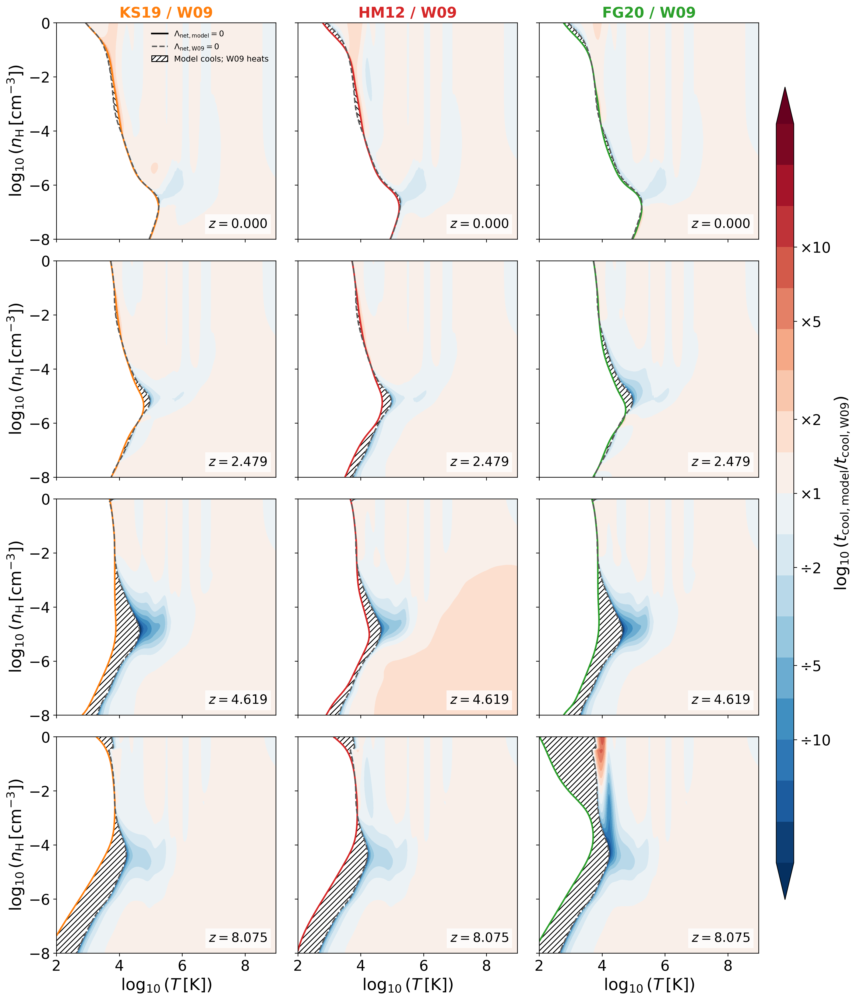
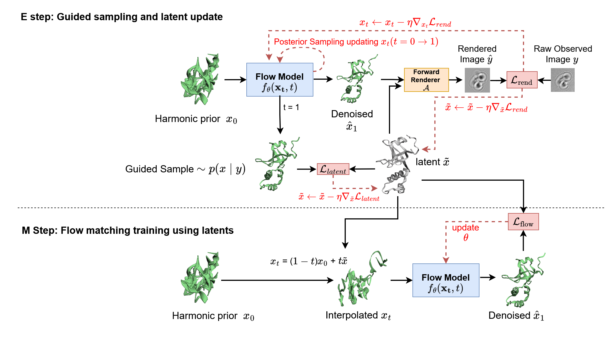

# arXiv Digest — 2026-11-05

- **Interest file used:** interests/2026.09.md (fallback — no 2026.11.md exists yet)
- **Categories pulled:** astro-ph.CO, astro-ph.EP, astro-ph.GA, astro-ph.HE, astro-ph.IM, astro-ph.SR, cs.LG, stat.ML, hep-ph
- **Papers scanned:** 409 (105 astro-ph new/cross + 304 cs.LG/stat.ML/hep-ph)
- **After first filter:** 27 candidates reviewed with full text
- **Final selected:** 11 papers across 3 tiers

---

## Tier 1 — Highly relevant

### [Net Cooling Tables for Cosmological Simulations under Multiple UV/X-ray Background Models](http://arxiv.org/abs/2611.06360v1)

Laura Di Federico, Klaus Dolag, Ildar Khabibullin et al.
**Primary category:** astro-ph.GA

The authors recompute element-by-element **cooling, heating and net-rate tables with CLOUDY 23.01 for three UV/X-ray backgrounds (HM12, KS19, FG20)**, in the Wiersma+09 format but with an extended helium-fraction grid and 13 individually tabulated metals, for optically thin gas in photoionization equilibrium. Against the widely used W09 (HM01) tables, the differences are negligible at z=0 but grow with redshift in exactly the diffuse-IGM regime: W09 equilibrium temperatures are **hotter by a median 0.24–0.42 dex at z≈4.6 and 0.72–0.82 dex at z≈8**, and cooling times near the equilibrium boundary differ by up to a factor ~10. **The tables disagree on whether gas heats or cools over ~9–10% of the diffuse density–temperature plane at z≈8.** The caveats are large for thermal-history work: uniform UVB, no self-shielding or non-equilibrium ionization (so not valid during reionization), and no propagation to T₀, γ or forest statistics.

*Cooling-time ratio of the new tables to W09 across the density–temperature plane at four redshifts: near-identical at z=0, but differing by up to an order of magnitude near the equilibrium boundary in diffuse gas at z≳4.6. Hatched regions are where the models disagree on the sign of the net rate.*

---

## Tier 2 — Adjacent / useful context

### [The PAU Survey: Self-supervised image denoising for flux-preserving photometry](http://arxiv.org/abs/2611.05447v1)

J. Chen, M. Eriksen, D. Navarro-Gironés et al.
**Primary category:** astro-ph.IM | also: astro-ph.CO

The paper applies Noise2Void to real PAUS narrow-band images and shows that **standard self-supervised denoising badly underestimates faint-galaxy fluxes** (flux ratio peaking at ≈0.36 for 21.5 ≤ i < 23) despite excellent image-quality metrics. A bounded ELU output layer restores the flux scale (peak ≈0.98), and **LoRA fine-tuning with differentiable aperture photometry and flux-aware losses** cuts repeat-exposure flux scatter to **σ₆₈ = 0.529 (≈47% reduction)** in all 40 bands. The loss directly optimizes the same repeat-exposure consistency used as the headline metric, and a band-dependent flux tilt still biases D4000 by ~7%. This is the right cautionary tale for anyone denoising low-SNR spectra or forest pixels: evaluate with the downstream physical statistic, not image metrics.

### [Planting neutrino SE-EdS: A < 3% accurate clustering approximation for neutrinos and other hot dark matter](http://arxiv.org/abs/2611.06399v1)

Amol Upadhye, Yvonne Y. Y. Wong
**Primary category:** astro-ph.CO | also: hep-ph

SE-EdS is a closed-form linear-response fit for the **neutrino-to-matter density contrast**, exact in Einstein–de Sitter and with time dependence entering only through D(a)/a. It is **< 3% accurate for 0.2 ≤ Ω_m0 ≤ 1, Ω_ν0 ≤ 0.018, |Ω_K0| ≤ 0.1 and w₀ ≤ −0.6** at all scales, and ≤1% against CLASS for the fiducial cosmology and for the DESI best-fit w₀w_a at small Ω_ν0. Because neutrinos are ≤3% of the matter, this lets you **paint neutrinos into N-body (or hydro) runs in Fourier space with < 0.1% error on the total density contrast** at negligible cost. It is linear only and fails for early dark energy; public code is on codeberg.

### [Mixture of Wide Experts: Sparse Routing for Interpretable Native Coordinates](http://arxiv.org/abs/2611.03655v1)

Tavish Mankash, Vardhaman Kalloli, Keshava Prasad et al.
**Primary category:** cs.LG | also: cs.CL

MoWE is a sparse feed-forward layer in which **routed experts read the full residual but write only to fixed, disjoint output coordinates**, so each native coordinate has a single owner. In 19-layer LMs trained on 10B tokens it slightly beats dense on loss (2.417 vs 2.452; standard MoE 2.220 with more parameters). **Native-coordinate specificity, scored by an LLM judge, is 0.523 vs 0.375 for dense and 0.268 for MoE**, comparable to a TopK SAE trained post hoc on the dense model. Case studies use a handful of coordinates to causally redirect predictions and trigger refusals, though they were selected post hoc. This is a cheap architectural prior for getting readable features out of a spectral transformer without a separate SAE.

*Native-coordinate specificity across depth: MoWE beats dense and standard MoE in 18 of 19 layers (A), and on average its raw coordinates are about as interpretable as SAE features fitted to a dense model (B). Sparse routing alone (MoE) does not help.*

### [Empirical Bayes Flow Matching for Continuous Cryo-EM Heterogeneity](http://arxiv.org/abs/2611.05202v1)

Daniel Aibinder, Azmi Haider, Dan Rosenbaum
**Primary category:** cs.LG | also: q-bio.BM

EB-FM **learns a flow-matching prior directly from indirect, noisy observations through a known, possibly non-linear forward operator**, using Monte Carlo stochastic-approximation EM. The E-step draws guided posterior samples and updates a persistent per-observation latent by EMA; the M-step trains the flow on those latents. No clean training data and no linear-Gaussian assumption are needed. **Persistent latents are what make it work:** on lifted two-moons only EB-FM recovers the distribution from 8 measurements. On simulated cryo-EM it beats a VAE and AlphaFold-based baselines on three of four proteins in EMD-RMSD, though it underestimates motion amplitude and assumes known poses. The template maps cleanly onto learning a data-driven prior over quasar continua or forest fields from noisy, resolution-convolved spectra.

*The EB-FM loop: each observation keeps a persistent latent that tracks its posterior mean via guided sampling through the differentiable forward model (E-step), and the flow prior is retrained on those latents in place of clean data (M-step).*

### [Tokenizer Myths and Where To Find Them](http://arxiv.org/abs/2611.04215v1)

Rylan Schaeffer, Sanmi Koyejo
**Primary category:** cs.CL | also: cs.LG

The paper dismantles three common claims about tokenizer evaluation. **Bits-per-byte is not tokenizer-agnostic**: it factorizes into tokens/byte × bits/token, so even untrained uniform models get a BPB minimum at a particular vocabulary size. Lower BPB does not imply a better model: across 81 tokenizers untrained MMLU stays at chance while BPB ranges from 4.34 to 10.00, and trained-model BPB correlates weakly with downstream scores. The published **r = 0.989 agreement between "tokenizer-agnostic" metrics is a model-size confounder that falls to r = 0.057** within sizes. A trilemma theorem says no metric can satisfy all three desiderata at once. If you compare spectral tokenizations (patch size, VQ codebook) by per-token loss, always report the untrained baseline.

*For untrained models outputting uniform distributions, bits per token rises and tokens per byte falls with vocabulary size, so their product (BPB) has a minimum: the metric prefers some tokenizers before the model has learned anything.*

### [Transport along Local Annealing Paths: Wasserstein Geometry and Multimodal Sampling](http://arxiv.org/abs/2611.05605v1)

Han Chen, Sifan Liu
**Primary category:** cs.LG | also: stat.ML

The authors show that **geometric annealing paths can take long detours in Wasserstein space when mass must move between modes**, and prove that long paths slow population-level transport learning while Poincaré-regular paths give exponential convergence. Their method, **componentwise annealed transport (CAT)**, starts from a mode-informed Gaussian-mixture base, decomposes the target exactly into components, and learns a simulation-free flow along each component's own annealing path, with separately estimated weights that stay consistent even when the flows are inexact. On benchmarks up to a 502-dimensional LDA posterior it reaches **importance-sampling ESS/N ≈ 0.97–0.99**, about 14× faster than ALPS at matched accuracy. It needs the modes located in advance and struggles with funnels and curved targets.

### [Spectroscopy-informed Deep Learning Searches for Photometric Little Red Dots in JWST Surveys](http://arxiv.org/abs/2611.06026v1)

Chenxuan Zhang, Huanian Zhang, Qingwen Wu
**Primary category:** astro-ph.GA

The authors build an AstroCLIP-style **contrastive alignment of NIRCam image cutouts and NIRSpec PRISM spectra**, then freeze the encoders and train an imaging-only head to identify little red dots. Spectroscopic information is thus distilled into the image embedding. Validation **recall rises from 0.84 (image-only CNN) to 0.92**, though on only 25 positives. Among spectroscopically observed "non-LRDs" the model flags 35 candidates, and **10 of the 13 with grating spectra show broad Hα**. It also yields 357 candidates in the Dawn JWST Archive that extend beyond standard colour cuts. There is no ablation isolating the contrastive pretraining, and purity in the external surveys is unknown.

### [One Mistake, Three Layers: Persistence Rules Under Depth Correlation](http://arxiv.org/abs/2611.03968v1)

Maryam Rahimimovassagh, Michael Brown, Sanjeda Sara Jennifer et al.
**Primary category:** cs.LG | also: q-bio.QM

The paper shows that the standard rule for reporting where a probed signal "first becomes decodable" (above a null threshold for three consecutive layers) **reports onset nineteen stages early under transformer-like correlation between neighbouring layers**. In the authors' real-data null the three-layer rule fires 12–17% of the time instead of the nominal 5%. Their fix uses **permutation nulls held fixed across depth, per-layer order-statistic thresholds and a calibrated five-layer persistence**. Applied to the Boltz-1 co-folding trunk, pocket information turns out to be decodable at every block, so onset says nothing about the regimes; accumulation depth does. This is directly relevant if you plan layer-wise probes of a spectral foundation model.

---

## Tier 4 — Meta-research about the field

### [CosmoVerse Data Challenge: How Tip of the Red Giant Branch Analysis Choices Shape the Inferred Hubble Constant](http://arxiv.org/abs/2611.05468v1)

Siyang Li, Eleonora Di Valentino, Jackson Levi Said et al.
**Primary category:** astro-ph.GA | also: astro-ph.CO

In this open challenge, 22 participants produced 26 independent sets of TRGB distances from public HST photometry, all converted to H₀ with a common SN Ia notebook. **The submissions scatter with σ = 7.38 km/s/Mpc around a median of 77.10, ~3.4× their typical quoted uncertainty.** About 60% of the variance comes from **calibrator-galaxy selection, driven by four galaxies with weak tips**. The anchor-tip scatter alone is worth ~3 km/s/Mpc. The authors stress that the challenge was unblinded and run largely by trainees, so it is not an H₀ measurement or a systematics estimate, but it is a clean demonstration of how analysis degrees of freedom propagate.

*H₀ from all 26 submissions: the spread across analysis choices far exceeds each submission's formal ±1σ error, with an asymmetric high tail tied to calibrator choice.*

### [Object-independent evaluation of small-data astronomical image classifiers: architecture, representation, and acquisition shortcuts](http://arxiv.org/abs/2611.06484v1)

Eraldo Pereira Marinho
**Primary category:** astro-ph.IM | also: cs.CV

This is a deliberately controlled audit of a small four-class DSS image task, with object-grouped splits, a one-pass test, three architectures and pixel-free controls. Balanced accuracy is 0.77–0.87, but **no architecture comparison survives Holm correction**. **Metadata-only controls (field of view, pixel scale, catalogue extent) reach 0.72–0.74** and centre-masked images reach up to 0.80. The point is general: in small astronomical datasets, high accuracy cannot be read as the classifier having learned morphology, and architecture comparisons are confounded with pretraining.
