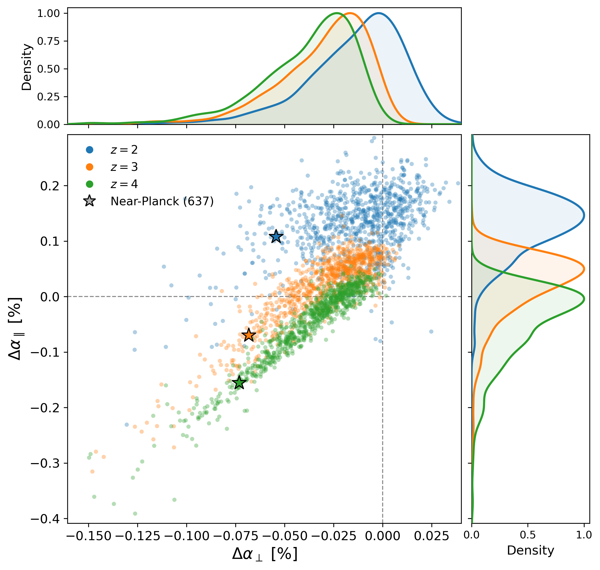
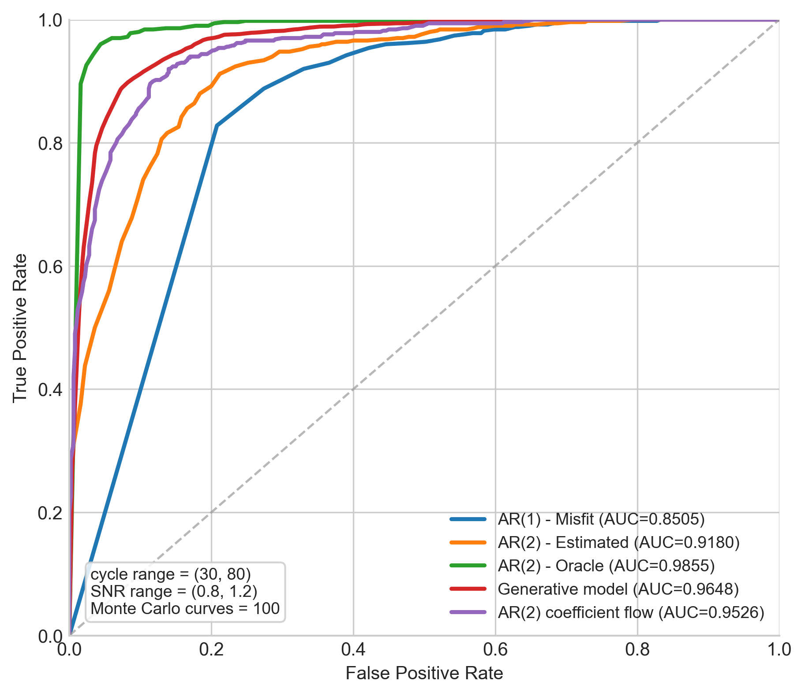

# arXiv Digest — 2026-11-13

- **Interest file used:** interests/2026.09.md (fallback — no 2026.11.md exists yet)
- **Categories pulled:** astro-ph.CO, astro-ph.EP, astro-ph.GA, astro-ph.HE, astro-ph.IM, astro-ph.SR, cs.LG, stat.ML, hep-ph
- **Papers scanned:** 660 (252 astro-ph new/cross + 408 cs.LG/stat.ML/hep-ph)
- **After first filter:** 28 candidates reviewed with full text
- **Final selected:** 14 papers across 3 tiers

---

## Tier 1 — Highly relevant

### [Simulation-Based Priors and BAO Shifts from the Lyman-$α$ Forest at the Field Level](http://arxiv.org/abs/2611.17299v1)

Divij Sharma, Roger de Belsunce, Mikhail M. Ivanov (de Belsunce & Ivanov: forest-EFT group)
**Primary category:** astro-ph.CO

The authors extend the field-level EFT forward model of the Lyα flux to **cubic order in perturbation theory (22 Lagrangian bias operators)**. They validate it on Sherwood and the 1024-simulation CAMELS-SB35 suite at z = 2–4, which varies cosmology, astrophysics and the UV background. It reproduces P3D to **~5% down to k ≈ 1–1.5 h/Mpc**, up to 40% better than the quadratic model, and it keeps the Fourier phases at the few-percent decorrelation level. Cosmic-variance cancellation gives precise bias measurements for every simulation. The paper turns these into **joint simulation-based priors on the EFT nuisance parameters for DESI P3D/P1D full-shape analyses**. The same biases predict **sub-percent nonlinear BAO shifts**: median (Δα⊥, Δα∥) = (−0.01%, +0.14%) at z = 2 and (−0.03%, −0.03%) at z = 4, with a clear dependence on cosmology. The cubic model also contains the tree-level trispectrum, so it can generate mocks for covariance estimation.

*Nonlinear BAO shifts predicted for each CAMELS-SB35 simulation at z = 2, 3, 4. Both shifts stay well below 1% across the whole cosmology/astrophysics range. Radial and transverse shifts become more correlated at higher z, and the radial shift changes sign from positive at z = 2 to negative at z = 4.*

### [The 21 cm-Lyman-$α$ forest cross-power spectrum with a minimal effective field theory](http://arxiv.org/abs/2611.17177v1)

G. Autieri, V. Iršič, M. Viel (Iršič, Viel: high-value)
**Primary category:** astro-ph.CO

The paper tests whether a **minimal EFT (tree-level Kaiser plus leading counterterms and stochastic terms)**, previously validated for the Lyα auto-spectrum, can jointly describe the 21 cm auto-, Lyα auto- and 21 cm × Lyα cross-spectra. The test uses the Sherwood 80 h⁻¹Mpc box with HI painted onto halos at z = 2.4–4.2, and Zel'dovich control variates reduce the sample variance. With scale cuts of k_max = 0.5, 1.2 and 2.0 h/Mpc, the mEFT fits all three spectra at all five redshifts. It recovers **b_HI to 2.0–2.5% and the Lyα density bias to 2.1–2.3%**, and the cuts follow the HI velocity dispersion and the Lyα pressure-smoothing scale. One caveat matters for forecasts: with T_b left free, fits that include the cross-spectrum **prefer brightness temperatures 20–30% too high (1–2σ)**, and a prior on b_HI is needed to recover the truth.

### [A Mechanistic Interpretability Study of an Astronomy Foundation Model](http://arxiv.org/abs/2611.15653v1)

Rachel C. Zhang, Alberto Bietti, Wes Gurnee et al. (incl. Cranmer: high-value)
**Primary category:** cs.LG | also: astro-ph.IM

This is the first **causal mechanistic-interpretability study of a scientific foundation model (AION-1)**. It targets why adding images to photometry improves redshift readouts from the frozen encoder. The gain is concentrated in spatially extended and dust-attenuated galaxies, and **most of it enters in the first of 12 encoder blocks**. In that block, linear decodability and causal importance come apart in opposite ways. Spatial extent is causally used but distributed: the head that probes it best can be ablated with negligible effect, and the property becomes decodable again one layer after erasure. Dust is the reverse: it is barely decodable, yet **a single head (Head 3) is necessary and nearly sufficient for the dust-graded multimodal advantage**, and none of the astrophysically motivated operations tested explains what it computes. This bears directly on interpreting a quasar-spectrum transformer: strong probes do not localize computation, and null ablations do not show that information is unused.

*Redshift R² by dust-attenuation quintile. Zeroing Head 3 removes most of the image-driven gain for dusty galaxies, while keeping Head 3 as the only active block-1 head preserves nearly all of it. That localizes the dust computation to one head without explaining it.*

### [Moving Beyond the DRW Model: Learning Quasar Variability with Generative Models](http://arxiv.org/abs/2611.15040v1)

Nadav Bojan Sellam, Kevin Park, Alex Bronstein et al. (Haiman group)
**Primary category:** astro-ph.GA | also: cs.AI

The paper replaces the damped-random-walk null hypothesis used in quasar periodicity, changing-look and reverberation-mapping work with **Nullasar, a conditional flow-matching generative model that learns stochastic light-curve variability from data**, with InfoNCE and consistency auxiliary losses. On synthetic sets it reproduces DRW PSDs and Fourier-amplitude statistics. It also learns correlated distributions of AR(2) coefficients without assuming a noise model. As a null for periodic-signal searches it matches a correctly specified DRW fit. When the true process is AR(2) it **beats per-curve parametric fitting (AUC 0.965 vs 0.918, oracle 0.986)**, because fitting AR(2) to each curve absorbs the injected sinusoid. The main weakness is **sensitivity to contamination of the training set by real periodic signals, already at 0.5%**. Projecting the conditioning vector onto its leading principal components largely fixes it.

*ROC curves for detecting injected sinusoids in AR(2) light curves. The learned null comes close to the oracle, while fitting AR(2) to each light curve is too permissive because the flexible fit absorbs part of the periodic signal.*

---

## Tier 2 — Adjacent / useful context

### [Transient early reionization allows for a high optical depth while remaining consistent with kSZ measurements](http://arxiv.org/abs/2611.16005v1)

Prakhar Bansal, Nicholas Kern, Dragan Huterer
**Primary category:** astro-ph.CO

A high **τ ≈ 0.09** would weaken DESI's preference for dynamical dark energy and for a low neutrino mass. Standard monotonic histories that reach it conflict with the Lyα-forest end of reionization and with kSZ limits. Using a self-consistent semi-numerical model of **supermassive Pop III stars that briefly ionize the IGM at z ≈ 20–25**, the authors show τ can rise from 0.060 to 0.096 without moving the end of reionization (5.3 ≲ z ≲ 6). The flash relics put kSZ power at small scales and lose their host-halo bias, so the model stays within SPT pkSZ limits. A forecast for **Simons Observatory + Lyα forest + UV luminosity functions gives σ(τ_{z>12}) ≈ 0.008**. A companion paper (2611.16006) forecasts the 21 cm signatures of the same scenario for SKA.

*Mean ionized fraction for a galaxies-only model (τ = 0.060) and with a Pop III flash (τ = 0.096). The flash adds optical depth at z ≈ 20–25 but leaves the Lyα-forest-constrained end of reionization unchanged.*

### [Cosmic Ray Heating of the Early IGM: Realistic Galaxy Populations, Reduced Efficiency, and 21-cm Signatures](http://arxiv.org/abs/2611.15858v1)

Michael Pagano, Andrei Mesinger, Carmelo Evoli et al.
**Primary category:** astro-ph.CO | also: astro-ph.HE

The authors re-implement cosmic-ray heating of the pre-reionization IGM in 21cmFAST. They use the **momentum power-law injection spectrum from diffusive shock acceleration**, include Coulomb losses, and source the CRs from data-informed atomic- and molecular-cooling galaxy populations. Because **99% of the heat comes from sub-relativistic protons (≲ 40 MeV)**, where a momentum power law puts little energy, CR heating is ≈ 12× weaker at matched efficiency and **≈ 28× weaker at z = 15** with the realistic galaxy model. At efficiencies supernovae can supply, CR heating is subdominant to X-ray heating, and the global signal cannot tell the two apart. A flattened EDGES-like trough would need efficiencies two orders of magnitude above local values.

### [Anatomy of LyC Escape in MEGATRON: Connecting Feedback Physics to Demographics, Leakage Timescales, and Explorations of ISM Density as a Tracer of Escape Fraction](http://arxiv.org/abs/2611.15931v1)

Nicholas Choustikov, Harley Katz, Taysun Kimm et al.
**Primary category:** astro-ph.GA | also: astro-ph.CO

Using MEGATRON zoom simulations with on-the-fly radiative transfer, 81-species non-equilibrium chemistry and several feedback variants, the authors show that **feedback physics jointly sets UV source counts, f_esc and the escaping ionizing luminosity**. These quantities anticorrelate: more UV-bright galaxies does not mean more ionizing photons. The controlling quantity is **the delay between a starburst and the onset of LyC escape**. Efficient early feedback in lower-density gas lets photons escape while the stars are still young and strongly ionizing, so those models reionize earlier with fewer UV sources. Electron densities from [O II] λλ3727 are proposed as an f_esc diagnostic, while UV-slope calibrations **over-predict escaping ionizing photons from young galaxies by up to two orders of magnitude**. This is relevant for interpreting JWST source budgets against forest-based reionization histories.

### [The SDSS-V Black Hole Mapper Reverberation Mapping Project: Short Lags in the COSMOS Field](http://arxiv.org/abs/2611.15166v1)

Zachary Stone, Yue Shen, Scott F. Anderson et al. (Shen: high-value)
**Primary category:** astro-ph.GA

These are the first SDSS-V BHM-RM results in COSMOS. They use six months (2020–2021) of plate-era spectroscopy of more than 250 AGN to z ~ 3, with ZTF+DECam light curves intercalibrated by PyCALI. Combining SDSS-RM and OzDES lag-reliability procedures, the authors recover **28 reliable lags (≲ 200 d) for 22 AGN in Hα, Hβ, Mg II and C IV**, giving **M_BH = 10⁷–10⁹ M☉** consistent with existing R–L relations. The combined procedure recovers more lags than either alone, with SDSS-RM the stricter of the two. This is a small first sample, but robot-era spectra through 2026 will extend the Mg II and C IV lags that matter for high-z quasar samples.

### [VIDE 2.0: Robust, Scalable Void Finding for Extremely Large Galaxy Surveys](http://arxiv.org/abs/2611.14742v1)

Paul M. Sutter, Benjamin D. Wandelt
**Primary category:** astro-ph.IM | also: astro-ph.CO

VIDE 2.0 replaces the boundary-particle treatment of survey edges with **deterministic flagging of edge galaxies and of the voids they contaminate**. It adds an automatic mask-resolution rule, so the Voronoi/watershed pipeline becomes parameter-free and bit-for-bit reproducible. Together with engine optimizations this gives **>100× speedups**: a 12-million-galaxy DESI Y1-class mock runs in about 15 minutes on a laptop, where VIDE 1.0 failed at 10⁶ galaxies. The authors show converged cosmic-variance covariances for the void number function, the void–galaxy cross-correlation and the ellipticity distribution on Patchy DR12 and AbacusSummit DESI Y1 ELG mocks. That makes **void cosmology with full DESI samples computationally routine**.

### [Training Calibrated Conditional Generative Models with a Sample-Only Coverage Loss](http://arxiv.org/abs/2611.15829v1)

Benjamin Remy, Raphael Rossellini, Chihway Chang et al.
**Primary category:** cs.LG | also: stat.ML

The paper introduces **a differentiable expected-coverage loss computed from model samples alone**, so it works for diffusion, flow or GAN posteriors without tractable densities. The authors **prove it is a strict divergence that vanishes only when the model equals the true posterior**, which existing density-based coverage regularizers do not guarantee. On SBI benchmarks it matches a density-based coverage loss at equal model evaluations. On imaging inverse problems, including a nonlinear black-box forward model, it is the only regularizer that calibrates the posterior on all three problems, with little loss in point-estimate quality. The authors explicitly target cosmological SBI next. This is a practical fix for overconfident neural posteriors.

### [Goal Encoding in LLMs](http://arxiv.org/abs/2611.17297v1)

Arnab Sen Sharma, Eric Todd, Sheridan Feucht et al.
**Primary category:** cs.CL | also: cs.LG

In a controlled multi-step code-generation setting, the authors localize **an encoding of the next sub-goal in the outputs of a sparse set of attention heads**. The encoding can be verbalized ("I'm checking if a word is a palindrome") and is causal for the next action. It is also plastic: transplanting it into another programming language triggers the same operation with different tokens. The encoding persists across an action longer than the remaining depth would allow a feed-forward state to be carried. They explain this with **a non-recurrent goal-seeking account: the model repeatedly re-reads the goal from the prompt, compares it with visible progress and acts on the difference**, and they confirm the account with targeted interventions. It is a clean example of attention-head attribution plus activation patching on a multi-step computation.

### [Symmetry in Time: A Representation Theory of Linear Recurrent Memory](http://arxiv.org/abs/2611.17162v1)

Anif N. Shikder, Ramit Dey, Jan Minac et al.
**Primary category:** cs.LG

Using representation theory, the authors prove that **an SSM tracks a group at every length exactly when the group is a quotient of the group generated by its transition matrices**. Diagonal real or complex SSMs (Mamba-style) can therefore track only commutative groups, which explains their reported state-tracking failures. Any tracking SSM must decompose into blocks over ℝ, ℂ and the quaternions ℍ. **HyperSSM** adds quaternion channels while keeping linear-time scans. Trained only on final answers, it solves S₅ with 32 generators exactly where prior SSMs are at chance, and it generalizes to **25× the training length**. Because the theory says what the transitions must encode, the trained weights are directly readable: they recover a real gyroscope's calibration and the rotations of imperfect qubit gates. This matters for choosing a sequence architecture for spectra or time series.

---

## Tier 4 — Meta-research about the field

### [Auditing AI peer reviewers: a benchmark on real scientific papers](http://arxiv.org/abs/2611.17052v1)

Íñigo Zubeldia, Boris Bolliet, Francisco Villaescusa-Navarro et al. (Villaescusa-Navarro, Cranmer: high-value)
**Primary category:** cs.CL | also: astro-ph.IM

The authors inject 357 objective, localizable errors (citations, mathematics, numerics, general) at three severity levels into 30 recent arXiv preprints, half astrophysics and half ML. They then measure detection and false-positive rates for twelve reviewer systems. **Model choice dominates: with the same prompt, frontier LLMs differ by ~50 percentage points in total detection** (e.g. GPT-5.5 61% vs Gemini 3.1 Pro 12% free-form on astrophysics). Tools help only where they supply what the model lacks. On astrophysics, their multi-agent reviewer Skepthical, which retrieves cited papers, runs computer algebra and executes code, reaches **71% total detection and the highest citation-error detection by a wide margin**. That citation advantage disappears on ML papers, where the models already know the literature better. False-positive rates are mostly below 10%, and the benchmark and adjudication logs are released.

### [galpy with differentiable, accelerated backends: galactic dynamics in jax and PyTorch](http://arxiv.org/abs/2611.14614v1)

Jo Bovy
**Primary category:** astro-ph.IM | also: astro-ph.GA

galpy v2 adds jax and PyTorch backends, so potentials, orbit integration, action–angle transforms and distribution functions (including tidal streams) run on GPUs and are differentiable, with **1–5 orders of magnitude GPU speed-ups**. The meta-research content is the detailed methods section: **an AI coding agent (Claude Code) wrote essentially all the code over five months (723 PRs, 696 merged) under the author's direction and review**. The section covers how trust was established: small reviewable PRs, rules against loosening tolerances, 18,807 new backend tests on top of the 4,462 existing ones passing in every mode, and derivatives checked against convergent finite differences and C variational equations. It also reports the work surfaced 40 pre-existing bugs in the NumPy/C code, and it gives costs: about $31k API-equivalent for the agent and about $59k of CI. This is one of the most concrete public accounts of agent-driven scientific software development in astronomy.
