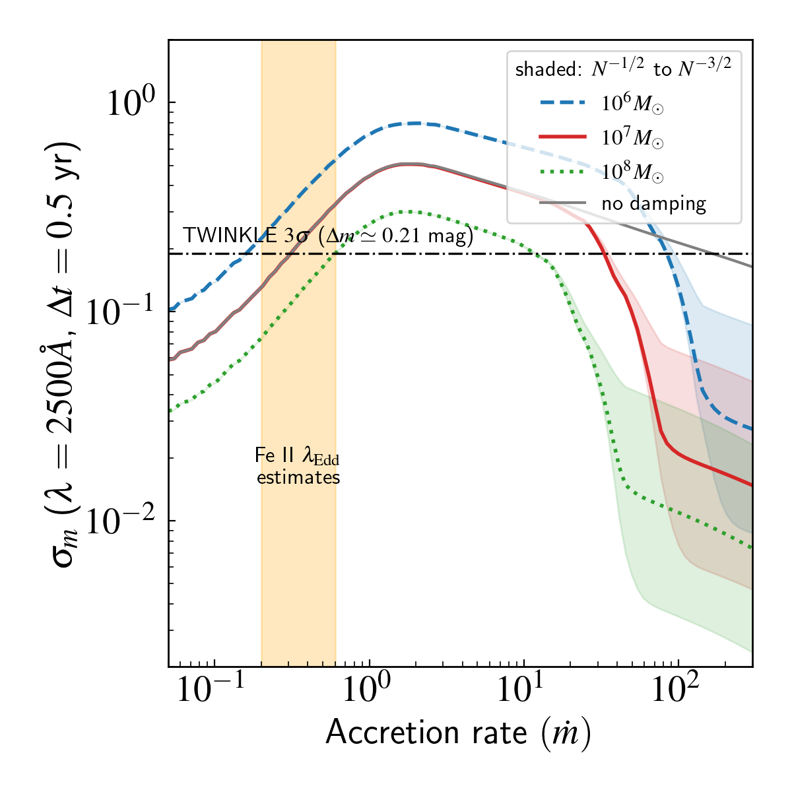
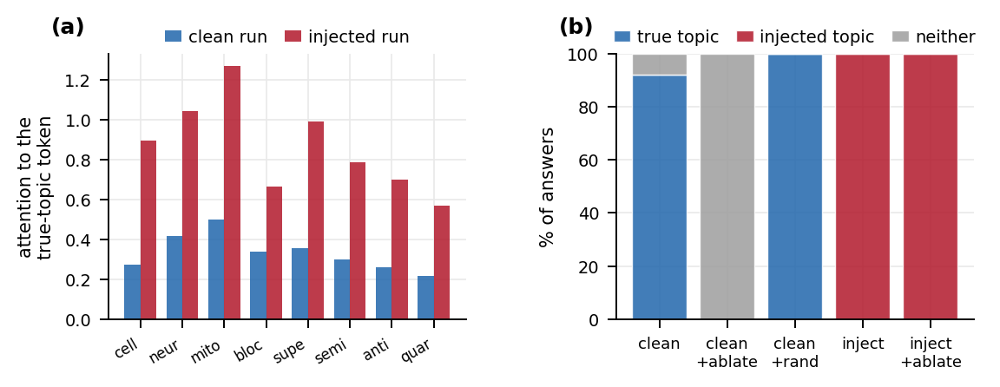
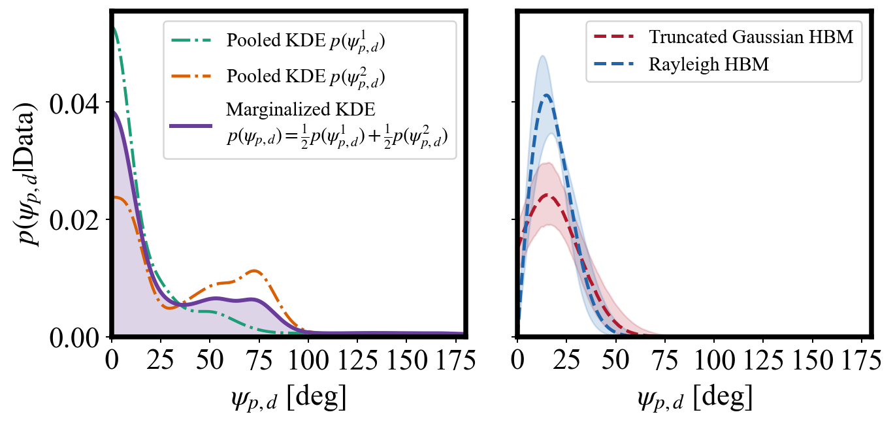

# arXiv Digest — 2026-11-16

- **Interest file used:** interests/2026.09.md (fallback — no 2026.11.md exists yet)
- **Categories pulled:** astro-ph.CO, astro-ph.EP, astro-ph.GA, astro-ph.HE, astro-ph.IM, astro-ph.SR, cs.LG, stat.ML, hep-ph
- **Papers scanned:** 292 (98 astro-ph new/cross + 194 cs.LG/stat.ML/hep-ph)
- **After first filter:** 26 candidates reviewed with full text
- **Final selected:** 14 papers across 3 tiers

---

## Tier 1 — Highly relevant

### [Full-shape analysis of the Lyman-alpha forest power spectrum and bispectrum: validation on simulations](http://arxiv.org/abs/2611.17405v1)

Roger de Belsunce, James M. Sullivan, Mikhail M. Ivanov (de Belsunce & Ivanov: forest-EFT group)
**Primary category:** astro-ph.CO | also: hep-th

The paper builds a **joint EFT full-shape model that combines the one-loop Lyα auto-spectrum (FF), the one-loop forest–quasar cross-spectrum (FQ) and the tree-level Lyα bispectrum (FFF)**, and validates it on Lyα mocks painted onto AbacusSummit at z = 2.5. The bispectrum matters because it **breaks the forest-specific degeneracy between the mean flux and the power-spectrum amplitude**. With baseline cuts of k_max = 0.6/0.3 h/Mpc (FF/FQ) and 0.1 h/Mpc (FFF), cosmology is recovered without bias: in an 8 h⁻³ Gpc³ volume, **H₀ to 0.6%, Ωm to 1.6% and σ₈ to 3.5%**. Adding the bispectrum tightens σ₈ and ln A_s by about 28% and the quadratic biases by 50–70%, and adding the quasar auto-spectrum and bispectrum gains a further ~35%. The paper is set up as the theory pipeline for a DESI / DESI-II Lyα full-shape analysis.

*Cosmological constraints from one Abacus mock, power spectrum alone (blue) versus power spectrum plus bispectrum (red: baseline k_max^B = 0.1 h/Mpc; gray: conservative 0.06 h/Mpc). Both recover the truth without bias. The bispectrum shrinks the σ₈ and ln A_s contours by ~28% but leaves H₀ and ω_cdm unchanged.*

---

## Tier 2 — Adjacent / useful context

### [Reconstruction of Dynamical Dark Energy and Gravity from latest cosmological data](http://arxiv.org/abs/2611.18558v1)

Maria Luisa Gallavotti, Alessandra Silvestri
**Primary category:** astro-ph.CO | also: gr-qc

The authors run a **joint non-parametric reconstruction of the effective dark-energy density Ω_X(a) and the gravitational response functions μ(a) and Σ(a)**, using CMB, DESI DR2 BAO, Pantheon+ and LSS data (including DES Y3 6×2pt). They fit with and without a Horndeski-motivated correlation prior and use a principal-component analysis (CPCA) to separate the directions the data constrain from those the prior sets. The robust feature sits in the background: **a maximum in Ω_X at z ≈ 0.5–0.7, i.e. a phantom-divide crossing**. It is **already present in CMB + BAO alone**, so it does not come from the supernovae. μ and Σ show suggestive low-z enhancements, but adding LSS favours Σ < 1, and the best-constrained modes are background-dominated. Current data therefore cannot say whether the two sectors share a cause. A shorter companion paper (2611.18557) summarises the same analysis.

*Reconstructed Ω_X, μ and Σ (medians, 68% bands) for Baseline and Baseline+LSS, with and without the Horndeski prior. The Ω_X bump near z ≈ 0.6 survives every choice. The μ and Σ deviations are weaker and change direction when LSS data are added.*

### [Probing baryonic feedback using fast radio bursts and galaxy surveys](http://arxiv.org/abs/2611.18512v1)

Haruki Ebina, Martin White
**Primary category:** astro-ph.CO

This is a forecast for how well **FRB dispersion measures cross-correlated with spectroscopic galaxy samples (DESI BGS/LGE)** can constrain the baryonic suppression of the matter power spectrum on the 0.1–1 h/Mpc scales that matter for Stage-IV lensing. Electrons, galaxies and matter are all modelled jointly in **hybrid EFT with a Padé feedback model**. The authors argue the DM–galaxy cross is cleaner than the DM auto-spectrum, DM–shear or kSZ. Galaxy clustering pins down the galaxy bias well enough that **galaxy modelling is not the bottleneck; the higher-order electron biases and the electron–galaxy stochasticity are**, and they keep the forecast from reaching percent-level feedback constraints. The same measurement could also calibrate feedback in hydro simulations without depending on how particular galaxy samples are modelled.

### [The Full-Shape Analysis of the Fading Dark Sector Model](http://arxiv.org/abs/2611.17422v1)

Georges Obied, Cumrun Vafa, David H. Wu
**Primary category:** astro-ph.CO | also: hep-ph, hep-th

The authors add the **DESI DR1 galaxy full-shape power spectrum** to their string-motivated Fading Dark Sector, in which a scalar field drives the dark-energy and dark-matter densities through two O(1) slopes (c, c′). The model also produces a dark-sector fifth force and varying dark-matter masses. With CMB + DESI DR2 BAO + DES-Dovekie, **FDS beats w₀–w_a CPL by Δχ²_MAP = −4 at equal parameter count and is preferred over ΛCDM at 4.1σ**. Without supernovae, the full-shape data raise the preference from 2.5σ to 3.4σ. The fitted (c, c′) do not move, so the improved fit to the growth history is a genuine prediction of the model. The inferred dark fifth force, 2c′² ≈ 0.5% of gravity, **conflicts with recent galactic-warp bounds**; the authors attribute this to core-profile assumptions they say they will address in later work.

### [Constraining Accretion Regimes of Little Red Dots from Their Variability](http://arxiv.org/abs/2611.18153v1)

Indu K. Dihingia
**Primary category:** astro-ph.HE

The paper builds a semi-analytic variability model for **super-Eddington slim disks**. Three effects damp the variability: advective attenuation, photospheric averaging and photon-diffusion filtering. The model is normalised to the observed rms of sub-Eddington quasars and checked against local accretor classes. Above ṁ of a few, the fractional rms collapses steeply. Taking the observed non-variability of LRDs at face value, a Monte Carlo forward model of the TWINKLE non-detections of 18 LRDs requires **ṁ ≳ 60 at 95% confidence**. There is a catch: on current baselines this is **formally degenerate with a frozen sub-Eddington disk (ṁ ≲ 0.1)**. Longer monitoring separates the two cases, because frozen-disk variability grows with baseline while the super-Eddington suppression does not. The model also predicts strongly suppressed X-ray variability.

*Maximum observable rms variability at 2500 Å over 0.5 yr versus accretion rate, for three black-hole masses. Above ṁ ≈ 10 the variability falls well below the TWINKLE detection threshold. Fe II-based sub-Eddington estimates (orange band) would have been detected.*

### [WISE-VAULT: Decade-long Mid-Infrared Variability of WISE AGN](http://arxiv.org/abs/2611.17996v1)

Suvendu Rakshit
**Primary category:** astro-ph.GA | also: astro-ph.HE

The paper uses more than ten years of WISE/NEOWISE photometry to measure **mid-IR variability for ~4.5 million colour-selected AGN**, using amplitudes, excess variance and ensemble structure functions over 0.5–10 yr. It finds **632,939 variable AGN**, 54,897 with ΔW1 > 0.5 mag and 624 with A_var > 0.5 mag. Cross-matches recover 533 known changing-look AGN and several catalogued IR flares. In the ensemble structure function, **variability amplitude anti-correlates strongly with Eddington ratio**, radio-detected AGN vary most, and there is a weak positive trend with radio loudness. The public catalogue is a survey-scale, extinction-robust variability label for SDSS/DESI quasar samples and a pool of changing-look candidates.

### [The ISM-CGM Transition of a Star-forming Dwarf Galaxy Resolved in Ionized Gas Emission](http://arxiv.org/abs/2611.17480v1)

Chloe Neufeld, Pieter van Dokkum, Imad Pasha
**Primary category:** astro-ph.GA

KCWI/KCRM integral-field spectroscopy maps Hα out to ~0.1 R_vir around the dwarf UGC 6578 (M* = 10^7.8 M☉). At **R ≈ 2.5 kpc (0.033 R_vir)** the surface-brightness profile **breaks from exponential to a shallow power law**. This is the first ISM–CGM boundary seen below 10⁸ M☉, and it sits at a similar fraction of R_vir to the boundary in galaxies two orders of magnitude more massive. BPT line ratios and an ionization budget show that **the inner CGM is photoionized by the galaxy's own star formation**, not by shocks or the UV background. A kinematically distinct, low-metallicity clump in the inner CGM may be gas being accreted onto the galaxy. The paper is the pilot for the BRIDGES emission survey.

### [Deep Latents, Long Memory: Latent persistence explains temporal correlations in transformer activations](http://arxiv.org/abs/2611.18089v1)

Francesco Cagnetta, Santiago Acevedo
**Primary category:** cs.LG | also: cs.CL

The authors define a layer's **activation autocorrelation**: the mean dot product of its activations at two positions separated by a lag. They show that **slowly decaying tails grow with depth because abstract latent variables are encoded persistently along the context**. On a synthetic Random Hierarchy Model with controlled latent structure, latent persistence predicts the shape of the autocorrelation and accounts for most of it, and the tails appear stage by stage during training. In pretrained LLMs (e.g. Gemma 2 9B), **the persistence of sparse-autoencoder features correlates strongly with autocorrelation magnitude** across models and datasets, and it increases with depth. **Ablating the persistent SAE features lowers the autocorrelation**, which supports a causal link. The tool is a cheap, label-free probe of how abstract each layer's features are, and it could be applied directly to a transformer trained on quasar spectra.

*Autocorrelation versus lag by layer, for a transformer trained on the hierarchical toy model (a) and for Gemma 2 9B on The Pile (b). In both, deeper layers decay more slowly. Panels (c, d) sketch the explanation: higher-level latents span longer stretches of input, so representations that encode them stay correlated over longer lags.*

### [Contrastive latent representation learning with denoising score matching](http://arxiv.org/abs/2611.18469v1)

Christopher Marouani, Grigory Bartosh, Christian A. Naesseth
**Primary category:** stat.ML | also: cs.LG

ScoreCLR targets the repulsive term in contrastive learning, the part that needs large batches, is noisy and scales quadratically with batch size. In an InfoNCE-style mutual-information objective, the authors **write the gradient of the latent entropy in terms of the score of the latent distribution**. They then **learn that score by denoising score matching with a lightweight network trained alongside the encoder**, regularised with several noise levels and a Gaussian prior on the latents. Explicit negatives are replaced by a learned repulsion whose **cost is linear in batch size**. On CIFAR-10 and ImageNet-100 the method loses very little linear-probe accuracy against SimCLR under a shared recipe, and its **projector outputs have higher effective rank**. That makes it a candidate pretraining objective where large batches of spectra are expensive.

### [Elliptic Sampling: Optimal Interpolant Schedules for Gaussians and Beyond](http://arxiv.org/abs/2611.18542v1)

Cole Becker, Taylan Kargin, Kimia Hassibi et al.
**Primary category:** stat.ML | also: cs.AI, cs.LG

The paper designs the interpolant schedule and the probability-flow ODE discretization together for stochastic-interpolant and diffusion samplers. The criterion is **analyticity of the complexified ODE trajectories, which they solve exactly by conformal mapping**. That yields **variance-preserving "elliptic" schedules built from Jacobi elliptic functions**, which depend on the target's condition number κ and reduce to the trig schedule as κ → 1. The tailored solver, Zoloflow, is linked to Zolotarev's optimal rational approximants and is **minimax-optimal for Gaussian targets among oblivious score-span algorithms, needing Θ(log κ · log(√d/ε)) score queries**. For log-concave targets they prove Õ(√d · polylog) bounds. The schedule is tested on SiT and Stable Diffusion 3.5 at very low numbers of function evaluations (4–8). The theory assumes exact scores.

### [Reasoning Models Confabulate to Defend Injected Beliefs About Their Own Requests](http://arxiv.org/abs/2611.17958v1)

Yang Ou
**Primary category:** cs.LG

The paper injects the activation trace of an off-topic concept, an edit that does not appear in the prompt text. This **overwrites a reasoning model's belief about what it was asked**. Across six models the injected topic becomes the task, and it comes back in forced quote-backs in 47 of 48 model–concept cells. Warnings that name the true topic recover it in under 5% of cases, and the model makes up a story about the user to explain the contradiction. The interpretability result is the important one: **under injection the model attends to the true request 2–3× harder, but that attention is causally inert**. Ablating it breaks clean runs and leaves injected runs unchanged, and circuit attributions (IOI, induction) still look on-task. It is a concrete case where **attention maps and circuit readouts show correct-looking computation that is not driving the output**.

*R1-Qwen-7B. (a) Under injection, attention to the true-topic tokens rises 2–3× across all eight concept pairs. (b) Ablating that attention derails clean runs but leaves injected runs untouched, and a random ablation of equal mass does nothing. The extra attention carries no causal weight.*

---

## Tier 3 — Outside my area but notable

### [Exoplanets are predominately aligned with exo-Kuiper Belts](http://arxiv.org/abs/2611.17423v1)

Jingwen Zhang, Maxwell A. Millar-Blanchaer, Brendan P. Bowler et al.
**Primary category:** astro-ph.EP | also: astro-ph.SR

This is the **first population-level measurement of planet–debris-disk mutual inclinations**: 32 planets in 16 systems, spanning 0.1–100 AU and ages from ~10 Myr to a few Gyr. **30 of the 32 planets lie within 10° of their debris disk**, and hierarchical Bayesian fits to the 3D mutual-inclination distribution, using Rayleigh and truncated-Gaussian population models, favour a narrow population. The alignment holds across orbital distance and age. The authors conclude that **Solar-System-like coplanarity is the typical birth configuration**, so misalignments seen in other systems were more likely produced after the planets formed than present from the start.

*Left: pooled posterior of 3D planet–disk mutual inclinations, piled up at small angles. Right: hierarchical-model population fits (Rayleigh, truncated Gaussian), both concentrated within ~10°.*

### [DART ejecta reveal the recoil momentum budget of a kinetic impact](http://arxiv.org/abs/2611.17649v1)

Zhijun Song, Yang Yu, Jian-Yang Li et al.
**Primary category:** astro-ph.EP

The authors **reconstruct the three-dimensional evolution of the DART ejecta from time-resolved morphology and brightness observations**, then integrate the momentum the ejecta carried away. This gives **β_D = 2.13 ± 0.19 for Dimorphos** (2.04 ± 0.19 for the Didymos system): ejecta recoil roughly doubled the impact's momentum transfer. Combined with the measured orbit change, it fixes **Dimorphos's bulk density at about 1435 kg m⁻³ without assuming its mass**. This is the first ejecta-based accounting of the recoil budget, as opposed to one inferred only from the orbit change.

### [Note on quantum optimal measurements of CMB spectral distortions](http://arxiv.org/abs/2611.17552v1)

Roshni Singh, Jacques Delabrouille, Daniel Carney
**Primary category:** astro-ph.CO | also: quant-ph

The authors use the quantum Fisher information to ask whether entanglement-based or other quantum measurement strategies could beat classical photometry for CMB μ- and y-distortions. They prove that **frequency-binned photon counting is already the optimal measurement**, with or without thermal foregrounds. The reason is that **the CMB density matrix is diagonal in photon number**, so there is no phase coherence for a quantum strategy to exploit. The same framework gives the information-theoretic minimum observation time to detect the ΛCDM μ and y signals. **PIXIE and SPECTER come within a few orders of magnitude of that limit**, and the remaining gap is in noiseless photodetection and calibration.
