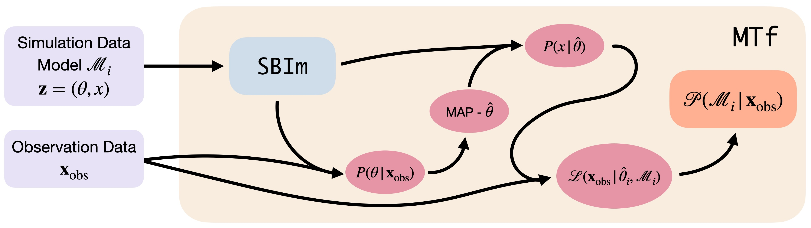
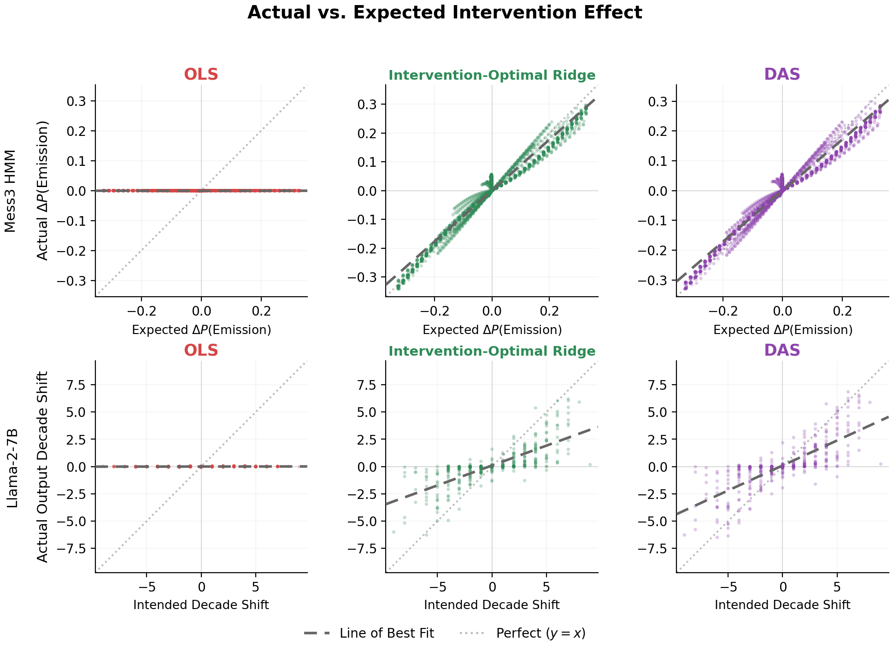

# arXiv Digest — 2026-11-17

- **Interest file used:** interests/2026.09.md (fallback — no 2026.11.md exists yet)
- **Categories pulled:** astro-ph.CO, astro-ph.EP, astro-ph.GA, astro-ph.HE, astro-ph.IM, astro-ph.SR, cs.LG, stat.ML, hep-ph
- **Papers scanned:** 651 (139 astro-ph new/cross + 512 cs.LG/stat.ML/hep-ph)
- **After first filter:** 26 candidates reviewed with full text
- **Final selected:** 11 papers across 2 tiers

---

## Tier 2 — Adjacent / useful context

### [Baryon Acoustic Oscillations from the all-sky Wen & Han cluster catalog and the 2MASS Redshift Survey](http://arxiv.org/abs/2611.19308v1)

Martín G. Richarte, Diego G. Lambas
**Primary category:** astro-ph.CO

The authors measure the correlation function of **302,176 spectroscopic galaxy clusters at 0.1 < z < 0.7** over 10,793 deg², using selection-modelled randoms, a jackknife-calibrated Gaussian covariance and iterative Fourier reconstruction with DESI DR2 settings. After reconstruction the BAO peak is detected at **5.6σ** (3.5σ before), giving **D_V/r_d = 10.29 ± 0.12 (stat) ± 0.09 (sys) at z_eff = 0.405**, a 1.5% distance with a statistical error 2.6× smaller than the best previous cluster measurement. The distance sits 0.8σ below the DESI DR2 ΛCDM fit and 1.8σ below Planck. The 2MRS galaxy sample at z_eff = 0.0475 gives only a 1.2σ peak (α_iso = 0.949 +0.034/−0.032), so the result is mainly a demonstration that **clusters are now a competitive BAO tracer**.

*Cluster (top) and 2MRS (bottom) monopoles before and after reconstruction, with best-fit BAO and no-wiggle models. Reconstruction sharpens the cluster peak from 3.5σ to 5.6σ, while the 2MRS feature stays marginal.*

### [Interpreting JWST UV luminosity functions and angular correlation functions via a "universal language" for high-redshift galaxies](http://arxiv.org/abs/2611.18850v1)

Ivan Nikolić, Andrei Mesinger, Steven G. Murray
**Primary category:** astro-ph.GA | also: astro-ph.CO

The paper describes high-z galaxies as **a chain of conditional distributions linking halo mass, stellar mass, SFR, metallicity and M_UV**, with a prior built from fits to five hydrodynamic simulations (ASTRID, FLARES, First Light, SERRA, FIRE). Fitting z > 6 JWST UV luminosity functions together with mass-complete angular correlation functions tightens the **stellar-to-halo mass relation scatter to 0.35 (+0.25/−0.19) dex**, compared with 0.45 dex from the luminosity functions alone. Scatter about the star-forming main sequence, not halo-mass scatter, is the main source of UV stochasticity, at **~61% of the M_UV variance at M_UV = −20**. Bayesian model comparison finds no need for redshift evolution, and the fiducial model lies orders of magnitude below the z ≳ 14 photometric-candidate luminosity functions. This sets up the ionizing-source modelling that feeds into reionization and IGM inference.

### [A COMPASS to the Galaxy: Joint nucleosynthetic yield set comparison and parameter inference in Galactic chemical evolution](http://arxiv.org/abs/2611.21175v1)

Berkay Günes, Giuseppe Viterbo, Sven Buder et al.
**Primary category:** astro-ph.GA | also: cs.LG

COMPASS is **a conditional score-based diffusion model with a transformer backbone that learns both the posterior and the likelihood from forward simulations**, so one amortized network does both parameter inference and model comparison through the maximized likelihood. In mock tests it identifies the generating yield set and recovers parameters about as accurately as standard SBI, with slightly conservative (1.4–1.6× wider) posteriors, at orders-of-magnitude lower cost than HMC. On 69 Milky Way stars it ranks 40 yield combinations and prefers **NuGrid AGB + IllustrisTNG CC-SN yields**, with an independent classifier agreeing (Spearman ρ = 0.89). For that set it infers **α_IMF = −2.65 ± 0.02** and log N_Ia = −2.81 ± 0.02, with a ≈0.3 systematic spread in α_IMF across the top-ranked sets. Attention maps tie α_IMF mainly to O and Mg, which illustrates the interpretability angle for scientific transformers.

*The COMPASS workflow: simulations from each yield model train a single score-based network. The network supplies the posterior and its MAP for the observed stars, and then the likelihood evaluated at that MAP, which ranks the competing yield models.*

### [Breaking feature collapse in self-supervised time series encoders](http://arxiv.org/abs/2611.20981v1)

Özgün Turgut, Daniel Rueckert
**Primary category:** cs.LG

The authors show that masked-reconstruction time-series encoders suffer **partial feature collapse**: patch tokens become nearly parallel, with cosine similarity rising from 0.72 to 0.95 as the model grows, and effective rank drops. They argue that this is why scaling plateaus; a 7.1M OTIS model lands within 0.6 pp of the 308M MOMENT model. OTISv2 adds **an EMA-teacher self-distillation loss on CLS and patch tokens plus a KoLeo regulariser**, together with register tokens and axial RoPE. The 7.1M OTISv2 reaches the best average balanced accuracy over 143 UEA/UCR datasets (70.12%), and **in a matched 7.1M→116M scaling study its 5-shot accuracy rises (52.3% → 54.3%) while OTIS falls (47.9% → 45.5%)**. The recipe carries over directly to a masked transformer pretrained on quasar spectra.

*Under matched pre-training, patch-token similarity plateaus at 0.46 for OTIS but falls to 0.32 for OTISv2. Effective rank and UEA 5-shot accuracy diverge accordingly, with OTISv2 ahead by 5–7 pp by 1.6B tokens.*

### [Summary Sufficiency in Simulation-Based Inference via Mutual Information](http://arxiv.org/abs/2611.21158v1)

Renjie Peng, Christian Genest, David A. Stephens
**Primary category:** stat.CO | also: stat.ML

Comparing SBI summary statistics by their Barber–Agakov mutual-information lower bound is ambiguous, because a low bound can mean either a poor summary or a poor neural posterior. The authors **rewrite the Barber–Agakov gap as a KL divergence between two sampleable joint distributions and estimate it with a classifier**, which separates the two failure modes. They also extend the comparison to observation-centred restricted data spaces that preserve the target posterior. On 100 replications of an ETAS earthquake model with masked-autoregressive-flow NPE, **a learned embedding beats 39 hand-crafted statistics by a median 0.507 nats**, positive in every replication, while both pipelines retain small but non-negligible gaps (0.024 and 0.010 nats). This is a practical diagnostic for whether compressed Lyα statistics such as the P1D lose posterior information.

### [Pretty Linear Liars: Unregularized Probes Favor Intervention-Unfaithful Features](http://arxiv.org/abs/2611.20371v1)

Karl Vilhelmsson Emneby, Julian Yocum, Cameron Allen
**Primary category:** cs.LG

The paper proves that **ordinary least-squares linear probes amplify low-variance activation directions that happen to covary with the target**, and that ridge regularization suppresses them. On a transformer trained on a Mess3 HMM (with exact belief states) and on Llama-2-7B birth-year probing, OLS probes decode best yet are causally inert. On Llama, intervening along the OLS direction gives a loss of 13.7, no better than not intervening, versus 7.1 for intervention-selected ridge and 6.4 for DAS, and OLS directions lie 85–90° from DAS. The recommendation is to **choose the ridge strength by maximizing intervention faithfulness, not decoding accuracy**, which applies directly to probing physical labels in a spectral foundation model.

*Change in network output under intervention versus the change the ground truth predicts. OLS probes sit flat at zero (decodable but causally inert), while intervention-optimal ridge probes track the diagonal, close to DAS.*

### [How VLMs Plan What's Next](http://arxiv.org/abs/2611.21600v1)

Rohit Gandikota, Arnab Sen Sharma, Adam Belfki et al. (David Bau's group)
**Primary category:** cs.CV | also: cs.LG

Using a synthetic multi-panel retrieval task and **causal activation and head patching** on Qwen3-VL-8B, the authors trace a full multi-step generation circuit. Binding heads resolve a pointer to an image region, relay heads carry it, a comma-token **"progress cursor"** with a select step picks the next unwritten region, and gaze heads fetch the content. Patching the 16 binding heads moves the answer in 85.9% of cases (random heads ≤0.1%). Patching a copied cursor state makes the model skip a panel in 91.0 ± 2.4% of pairs, and a targeted cursor patch does so in 98.4 ± 1.1%. **The same head types appear at every scale from 2B to 32B**, which makes this a clean template for mechanistic analysis of sequence-generating transformers.

### [How Should Parallel Langevin Chains Share Noise?](http://arxiv.org/abs/2611.19784v1)

Ryan Farell
**Primary category:** cs.LG

The paper's one change to parallel unadjusted Langevin sampling is to **centre the Gaussian noise across the K chains and rescale it by √(K/(K−1))**. Each chain keeps its exact path law, while the noise contribution to ensemble-mean estimates cancels. An exact covariance theorem for quadratic targets and a residual bound for non-quadratic targets back this up; the cost is that mean-subtracted quadratic forms get variance 1/(K−1) instead of 1/K. On logistic-regression posteriors at K = 8, the **posterior-mean trace variance drops to 0.0005–0.006 of i.i.d. noise**, and 8 centred chains beat 128 i.i.d. ones. Reference-MSE gains are much smaller (about 4–14×), and with Metropolis correction the variance gain shrinks to about 3–8×. It is trivial to add to GPU ensemble samplers.

---

## Tier 4 — Meta-research about the field

### [The novelty exposed: ablation, reproducibility and transparency in 40 technical reports of open-weight large language models (LLMs)](http://arxiv.org/abs/2611.20003v1)

Bahaeddin Türkoğlu
**Primary category:** cs.CL

An audit of 164 causal-LM architectures in Hugging Face transformers finds that **39 of the 48 added in 2025 take at least two of their three core blocks from another model**, mostly Llama; part of this reflects how the library writes new models. In a stratified sample of 40 technical reports, 28 make 73 architectural or training novelty claims, of which **only 19 (26%) have a controlled with/without ablation** and 34 (47%) have no comparison at all. Only 4 reports state more than one training run, only 1 discloses data mixture, token count and compute together, and none meets more than three of five transparency criteria. The author proposes seven reporting rules.

### [Eliciting Research Taste in LLMs through Future Research Direction Choice](http://arxiv.org/abs/2611.19794v1)

Dhruv Trehan, Paras Chopra
**Primary category:** cs.LG

The authors build 80 order-controlled pairwise questions from 19 ML papers published after model training cutoffs. Each question asks a model to choose between **the authors' own recommended next direction and a plausible distractor**. Across eight LLMs, author alignment ranges from **45.0% to 67.5%**, with 15–36% stable divergence (choosing the distractor in both orderings) that largely survives prompt ablations. Models agree with each other only 61.9% of the time on average. A 10-person human pilot picked the author direction in 61.1% of answered cases. This is a small but concrete benchmark for how far AI "research taste" matches researchers'.

### [Demographic dynamics of the Japanese astronomy and astrophysics publication community during 1996-2025](http://arxiv.org/abs/2611.20357v1)

Hideaki Fujiwara
**Primary category:** astro-ph.IM | also: physics.soc-ph

Using 23,274 publications from major astronomy journals, the paper tracks Japan-affiliated active authors growing from **~600 in the late 1990s to over 2,000 by the early 2020s**. Of 9,910 unique authors, 46% appear in only a single publication year. The author defines a **Community Renewal Rate**, the fraction of active authors not seen in the preceding window, and finds the 5-year rate stays near one quarter (21–33%) over 2001–2025. Incoming students explain only part of that renewal. The analysis is descriptive, but it is a rare quantitative look at turnover in an astronomy research community.
