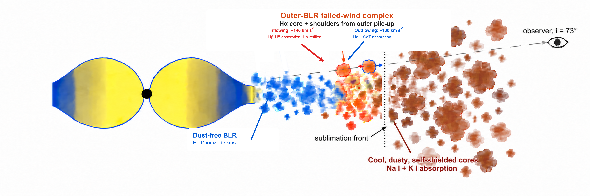

# arXiv Digest — 2026-11-18

- **Interest file used:** interests/2026.09.md (fallback — no 2026.11.md exists yet)
- **Categories pulled:** astro-ph.CO, astro-ph.EP, astro-ph.GA, astro-ph.HE, astro-ph.IM, astro-ph.SR, cs.LG, stat.ML, hep-ph
- **Papers scanned:** 343 (104 astro-ph new/cross + 239 cs.LG/stat.ML/hep-ph)
- **After first filter:** 27 candidates reviewed with full text
- **Final selected:** 14 papers across 2 tiers

---

## Tier 2 — Adjacent / useful context

### [Efficient and Optimal Analysis of Galaxy Surveys on Large Scales](http://arxiv.org/abs/2611.21718v1)

Julius Adolff, Uroš Seljak
**Primary category:** astro-ph.CO

The authors build a **linear-scale field-level likelihood compressed into optimal quadratic (MUSE) estimators**, with the survey window, integral constraints and shot noise in the forward model and no dense covariance inversion. Because the likelihood of the compressed statistic is parameter-dependent, it stays calibrated when f_NL ≠ 0, where their coverage tests show a fixed-covariance Gaussian power-spectrum likelihood becomes overconfident. For DESI DR2 LRG+QSO they forecast **σ(f_NL) = 4.1 versus 4.8** for the standard power-spectrum analysis (a 14% gain), at ~4 GPU-hours per 100 mocks. A new **non-parametric marginalisation over an unknown angular contaminant** (e.g. dust) costs 20% in error but beats the DESI k_min scale cut by a further ~20%.

*Joint posterior on f_NL, b₁ and a contaminant amplitude for LRGs: the field-level fit absorbs an unknown angular systematic without a scale cut and returns ~20% tighter f_NL errors than the scale-cut power spectrum, whose errors are also overconfident.*

---

### [Velocity Reconstruction from kSZ with SPT-3G and DESI-LS](http://arxiv.org/abs/2611.21721v1)

Selim C. Hotinli, Edmond Chaussidon, Simone Ferraro et al.
**Primary category:** astro-ph.CO

This is the first kSZ velocity reconstruction with SPT-3G, cross-correlating the D1 maps at 95/150/220 GHz with DESI Legacy Imaging LRGs over ~5% of the sky. The **galaxy–velocity dipole is detected at SNR 11.2** and the velocity auto-spectrum at 8.1 (extended sample), with the first detection at 220 GHz, and the monopole separates the tSZ and CIB foregrounds. The shared velocity bias b_v = 0.255 (+0.033/−0.035) is consistent with feedback-driven gas depletion. Velocities alone give **f_NL = −38 ± 61** and −20 (+40/−46) with clustering, only ~3% tighter than clustering alone, short of the 10–20% Fisher forecast, which the authors attribute to window and photo-z mode mixing.

---

### [FastSpecFit: Spectrophotometric Modeling of 38 Million Extragalactic Targets from the Dark Energy Spectroscopic Instrument Second Data Release](http://arxiv.org/abs/2611.22914v1)

John Moustakas, Jeremy Buhler, Dirk Scholte et al.
**Primary category:** astro-ph.GA

FastSpecFit **jointly forward-models every DESI spectrum with its broadband photometry**, convolving stellar-population and emission-line templates with each fiber's resolution matrix so that pixel noise stays uncorrelated, at ~0.1 s per fit. The resulting **DR2 value-added catalog covers 38.2 million targets at 0 < z ≲ 4**, with stellar masses, SFHs, velocity dispersions and fluxes/EWs for 46 lines including narrow+broad Balmer components, plus corrected redshifts for ~165,000 QSOs. Stellar masses run 0.15–0.30 dex above CIGALE-based catalogs. For quasars the continuum products are explicitly not valid and UV lines are only approximate; a dedicated power-law + FeII + host + torus mode is in development.

---

### [Spectro-Spatial Survey Fusion](http://arxiv.org/abs/2611.21798v1)

Georgios N. Vassilakis, Miles Cranmer, Vasily Belokurov
**Primary category:** astro-ph.CO | also: astro-ph.IM

The paper fits **one continuous spectral surface-brightness field through each instrument's own response**, representing it as adaptive anisotropic Gaussians (borrowed from Gaussian splatting) whose spectra mix a **shared, learned 32-template dictionary**. On 400 SDSS ugriz exposures and 800 fiber spectra over 84′×84′ of COSMOS (2.86M components, 873M pixels), summed flux matches within 2% per band and 96% of spectra within 10% in integrated flux. Without refitting, the field predicts withheld SDSS spectra, HSC images and DESI spectra that never entered the fit; QSO spectral shapes are recovered less well (14.7–22.8% error) and narrow lines are smoothed out.

*The representation: a galaxy is assembled from 1 to 64 adaptive Gaussians, and every component's spectrum is a mixture of the same 32 learned templates, which is what lets sparse fibers constrain spectra everywhere in the imaged area.*

---

### [XQR30: ALMA Observations Reveal the Diverse Structure of Cold Gas within z>6 Quasar Host Galaxies](http://arxiv.org/abs/2611.21755v1)

Marcel Neeleman, Sarah E. I. Bosman, Valentina D'Odorico et al. (Bosman, Becker, Eilers among co-authors)
**Primary category:** astro-ph.GA

New 0.25″ (~1.5 kpc) ALMA [CII] and dust observations of 24 quasars, plus re-reduced archival data for 17, give a **nearly complete sample of the 41 XQR-30 quasars (J_AB < 20, z = 5.8–6.6)**. [CII] is detected in 39/41 hosts (L = 0.3–9.2 × 10⁹ L☉); 18 are rotation-dominated and 9 dispersion-dominated, and 8 [CII] companions appear, consistent with clustering expectations. A new kinematic position-angle alignment statistic shows **most hosts deviate from pure disks**, and dust is more compact than [CII] in every resolved host. Dynamical masses agree with the sum of stars, gas (~40% of M_dyn) and black hole, with **M_BH ≈ 3% of M_dyn on average**.

---

### [Lord/Egg of the LRDs: One geometry for its many faces](http://arxiv.org/abs/2611.22316v1)

Piero Madau, Roberto Maiolino, Xihan Ji et al.
**Primary category:** astro-ph.GA

The authors test whether a **single AGN geometry** can explain every observable of SDSS J1025+1402 (z = 0.10), the best local little-red-dot analog. An inclination-dependent super-Eddington disk + young stars + clumpy dust fits the UV–IR continuum (χ²_ν = 0.9) with **log M_BH ≈ 7.4, ṁ ≈ 80, i ≈ 73° and A_V ≈ 2.8 mag**, and the V-shape is the crossover between starlight and the reddened disk. A Cloudy broad-line region whose **density rises from 10⁹ to 10¹¹ cm⁻³ near the sublimation radius** reproduces broad Hα, the different Balmer widths, the exponential wings and the Balmer decrement without electron scattering. It also matches the continuum and Hα polarisation (1.62% vs. 1.53% observed). Every absorber (Na I/K I, Ca II triplet, ~500 km/s He I*, redshifted Balmer) sits below the local escape speed, implying a bound, failed BLR wind.

*The proposed geometry along the i ≈ 73° sightline: a pile-up in the outer BLR produces the Hα core, in- and outflowing gas produces the blue and red Balmer absorption, a thin ionised skin produces fast He I*, and distant dusty clumps produce the alkali lines.*

---

### [Super-Eddington Accretion onto Compact Objects: Theory Meets Observation](http://arxiv.org/abs/2611.21838v1)

Yan-Fei Jiang, Jenny E. Greene
**Primary category:** astro-ph.HE | also: astro-ph.GA

This review compares candidate super-Eddington populations (ULXs, NLS1s/high-Eigenvector-1 AGN, extremely red quasars, Hot DOGs, LRDs and transients) with slim-disk models and radiation-MHD simulations. The shared signatures are **outflows on many scales, hard-X-ray weakness, weak jets and suppressed optical/UV variability**. Radiative efficiency falls with accretion rate in thermal-pressure-supported disks, and wind kinetic power can rival jet power. The observed classes sort onto a **two-parameter plane of Eddington ratio and viewing angle**, and the authors speculate that at the highest rates the photosphere extends beyond ~10⁶ r_g, so only thermalised emission is seen: their proposed picture for LRDs and supersoft sources. Class-specific bolometric corrections and machine-readable compilations of simulation results are included.

*Disk, funnel and wind photosphere at three increasing accretion rates (from ~100 to ~10⁶ r_g in size) with schematic spectra, showing which source classes appear at which rate and inclination, ending in the photosphere-only regime proposed for LRDs.*

---

### [The phase gradient spectrum: probing the squeezed bispectrum of the 21-cm signal during reionization](http://arxiv.org/abs/2611.21760v1)

Sambit K. Giri, P. Daniel Meerburg, Léon V. E. Koopmans
**Primary category:** astro-ph.CO | also: astro-ph.GA, astro-ph.IM

The authors define a single-FFT statistic, the circular coherence of phase differences between Fourier modes separated by a long-wavelength mode. They show analytically that it **measures the angle-averaged normalised squeezed bispectrum**, i.e. how small-scale 21-cm power responds to large-scale fluctuations. In 21cmFAST and BEoRN simulations it tracks the density field until ⟨x_HI⟩ ≲ 0.9, then follows ionisation topology with a **rise–trough–rise pattern whose trough marks the sign change of the squeezed bispectrum**, robust across source models. For a 1000 h SKA-Low observation it constrains the astrophysical parameters on its own (2–3× more weakly than P(k)), and combined with P(k) it tightens marginalised errors by up to ~20%. Foregrounds and calibration errors are not yet modelled.

---

### [21 cm Cosmology of Boosted Dark Matter](http://arxiv.org/abs/2611.21714v1)

Min Sub Lee, Jeong Han Kim, Kyoungchul Kong et al.
**Primary category:** hep-ph | also: astro-ph.CO

In this two-component model, annihilation of the heavy component (30 MeV) boosts the light one (5 MeV), whose self-interactions then provide **pressure support that suppresses small-scale power even for MeV-mass dark matter**. Passing modified-CLASS outputs into a semi-numerical 21-cm code, they find the global absorption trough **delayed by Δz ≈ 1–3 and up to ~10 mK shallower**, with a shifted power-spectrum evolution. An SKA1-Low forecast (MultiNest on an MLP emulator, marginalising over M_turn, L_X/SFR and N_γ) shows that for σ/m₁ ≈ 0.1 cm²/g, **light-component fractions 0.2 ≲ r₁ ≲ 0.7 are distinguishable from ΛCDM at 95%** in the optimistic case, though a lower M_turn partly mimics the signal.

*Projected 95% SKA1-Low exclusion boundaries in the (r₁, σ_self/m₁) plane for moderate and optimistic scenarios at 1080 h and 5000 h: only intermediate light-component fractions, where both components remain abundant, are separable from ΛCDM.*

---

### [A branchless single-precision Voigt approximation for spectral synthesis](http://arxiv.org/abs/2611.22473v1)

Richard Hoppe
**Primary category:** astro-ph.SR | also: astro-ph.IM

QLG is a family of **branchless Voigt approximations, separable in the damping parameter a**, built from Lorentzian and Gaussian generators times an envelope that keeps both limits exact, with coefficients fit by linear least squares. The three members reach **maximum relative errors of 6.5×10⁻³, 9.2×10⁻⁴ and 7×10⁻⁵ over a ∈ [10⁻⁹, 10⁹]**, whereas the tested SIU, MOOG and Humlíček w4 kernels approach 100% relative error at small a. The most accurate member is 1.6–3.0× cheaper than w4 with 3.4–5.0× smaller flux errors in syntheses. The Hui et al. (1978) approximation, used in some absorption-line codes, **goes negative in the inner wing below a ≈ 2.4×10⁻⁶**. A Fortran module is provided.

---

### [Large-scale Neuron Community Discovery Reveals Neuron-Sparse Behaviors in Language Models](http://arxiv.org/abs/2611.23112v1)

Igor Shilov, Thomas Fel, Tal Haklay et al. (Bushnaq among co-authors)
**Primary category:** cs.LG | also: cs.CL

The method uses **the model's own MLP neurons rather than SAE features**. Gradient×activation attribution picks the top neurons per layer for each of 10M prompts to Llama-3.1-8B, neurons repeatedly attributed together are linked into a graph, and Leiden community detection extracts candidate groups. Each community is tested on 10M held-out prompts for **causal necessity, sufficiency within the layers it spans, and layer necessity**. With communities capped at 128 neurons, **10.3% of held-out prompts have at least one layer explained on a neuron-sparse basis** (8.7% for ≥4 layers, 3.3% for ≥12, vs. ~3% for a random baseline). Discovered functions include agreement, fixed phrases, in-context copying and arithmetic, often implemented by redundant "voting" neurons, any one of which can be removed.

*The pipeline: per-prompt attribution of MLP neurons, a co-occurrence graph, Leiden communities, then necessity and sufficiency tests on a layer subset using held-out prompts.*

---

### [What Does a Bias Head Measure? Non-Identifiability in Head-Level Bias Attribution](http://arxiv.org/abs/2611.23218v1)

S. M Seefat Alam
**Primary category:** cs.CL | also: cs.LG

The paper audits contrastive head-attribution for social bias on Qwen-2.5-7B and Llama-3.1-8B. The head map correlates at ρ = −0.95 and −0.77 with a label-blind response-length map, but **an intervention that breaks the length–label coupling rejects the length reading**: with the prompt held fixed, length explains 1% of the statistic's variance, while prompt identity explains 64%. Within a prompt the fairness label, response length and protected-token presence are **collinear at φ = 0.95, so the head map is non-identifiable** by any observational analysis. No head set reduces unfairness when ablated against a layer-matched null, while a positive control (destroying refusal, p = 2.7×10⁻⁵) shows the pipeline can detect effects of this size. It is a clean case study of a correlational attribution control that misled until an intervention was run.

---

### [Every Measurement, Every Direction, All at Once: Multimodal Flow Matching for Molecules and Spectra](http://arxiv.org/abs/2611.22098v1)

Thorben Prein, Elton Pan, Rafael Gómez-Bombarelli et al.
**Primary category:** cs.LG | also: physics.chem-ph

MOSAIC is a single MMDiT rectified-flow model over 3D molecular-structure latents and patched UV, IR and Raman spectra. **Random per-modality masks decide which measurements are conditions and which are targets**, so one experiment yields many supervised denoising tasks and the model can generate any subset of modalities from any other. On QM9S, all-spectra→structure reaches **88.8% top-1 graph recovery vs. 60.3% for DiffSpectra** in 50 steps instead of 1000, while also beating a structure→spectra specialist. **Any-to-any training adds ~5 points over structure-only training at every model size**, and the structure-only model overfits. On 99 experimental IR spectra, simulation-to-experiment retrieval reaches 15.2% top-1.

*Joint training samples target and condition modalities per example (a); structure accuracy grows with model size and stays above the single-direction baseline (b); and one model serves generation in both directions, completion and retrieval (c).*

---

## Tier 4 — Meta-research about the field

### [Higher-Scoring Coding Models Did Not Get More Work Done](http://arxiv.org/abs/2611.23216v1)

Yining Hua
**Primary category:** cs.SE

A 19-day export-control suspension of one frontier coding model forced its users onto a model 11 points lower on SWE-Bench Pro, and the paper uses this as a **natural experiment** (297 treated developers, 8,908 controls). A difference-in-differences fit with developer and date fixed effects finds the **7-day pull-request merge rate changed by only +1.4 pp [−1.4, +4.3]**. Across five 2026 model upgrades (1,208 developers, 15,442 PRs) the change was −0.9 pp [−1.9, +0.2], and merged PRs per week moved +2.4% [−4.9%, +10.2%]. Benchmark gains of 5–18 points thus did not show up as measurable output gains. Caveats: base merge rates were already 92–95%, and only ~1% of PRs name the model used.
