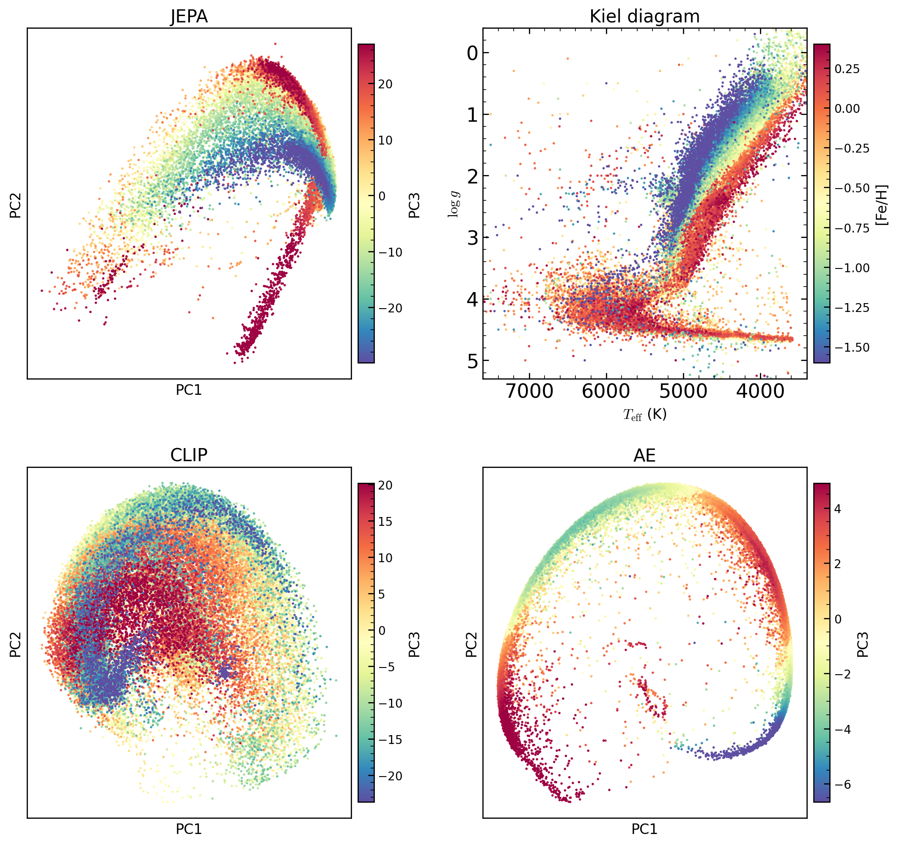

# arXiv Digest — 2026-11-19

- **Interest file used:** interests/2026.09.md (fallback — no 2026.11.md exists yet)
- **Categories pulled:** astro-ph.CO, astro-ph.EP, astro-ph.GA, astro-ph.HE, astro-ph.IM, astro-ph.SR, cs.LG, stat.ML, hep-ph
- **Papers scanned:** 352 (96 astro-ph new/cross + 256 cs.LG/stat.ML/hep-ph)
- **After first filter:** 29 candidates reviewed with full text
- **Final selected:** 14 papers across 4 tiers

---

## Tier 1 — Highly relevant

### [JEPA for astronomy: multi-survey spectral alignment puts stellar parameters on the leading principal axes](http://arxiv.org/abs/2611.23492v1)

Xiaosheng Zhao, Rosemary F. G. Wyse, Yuan-Sen Ting et al. (Ting among co-authors)
**Primary category:** astro-ph.GA | also: cs.LG

The authors fix a cross-survey architecture (frozen per-survey autoencoder/masked-transformer/universal-spectral-tokenizer backbones feeding survey-specific heads) and change only the alignment loss, comparing a contrastive CLIP objective with a **non-contrastive JEPA objective that never pushes stars apart** and only constrains each survey's embedding distribution. They score each objective by **"legibility": whether stellar physics sits on the leading principal components and can be read out with a linear probe**. With JEPA, PC1–PC2 of the Gaia XP embedding reproduce a Kiel diagram, PC3 tracks [Fe/H], and [α/Fe] varies smoothly across the plane. **JEPA beats CLIP at the same architecture, and keeps improving as surveys are added** (XP + LAMOST + DESI + APOGEE), without needing large negative batches. Abundances predicted for 8.0 million XP giants recover the Milky Way's [α/Fe]–[Fe/H] structure, and the authors conclude that **the choice of alignment objective, not alignment itself, determines whether labels are linearly recoverable**.

*The same 40,000 stars in the PC1–PC2 plane: the reconstruction-only autoencoder leaves [Fe/H] unordered, while alignment recovers the ordering. JEPA recovers it much more sharply than CLIP, close to the APOGEE Kiel-diagram reference.*

---

## Tier 2 — Adjacent / useful context

### [Redrock: Spectroscopic Classification and Redshift Fitting for the Dark Energy Spectroscopic Instrument](http://arxiv.org/abs/2611.23636v1)

S. Bailey, A. Brodzeller, J. Moustakas et al.
**Primary category:** astro-ph.IM | also: astro-ph.CO

This is the reference paper for DESI's classifier and redshift fitter. It scans **χ² against z over PCA templates for galaxies, quasars and stellar subtypes, convolving every template with each spectrum's own resolution matrix** so that the pixel errors stay uncorrelated, with optional archetype fits to reject unphysical solutions. On DESI DR2 spectra the redshift recovery rate is ~98% for BGS and LRGs, 95.9% for ELGs and **92.6% for quasars**, and stellar radial velocities are unbiased at ~5 km/s. The paper also documents the ZERR calibration, the Δχ² = 9 SMALL_DELTA_CHI2 warning threshold and its purity–completeness trade-off, and the separate QSO-HIZ templates released as the DR1 "zlya" value-added catalog. Redrock supplies the quasar classifications and redshifts that DESI's forest quasar catalogs start from.

---

### [Excess intergalactic heating around a dual quasar system 2.8 Gyr after the Big Bang](http://arxiv.org/abs/2611.23487v1)

Kirsten R. Hall, Nadia L. Zakamska, Jake S. Bennett et al.
**Primary category:** astro-ph.GA

ALMA/VLA observations of the z = 2.37 dual quasar J1549 show a **thermal Sunyaev–Zel'dovich decrement detected at 6σ**, measured three ways: as a distortion of the SED on 10–15 kpc scales, in the shortest-baseline visibilities, and as a ~100 kpc negative bubble in the residual image. The SED-based **thermal energy of (9.7 ± 1.6) × 10⁶⁰ erg is 3.6× the total expected for the hot gas of a 10¹³ M☉ halo**, and is at least 0.6% of the quasars' lifetime energy output. Ionized [OIII] outflows blueshifted by up to ~800 km/s point to quasar winds as the heat source, and there are hints of hot gas out to 100–600 kpc. For forest work this is direct evidence that quasar feedback can inject large, localised heat into the CGM/IGM at z ≈ 2.4.

---

### [A Tight Broad-line Width-Luminosity Relation in Little Red Dots and Its Consequence for Virial Black Hole Masses](http://arxiv.org/abs/2611.24217v1)

Haoyu Wang
**Primary category:** astro-ph.GA | also: astro-ph.HE

The author refits public NIRSpec spectra of 29 LRDs, 15 other JWST broad-line sources and luminosity-matched SDSS quasars with one uniform procedure. At fixed Hα luminosity, the **LRD broad-Hα widths have an intrinsic scatter of only 0.054 dex (<0.075 dex at 95%)**, clustering near 1760 km/s, which is less than half the 0.12 dex scatter of quasars. Because virial masses scale as width squared, **single-epoch LRD black-hole masses and mass functions are essentially a restatement of luminosity**, whatever the broadening physics. Compared with the Keplerian speed at an Eddington-limited photosphere, the widths are 2.5–3.0 v_K. This means that either the orbits are sub-Eddington (L ≲ 0.1–0.3 L_Edd) or the envelope adds a uniform 2–3× non-gravitational broadening.

*Broad Hα width against luminosity for the uniformly refitted sample (a) and for a literature compilation (b). The LRDs lie on a narrow band of nearly constant width, with only the few brightest sources setting any slope, which is why their virial masses carry little information beyond luminosity.*

---

### [Map-Level Inference of Primordial Gravitational Waves from the CMB with Spherical Neural Networks](http://arxiv.org/abs/2611.24939v1)

Anto I. Lonappan, Adrian E. Bayer, Brian Keating et al.
**Primary category:** astro-ph.CO | also: astro-ph.IM

A spherical graph-convolutional network (Chebyshev convolutions on the HEALPix graph) takes six-frequency cut-sky B-mode maps with lensing, inhomogeneous noise and Galactic dust and synchrotron, and infers r directly, with no power-spectrum estimation or component separation. Compared with a multifrequency bandpower likelihood built from the **same 20,000 simulations and the same prior**, it **lowers the RMS error on r by 1.3× and gives calibrated 68% intervals 1.2× narrower**. Without foregrounds the two methods are equivalent, so the gain comes from non-Gaussian, spatially varying foreground information that bandpowers discard. Saliency maps show the network learns to weight the deepest sky and the cleanest channels. **It does not generalize to a 3D dust model with line-of-sight variation**, which is a useful warning for any map-level SBI tied to one simulator.

---

### [Rethinking Contrastive Targets in Radiology Language-Image Pretraining](http://arxiv.org/abs/2611.24016v1)

Yunhe Gao, Ashwin Kumar, Jiaming Liu et al.
**Primary category:** cs.CV | also: cs.LG

The paper explains two known failures of CLIP-style pretraining: zero-shot performance peaks and then degrades while the loss keeps falling, and large batches collapse. The diagnosis is **target misspecification: unpaired reports that share findings with an image are wrongly treated as negatives**, a deterministic gradient bias that grows with batch size. A synthetic CLEVR-Radiology testbed that keeps only this overlapping-fact structure reproduces both failures. The fix, **CorLIP, treats any text whose assertions are compatible with the image as a positive**, with no architecture change. It removes the post-peak degradation, stays stable up to B = 2048, makes extra data pay off, and transfers from chest X-ray to 3D CT. The same issue applies to contrastive spectral models, where many "negative" spectra share the same physical parameters. That is the regime where the JEPA paper above finds non-contrastive alignment wins.

---

### [What Interpolators Store and What They Express: An Information-Theoretic Framework for Benign Overfitting and Label-Free Model Selection](http://arxiv.org/abs/2611.23630v1)

Nikolaos Nikolaou
**Primary category:** cs.LG

The paper separates what an interpolating learner *stores* from what it *expresses*. **Every interpolator stores exactly nH(Y|X) bits of label noise**, so storage-based and CMI generalization bounds cannot tell interpolators apart. Excess risk is instead bounded above and below by the **expressed information V, the entropy across training samples of the prediction at a fresh input** (plus a modal-bias term, and exactly so for binary labels). Benign overfitting is then vanishing expression. This view recovers the known results for nearest neighbours, averaging and minimum-norm least squares, and places the double-descent peak at a peak of V. As a practical tool, **V estimated from two disjoint halves selects among overparameterized models without held-out labels**, with 60% less regret than holdout validation at equal cost and matching 5-fold CV at a quarter of the cost on 15 noisy datasets.

---

### [Deconstructing the cosmic baryon distribution with fast radio bursts](http://arxiv.org/abs/2611.24838v1)

Koustav Konar, Yin-Zhe Ma, Léon V. E. Koopmans et al.
**Primary category:** astro-ph.CO | also: astro-ph.HE

Using IllustrisTNG, the authors split the large-scale structure into eight matter-density bins (from voids through filaments to haloes). They then solve the overdetermined system linking FRB dispersion measures to the electron-to-matter ratio in each bin, combining it with a galaxy-based density estimator from a Euclid-like mock catalog after a bias correction. The **bin-wise electron density matches the simulation to within 10%** and yields **Ω_b f_ion = 0.0455 (+0.0028/−0.0026)** against a true 0.0462. The inferred gas fractions are 0.186 ± 0.012, 0.179 ± 0.015 and 0.046 ± 0.014 in voids, filaments and haloes (truth 0.167, 0.173, 0.067). Electrons sit mostly in low-density regions. This is a simulation-only demonstration, and the discussion shows the results depend on how correlated the sightlines are allowed to be.

---

### [Are AGN Required? Updated Photoionization Models for Rest-UV Line Diagnostics in Reionization-era Galaxies](http://arxiv.org/abs/2611.23391v1)

Jiayang Yang, Casey Papovich, Weida Hu et al.
**Primary category:** astro-ph.GA

Deep NIRSpec G140M/G395M spectra of eight z ~ 7–9 galaxies from the C3PO survey give 12 + log(O/H) = 7.50–7.90, **C/O = 0.10–0.32** and **n_e(CIII]) = (1.9–4.9) × 10⁴ cm⁻³**. Cloudy models with BPASS and BC03 stellar populations show that **lowering C/O and raising the gas density pushes purely stellar grids into the "composite" and "AGN" zones** of the standard rest-UV diagnostic diagrams. So a position in those regions does not by itself show that an AGN is present at these redshifts. Strong He II remains unexplained by the updated models. This matters for the ionizing-source budget, and so for any reionization model that apportions photons between stars and AGN from such diagnostics.

---

### [A Rank-One Bypass of Fixed Linear Erasure](http://arxiv.org/abs/2611.23880v1)

Jai Kumar Sharma, Vanshaj Khattar
**Primary category:** cs.LG

Linear concept erasure (INLP/LEACE-style null-space projection) guarantees that no linear head can read a target from the *current* features. This paper asks what happens when the upstream weights can be edited. It proves that **if the erasure layer passes even one direction visible to an allowed head, an attacker can write the target score into it, and that this condition is also necessary**. For a linear target score, **the required change is a rank-one affine update**. On six CIFAR-10 class pairs the bypass restores nearly all pre-erasure performance while leaving a deployed benign head's outputs unchanged to numerical precision. With eight labels and a 10% mean feature edit it reaches 91.2% of the fitted score's gain over chance. The takeaway for representation editing is that **linear guardedness certifies a representation, not a model whose weights can still be edited**.

---

## Tier 3 — Outside my area but notable

### [An inspiral of a star inside a common envelope with its giant companion](http://arxiv.org/abs/2611.23470v1)

Viraj Karambelkar, Kishalay De, Karel D. Temmink et al.
**Primary category:** astro-ph.SR

AT 2025abao in M31 is a ~7 M☉ early-AGB star, quiescent from 1989 to 2018, that then brightened in two 1000–1500-day episodes, faded optically while brightening in the infrared (caught by SPHEREx with R ≈ 860 R☉ and ~0.1 M☉ of new dust-laden ejecta), and in October 2025 erupted by ~100× as a luminous red nova. The authors model the seven-year rise as **a ~0.7 M☉ companion spiralling inside the convective envelope, the first direct observation of frictional-drag energy dissipation in common-envelope evolution**. The final merger within fewer than ~10 orbits ejected the outer ~10% of the envelope at ~10× the escape speed. This empirically bounds the **common-envelope efficiency to 0.01 ≲ α ≲ 0.4**, a parameter that until now has been set almost entirely by theory in binary population synthesis.

*Lightcurve from 1989 to 2026 across UV to mid-IR surveys: a flat progenitor, then the slow multi-year precursor brightening attributed to the inspiral, then the luminous-red-nova eruption, each shown on its own time axis.*

---

### [A Butterfly Collector's View of Fast Radio Bursts: Repeating Sources Go Quiet within a Few Years](http://arxiv.org/abs/2611.24202v1)

Shotaro Yamasaki
**Primary category:** astro-ph.HE | also: astro-ph.IM

The paper applies **Good–Turing-style "unseen species" estimation** to CHIME/FRB Catalog 2. If sources keep a constant mean rate, the number of sources seen k+1 times in one window predicts how many bursts the k-times sources will emit in a later window. This test makes no assumption about the rate distribution or distances. The observed-to-predicted ratio R stays near 1 for gaps ≲ 60 days but **halves within about one year**, which neither steady nor randomly fluctuating sources reproduce unless most of them are silent. A **~3-year lifetime, on/off activity with ~2-year active phases, or a short-plus-long-lived mixture** fit equally well, and models fitted to the first three years correctly predict the decline in the last two. The method is a reusable, distribution-free test for non-stationarity in any catalog of repeating transients.

*R against the gap between windows for CHIME/FRB Catalog 2 (black) compared with mock catalogs: steady sources give R = 1, while finite-lifetime or on/off models reproduce the drop over about a year.*

---

### [Rest-frame annihilation lines of $\sim70$ GeV WIMPs in 23,000 stacked galaxy clusters](http://arxiv.org/abs/2611.21595v1)

Uri Keshet
**Primary category:** astro-ph.HE | also: hep-ph

The author stacks 16.3 years of Fermi-LAT photons around 23,343 high-latitude clusters (MCXC, eROSITA, DESI) **in each cluster's rest frame** and blind-scans for {γγ, γZ, γh} line triads. The strongest triad, at 70 GeV, is **2.8σ trial-corrected on its own**. Together with the author's earlier 43 GeV three-cluster line and eROSITA cross-correlation claims, the combined significance quoted is **5.7–6.1σ**, interpreted as cross-annihilating ~69.7 and ~74.5 GeV WIMPs with cross sections of a few 10⁻¹⁹ cm³ s⁻¹ (uncorrected). The claimed features appear only in the rest frame (they vanish under redshift rescaling or permutation), fade away from cluster centres, and are absent from the surrounding fields. Treat this with caution: the high numbers come from combining with the author's own earlier claims, and independent confirmation is needed.

---

## Tier 4 — Meta-research about the field

### [Integrating AI Coding Agents Into Scientific Research](http://arxiv.org/abs/2611.23334v1)

Rory Barnes
**Primary category:** cs.SE | also: astro-ph.IM

An astronomer's framework for using agentic coding tools (Claude Code, Codex) to write the analysis code of a research project. The paper lists eleven ways agents change how numerical results are generated, verified and reproduced. It then proposes a **six-level "PROOF" ladder (provenance, reproducibility, openness, oversight, falsifiability)**, from version-controlled, human-verified results up to a public archive of files, change history, prompt transcripts, **independent agent regeneration of the analysis and cryptographically verifiable attestations by independent researchers**. The accompanying open-source package vaibify, itself written entirely by agents, sandboxes agents in Docker, tracks file changes and takes projects to Level 3 (reproducible). The author is explicit that whether verifying agent-built results is cheaper than doing the work by hand is still an open question.
