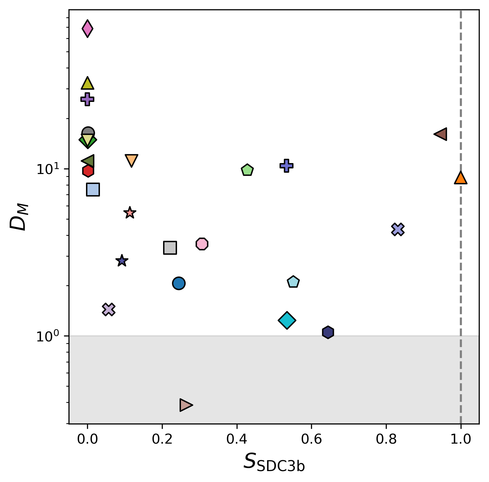

# arXiv Digest — 2026-11-20

- **Interest file used:** interests/2026.09.md (fallback — no 2026.11.md exists yet)
- **Categories pulled:** astro-ph.CO, astro-ph.EP, astro-ph.GA, astro-ph.HE, astro-ph.IM, astro-ph.SR, cs.LG, stat.ML, hep-ph
- **Papers scanned:** 342 (104 astro-ph new/cross + 238 cs.LG/stat.ML/hep-ph)
- **After first filter:** 30 candidates reviewed with full text
- **Final selected:** 12 papers across 3 tiers

---

## Tier 1 — Highly relevant

### [Multiphase Gas in High-$z$ Cosmic Sheets](http://arxiv.org/abs/2611.25220v1)

Charles Willard, Yakov Faerman, Samuel McCarty et al. (McQuinn among co-authors)
**Primary category:** astro-ph.CO | also: astro-ph.GA

The authors run high-resolution AREPO zoom simulations of two individual cosmic sheets at z = 3–6 (virial temperatures 2×10⁵ and 8×10⁵ K, gas mass resolution down to ~10⁴ M☉) to study the cold ~10⁴ K gas in the diffuse cosmic web. The sheets' cold cores break up into **kiloparsec-scale fragments that show up as strong variations in N_HI**. Semi-idealized runs show that **bending driven by the nonlinear thin-shell instability, followed by shear-driven vorticity/KHI**, causes this, not the thermal or Richtmyer–Meshkov instabilities proposed before. The structure is **not converged: a fourfold increase in spatial resolution raises pLLS covering fractions by ~1.5× and LLS covering fractions by ~3.5×**. An order-of-magnitude estimate suggests sheets could host a large fraction of the ultra-low-metallicity (p)LLS population. This is a warning for forest and absorber statistics taken from large-box simulations at m_gas ≳ 10⁵ M☉.

*Face-on N_HI maps of the same sheet region with resolution increasing from top to bottom: the cold sheet gas fragments more and more as resolution improves, in both the low- and high-T_vir sheets.*

---

## Tier 2 — Adjacent / useful context

### [Square Kilometre Array Science Data Challenge 3b: EoR inference](http://arxiv.org/abs/2611.25823v1)

O. Bait, A. Bonaldi, M. Bianco et al.
**Primary category:** astro-ph.CO

This is the first community-wide blind comparison of Epoch of Reionization inference pipelines. **16 teams inferred the neutral hydrogen fraction in three redshift intervals between z = 8.41 and 6.25** from common simulated SKA-Low 21-cm power spectra and images, with and without foregrounds. Even in the simplest noise-only case the **teams disagree well beyond their quoted errors: median Z-scores are ~1.3–2.2**. Teams using the same simulator (11 of them used 21cmFAST) do not converge either, which points to inference and implementation choices rather than simulator physics alone. The **average of all teams' estimates lands close to the input**, and the authors recommend that methodological uncertainty be quantified and added to reported error bars. The lesson applies just as well to emulator-plus-likelihood pipelines for the forest.

*Challenge score against Mahalanobis distance for the noise-only power-spectrum dataset: many solutions fall outside the D_M < 1 band, so their posteriors are overconfident relative to their actual offset from the truth.*

---

### [Star-forming disc galaxies align tangentially with the cosmic tidal field](http://arxiv.org/abs/2611.26593v1)

Calum Murray, Roman Paviot, Martin Kilbinger et al.
**Primary category:** astro-ph.CO | also: astro-ph.GA

The authors combine **SPHEREx 102-band spectrophotometry with DESI Legacy Imaging into a full-sky catalogue of 71 million galaxies with σ_NMAD ≈ 0.0065 redshifts**, validated against DESI DR1, SDSS, GAMA and others, and use it to measure intrinsic alignments split by colour and morphology. They detect **tangential alignment of blue disc galaxies at 22.5σ**, a signal that earlier surveys had largely failed to find, alongside radial alignment of red spheroids at 65σ. Splitting the signal around overdensities and underdensities shows that **both alignments flip sign between clusters and voids as expected for a linear response to the tidal field**, which rules out a purely quadratic tidal-torque response. The result matters for intrinsic-alignment modelling in weak lensing and shows what SPHEREx-quality photometric redshifts can do for large-scale-structure statistics.

*Shape–position cross-correlation at 0.20 < z < 0.35: blue discs (tangential) and red spheroids (radial) both follow the linear tidal-response model (solid) and not the quadratic one (dashed), and the predicted lensing contamination (dotted) is negligible.*

---

### [The Galaxy Activity, Torus, and Outflow Survey: N. Little Red Dots are not dust deficient: constraints from Seyfert 1 JWST spectra](http://arxiv.org/abs/2611.26483v1)

C. Ramos Almeida, R. Maiolino, I. García-Bernete et al.
**Primary category:** astro-ph.GA

The authors stack rest-frame 3–27 μm NIRSpec+MIRI spectra of eight nearby Seyfert 1 nuclei, normalized by broad Hα and 5100 Å luminosity. They use this **local-AGN template to predict the infrared emission of Little Red Dots**, testing it on a stack of 249 LRDs at 2.3 < z < 9.3 and on a local LRD at z = 0.1. The **5100 Å normalization predicts LRD infrared emission to within a factor of three** for modest extinction (A_V < 1). Fitting the optical and infrared SED together, however, requires **a more reddened accretion disc (A_V ≈ 2) and a torus with low covering factor (C_T ≈ 0.1–0.2)**. This is offered as an alternative to black-hole-star models in which the red optical continuum is an unreddened ~5000 K blackbody. They infer torus dust masses of ~10⁴ M☉, which argues that LRDs are not dust deficient, the case in which SED-based bolometric luminosities and black-hole masses would be overestimated.

---

### [First $Ω_{\rm m}-w$ Measurement Using Only Fast Radio Burst Observations](http://arxiv.org/abs/2611.25312v1)

Yi-Ying Wang, Shi-Jie Gao, Chi Zhang et al.
**Primary category:** astro-ph.CO | also: astro-ph.HE

The authors build a cosmology-dependent cosmic-DM likelihood in which **both the mean and the variance of the dispersion measure respond to cosmology**. The variance comes from a nonlinear matter-power-spectrum emulator (GokuNEmu) together with a TNG300-calibrated electron bias. Applied to 125 localized FRBs at 0.105 ≤ z ≤ 2.148, it gives the **first FRB-only joint constraint, Ω_m = 0.33 (+0.10/−0.11) and w = −0.80 (+0.28/−0.38)** in flat wCDM, consistent with ΛCDM. The posterior shows a **positive Ω_m–w degeneracy, opposite to the SN Ia anticorrelation**, so FRBs could help break degeneracies alongside DESI BAO. The authors note that the posteriors extend beyond the emulator's training domain and depend on the feedback-sensitive electron prescription.

---

### [EuclidFM: Foundation Model for Compact Photometric Survey Representation](http://arxiv.org/abs/2611.25080v1)

Reyhaneh Vojoudi Salmani, Mahsa Berahman, Saeed Ansarifard et al.
**Primary category:** astro-ph.IM | also: astro-ph.CO

The authors train a compact **masked-autoencoder Transformer on heterogeneous Euclid Q1 catalogue photometry** (90,258 sources in three Deep Fields). Only the available flux–uncertainty pairs are tokenized, with metadata and original-index positional embeddings, and a CLS token provides a 128-d embedding per source. The embeddings encode morphology: **point-like sources have 12.4 of 15 neighbours of the same class, against 4.3 under randomization**. Linear probes predict VIS magnitudes with r = 0.954–0.980 on held-out fields. The paper reports a cautionary result: a classifier trained on spectroscopically confirmed sources flags 1,150 quasar candidates, but **only 21 of the 156 with external counterparts show AGN evidence**, a clear example of label-sample shift when downstream heads are trained on selective "platinum" sets.

---

### [Attention Head Specialization: Phase Transitions in Sample Complexity](http://arxiv.org/abs/2611.26228v1)

Léo Catteau, O. Duranthon, Lenka Zdeborová
**Primary category:** cs.LG | also: cond-mat.dis-nn, stat.ML

The authors ask how much data, rather than how much training time, multi-head attention needs before heads specialize. In BERT-Small trained on fixed datasets of increasing size, **syntax-tracking heads appear sharply above a critical dataset size**. They then solve a multi-feature single-location regression model of multi-head attention in the high-dimensional limit and show that **head specialization is a genuine phase transition in sample complexity**, with non-analytic test error. The phase diagram contains an unspecialized phase in which heads differ only by fitting noise, so distinct attention patterns do not imply useful specialization. With heterogeneous signals there is a **cascade of transitions in which heads recover features from strongest to weakest**, a statistical form of simplicity bias. This gives a principled way to read attention-head emergence in a self-supervised spectral transformer as a function of training-set size.

*Left: in BERT-Small trained on fixed datasets of N sequences, the score for recovering syntactic dependencies from attention rises sharply with N. Right: the solvable attention model reproduces the same qualitative onset.*

---

### [Separating Interpretability and Reconstruction in Sparse Autoencoders](http://arxiv.org/abs/2611.25165v1)

Anh Tien Nguyen, Dimitris Samaras, Mahdi S. Hosseini
**Primary category:** cs.LG

Standard SAEs make one sparse code do two jobs, interpretable features and faithful reconstruction, which pushes latents to mix semantic and non-semantic factors. **DualSAE adds a plug-in Residual Branch that absorbs non-semantic information, with a decorrelation loss** that keeps it from duplicating active sparse decoder directions, and a two-stage warm-up that first stabilizes the sparse branch. Across six SAE variants, several vision encoders and language-model activations, it gives **~29% better reconstruction fidelity and ~34% higher monosemanticity score** on average, with gains in downstream topic modeling and LLM steering. The method drops into existing SAE pipelines, including for interpreting a spectral foundation model's embeddings.

---

### [Who Moved My $Z$ Boson? Revealing Resonance Features Inside a Neural Network](http://arxiv.org/abs/2611.26291v1)

Kevin Alberto Urquía Calderón, Midori Kato, Inar Timiryasov et al.
**Primary category:** hep-ph | also: cs.LG, hep-ex, physics.data-an

The authors apply mechanistic interpretability to ShellFlow, a transformer flow-matching generator trained on ATLAS Open Data that was never told which muons come from resonances. They **build steering vectors from class-mean gradients of the network** and show that adding one at an early transformer block **moves the Z pole between ~80 and 105 GeV** while leaving the rest of the dimuon spectrum and the muon kinematics largely unchanged. **Ablating the feature broadens the Z peak**, and analogous directions exist for the J/ψ and Υ. Because the output is quantitative, a lineshape fit checks that steering shifts the pole mass while tracking the width and detector-resolution parameters, a clean test of whether steering is selective. The same recipe could be used to probe whether a quasar-spectrum generator encodes physical quantities such as emission-line or continuum parameters.

*Dimuon invariant mass from one million generated pairs as the Z steering strength α is varied: the Z peak shifts in mass while the J/ψ and Υ peaks and the continuum stay nearly unchanged.*

---

### [RL Post-Training in Diffusion Transformers Is Activation Steering](http://arxiv.org/abs/2611.26627v1)

Tuna Han Salih Meral, Kaan Oktay, Alec Helbling et al.
**Primary category:** cs.CV | also: cs.LG

The authors test whether RL post-training of image and video diffusion transformers needs input-dependent changes at all. They freeze the base model and add **a fixed set of steering vectors to the block outputs, identical for every prompt, token and seed**, fitted only to match the RL-tuned model's velocity predictions, with no reward in the objective. On SD3.5-M these vectors have 65× fewer parameters than the RL LoRA, yet they **recover 90–96% of the reward gains of six RL-tuned image models**, and about 90% and 112% for two video models. Trained directly with online RL, the vectors alone beat weight-based RL on OCR and PickScore. The conclusion is that **policy-gradient post-training mostly steers the generator toward what it can already compute**, which is relevant to representation-editing views of fine-tuning.

---

## Tier 3 — Outside my area but notable

### [Gamma-Ray Pulsar Discovery Using a Lattice-Based Method](http://arxiv.org/abs/2611.26425v1)

Daniel Pook-Kolb, Dotan Gazith, Colin J. Clark et al.
**Primary category:** astro-ph.HE | also: astro-ph.IM

Blind γ-ray pulsar searches are hard because Fermi-LAT sees roughly one photon per ~10⁸ rotations. The authors **recast the search as a shortest-vector problem in a high-dimensional lattice**, in which short vectors correspond to high-posterior pulsar solutions. They solve for the five continuous spin and position parameters analytically and use the G6K lattice sieve for the integer rotation counts. The method found **PSR J1622−7204, an isolated 261 Hz millisecond pulsar, in ~10 CPU hours**, where a semicoherent Einstein@Home search had failed after ~600 CPU years and TRAPUM radio searches had also come up empty. The cost reduction of 5–6 orders of magnitude makes blind searches for binary γ-ray pulsars among the hundreds of unassociated 4FGL sources look feasible.

---

### [Near-Quadratic Sample Compression for All VC Classes](http://arxiv.org/abs/2611.25011v1)

Yang Cai, Vineet Gupta, Yanchen Jiang et al.
**Primary category:** cs.LG | also: cs.AI, cs.DS, math.CO, stat.ML

The sample compression conjecture (Littlestone–Warmuth 1986, Floyd–Warmuth 1995) asks whether every binary concept class of VC dimension d admits a compression scheme of size O(d). Since Moran–Yehudayoff (2016), the best bound depending only on d had been exponential in d. This paper **constructs a compression scheme of size O(d² log² d) for every VC class, resolving the weaker, polynomial-in-d version of the conjecture**. The construction combines a representative-cell pool with multiplicative-weights reconstruction, and the authors note that **the main overhead comes from the unlabeled points**, which suggests a route toward the full O(d) conjecture. It is a long-standing result about how "simple explanations" relate to generalization.
