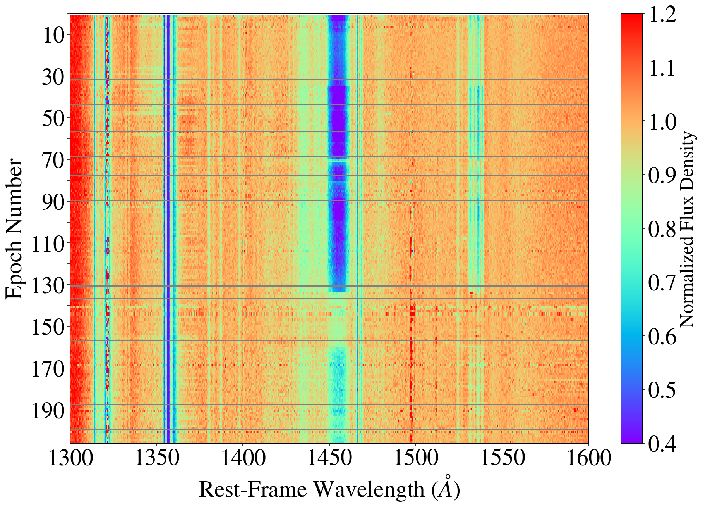

# arXiv Digest — 2026-11-25

- **Interest file used:** interests/2026.09.md (fallback — no 2026.11.md exists yet)
- **Categories pulled:** astro-ph.CO, astro-ph.EP, astro-ph.GA, astro-ph.HE, astro-ph.IM, astro-ph.SR, cs.LG, stat.ML, hep-ph
- **Papers scanned:** 346 (97 astro-ph new/cross + 249 cs.LG/stat.ML/hep-ph)
- **After first filter:** 33 candidates reviewed with full text
- **Final selected:** 13 papers across 3 tiers

---

## Tier 1 — Highly relevant

### [Symbolic Regression Diagnostics of 1D Lyman Alpha Forest Emulator](http://arxiv.org/abs/2611.31450v1)

Aidan Behmer, Ming-Feng Ho, Camille Avestruz et al. (Ming-Feng Ho: PRIYA/multi-fidelity emulator group)
**Primary category:** astro-ph.CO

Starting from the pretrained multi-fidelity GP emulator of the **PRIYA P1D**, the authors use PySR to find explicit per-parameter equations (an additive-Taylor construction plus a resolution-correction ratio between low- and high-fidelity runs) that reproduce the emulated flux power at the percent level. The main finding is a warning: **value accuracy does not guarantee derivative accuracy**, so a symbolic surrogate can match P1D and still give wrong slopes for Fisher forecasts. They introduce a derivative-faithfulness score against the GP gradient and a **Sobolev (derivative-matching) loss**, which gives faithful equations for **9 of 11 PRIYA parameters at z = 3.6**, including $A_P$ and $n_P$; only $h$ and $\epsilon_{\rm AGN}$, whose P1D imprints are weak or degenerate, fail. Joint six-parameter fits keep only a few independent gradient directions until the complexity budget gets large, so the additive per-parameter form stays the controlled choice.

*With the ordinary value loss, many parameters' best equations have slope errors above the 0.25 faithfulness threshold. Under the Sobolev loss, only $h$ and $\epsilon_{\rm AGN}$ stay above it.*

---

## Tier 2 — Adjacent / useful context

### [Modified recombination or dynamical dark energy (or both)?](http://arxiv.org/abs/2611.32857v1)

Alexander Reeves, Gabriel P. Lynch, Andrina Nicola et al.
**Primary category:** astro-ph.CO

The authors fit a seven-node reconstruction of the free-electron fraction and $w_0w_a$, separately and together, to **DESI DR2 BAO**, a 5×2pt galaxy-clustering + CMB-lensing combination, and three CMB likelihoods (P-ACT, Planck PR4, Planck 2018). With Λ, the data prefer early recombination near last scattering. Once DDE is allowed, **that preference disappears and the $w_0$–$w_a$ constraints barely move**, and adding recombination freedom to DDE raises the AIC by 5.1–11.7. The reason is that earlier recombination can only rescale the CMB-predicted BAO distances, whereas the anisotropic DESI measurements also want the changed redshift dependence that DDE provides. Noiseless mocks confirm it: a DDE universe fit with modified recombination produces a spurious ionization suppression, while the reverse does not happen.

*For all three CMB baselines, the ionization-fraction departure inferred with Λ (gold) mostly vanishes when DDE is fitted at the same time (teal), returning to standard recombination.*

### [The SDSS-V Black Hole Mapper Reverberation Mapping Project: Time-delayed Variability of a Quasar's C IV Broad Absorption Troughs](http://arxiv.org/abs/2611.31415v1)

Kaleb Roessler, Catherine J. Grier, Loren Robinson et al.
**Primary category:** astro-ph.GA

The authors follow the C IV outflows of the z = 3.228 BAL quasar SDSS J142129.40+522752.0 in **199 high-S/N spectra over 12 years** from the SDSS-III/IV RM and SDSS-V BHM-RM programs. A high-velocity BAL (~−20,000 km/s) and a mini-BAL (~−3,700 km/s) both change significantly on timescales under 10 rest-frame days (33 cases, one at 22σ over 4 days), weaken over the later years, and vanish temporarily in 2022–2023 before returning at the same velocities. The EW changes track the g-band flux and each other, pointing to **ionization-state changes as the driver**, and **the mini-BAL lags the BAL by ~4 rest-frame days**, which suggests different densities or distances for the two absorbers. For forest work, this shows how fast BAL troughs can change in a single object, which matters for BAL masking and for continuum templates built from multi-epoch quasar spectra.

*All 199 normalized epochs stacked in time order (top to bottom), so each trough's strengthening, weakening and temporary disappearance shows up as a change along the vertical axis at a fixed wavelength.*

### [Euclid: Discovery of a quasar at z = 8.13 hosting a 360-million-solar-mass black hole](http://arxiv.org/abs/2611.31385v1)

J. Wolf, S. Belladitta, D. Yang et al.
**Primary category:** astro-ph.GA

J1504+6252 was selected from Euclid Wide Survey imaging and confirmed with Keck, HST, LBT and JWST. It is the **first quasar at z > 8 (z = 8.129 ± 0.005 from narrow Hβ)** and moves the quasar redshift frontier about 39 Myr earlier than the previous record at z = 7.77. Its spectrum looks like a normal broad-line quasar. Single-epoch Hβ and Mg II calibrations give **log M_BH = 8.33–8.89 (fiducial 8.56 ± 0.43) with Eddington ratios of only 0.12–0.44**. A black hole this massive but accreting below Eddington at 630 Myr needs a massive seed or sustained efficient early growth, and it suggests that the known reionization-era quasars may be the rapidly accreting end of a broader population.

### [Tentative Excess Dispersion Measures toward DESI Galaxy Groups from Localized Fast Radio Bursts](http://arxiv.org/abs/2611.31805v1)

Jiale Wang, Taotao Fang
**Primary category:** astro-ph.CO

The authors cross-match **117 localized FRBs** with the DESI Legacy Imaging Surveys group catalog. In the main sample (in the footprint, z_host < 0.5), 23 sightlines pass through foreground groups and 18 are clean controls. A joint fit with a common DM_cosmic–z relation gives an **offset of 143 ± 53 pc cm⁻³ for group-intersecting sightlines**, and label-permutation tests within redshift bins give one-sided p of 5×10⁻⁵ to 9×10⁻⁴. A halo-gas template, however, is **essentially unconstrained (A_halo = 0.34 ± 0.5)** and does not track the residual scatter, and one known sightline (FRB 20181112A) moves it a lot. The result is a tentative detection of extra ionized baryons in groups, not yet a measurement of their profiles. The forecast shows how this tightens as localized FRB samples from DSA-class surveys grow.

### [The hot circumgalactic medium: implications of mixing and resolution at the disk-halo interface](http://arxiv.org/abs/2611.31387v1)

Omry Ginzburg, Jonathan Stern, Drummond B. Fielding et al.
**Primary category:** astro-ph.GA

The analytic part shows that the near-axis hot CGM of a Milky Way-mass halo depends on how fast hot gas joins the disk. Inflow on the cooling time gives a **cooling flow with K ∝ r^{1/3}**, while inflow faster than cooling (turbulent mixing, fountains) gives an **isentropic halo**. The two differ by ~10× in density above the disk and **~100× in X-ray emission measure**. Idealized simulations that do not resolve the pc-scale interface converge to the isentropic state through numerical mixing, and FIRE zooms show the same structure along the rotation axis. Replacing the interface with a slow-inflow inner boundary recovers the cooling flow, which also matches Milky Way constraints from density at ~100 kpc and eROSITA-bubble entropy better. Simulated hot-CGM predictions near disks may therefore be set by numerics rather than physics.

*On-axis density, temperature, entropy and velocity profiles for the two assumed inflow speeds at 1 kpc. The fast-inflow (isentropic) and cooling-flow solutions bracket the simulations and differ by about an order of magnitude in density near the disk.*

### [CosmoMap: Predicting Hot Gas Temperature and Density from Dark Matter with a Conditioned 3D U-Net](http://arxiv.org/abs/2611.31282v1)

Aman Bhutani, Maggie Lieu
**Primary category:** astro-ph.CO

The model is a **3D U-Net FiLM-conditioned on cosmological and feedback parameters** that maps dark-matter density and velocity to gas temperature and electron density across the CAMELS-IllustrisTNG Latin hypercube. At z = 0 it reaches **R² = 0.765 (log T) and 0.934 (log n_e)**, cuts the error of gradient-boosted trees by 22–23%, stays ahead of them up to z = 2, and loses little when the inputs come from gravity-only runs. Most of the gain over simpler models comes from the parameter conditioning, and most of the cosmological information in the gas survives. The squared-error loss smooths compact structures, so the brightest gas is biased low by 0.12 dex, and a heteroscedastic variance head costs accuracy unless trained separately. This is the hot-gas counterpart of DM-to-baryon painting for forest mocks, with the same mean-regression failure mode to watch for.

### [Parallel and perpendicular: a two-population test with POSSUM radio galaxies confirms hint of CMB birefringence](http://arxiv.org/abs/2611.31411v1)

Marcus Brüggen, Jorinde Dreismann, Pranjal Trivedi et al.
**Primary category:** astro-ph.CO

Radio galaxies give a low-redshift test of CMB cosmic birefringence because their Faraday-corrected polarization angle is statistically aligned with the source axis. Earlier tests used only the perpendicular population. The authors add the **parallel (χ₀ − ψ ≈ 0°) population, which turns out to be equally abundant**, and fit both with axial von Mises components in an unbinned likelihood over **33,298 components of 16,649 POSSUM double sources**, which halves the variance of the rotation. They find **β = 0.48° ± 0.35° (CMB convention)**, matching the CMB in sign and amplitude. Combined with ACT+Planck under a late-time-rotation model, this gives **β = 0.282° ± 0.056°, 5.0σ from zero**. Absolute angle calibration is now the limiting systematic, and redshift-binned β(z) could separate axion-like dark energy (rotation within the last ~5 Gyr) from pre-reionization axion dark matter (β ≈ 0 at low z).

*Distribution of χ₀ − ψ for the baseline sample, with peaks near 0° and 90° that are fitted jointly with a common rotation on top of a uniform background.*

### [JWST/NIRSpec observations of AMORE6 suggest active Pop III star formation in a self-polluted galaxy](http://arxiv.org/abs/2611.31355v1)

Mirko Curti, Elka Rusta, Stefania Salvadori et al.
**Primary category:** astro-ph.GA

Deep NIRSpec spectroscopy of the μ ≈ 78 lensed z = 5.725 galaxy AMORE6-B detects He II λ1640 (35σ) and λ4686 (He II/Hβ = 0.080 ± 0.015). The only metals are weak [O III] and C IV, giving **12+log(O/H) ≈ 6.1, the lowest at its stellar mass**, with near-primordial helium (Y = 0.226) and T_e ≈ 2×10⁴ K. Photoionization and SED fits favor **~1.3×10⁵ M⊙ of top-heavy Pop III stars formed in the last 4 Myr**, ionizing gas enriched by the first supernovae and **leaking 86% of their ionizing photons**. Ordinary metal-poor populations, very massive stars and accretion sources are disfavored, and an X-ray binary alternative needs extreme conditions. The He II-to-Balmer ratio jointly constrains the Pop III IMF and excludes the most top-heavy IMFs allowed by near-field constraints.

### [On Potentiality and Actuality Of Foundation Models](http://arxiv.org/abs/2611.32991v1)

Fabian Gröger, Shuo Wen, Maria Brbić
**Primary category:** cs.LG | also: cs.AI, cs.CL

The authors split the hidden-state change produced by an adaptation (LoRA, full fine-tuning) into a component shared by all inputs and an input-dependent residual. They find that **the shared component carries most of the adaptation gain**. A **"shift adapter" that learns one constant vector per layer, the same for every input, matches LoRA and full fine-tuning** across 18 models and 17 tasks, and steers close to LoRA on AxBench's 500 concepts. They read this as a "potentiality" principle, in which the base model already holds the expertise and adaptation only moves inputs into a narrow region of activation space, and they use it to connect PEFT, activation steering, cross-model convergence and "neural thickets." For a pretrained spectral transformer, this means testing a constant-shift adapter before LoRA when probing what fine-tuning actually adds.

*Averaged over 18 models and 17 tasks, a single constant shift per layer reaches the accuracy of LoRA at various ranks, and its paired difference to rank-8 LoRA stays near zero across task types.*

### [Tokenization and Architecture Jointly Allocate Component Roles in Time Series Transformers](http://arxiv.org/abs/2611.31730v1)

Mingyu Kim, Doguk Kim
**Primary category:** cs.LG

The authors define 15 token-level temporal probing tasks (trend, volatility, spectral energy, etc.) and measure **feature construction as the gain in linear decodability from one sub-layer to the next**. They apply this to 5 supervised forecasters on 8 benchmarks and confirm it with activation patching, knockouts and retraining. **Which component builds temporal features depends on tokenization**: under patch tokens (PatchTST) the FFN's gain is 3.2× attention's on average and the FFN alone nearly matches the full model, while under variate tokens (iTransformer) attention dominates. In a controlled test, single-scalar tokens (P = 1) almost eliminate the FFN's role, and P = 2 restores it. This directly informs how spectra are tokenized (per-pixel vs. patch) in a self-supervised quasar-spectrum transformer, and offers a probing protocol to reuse.

---

## Tier 3 — Outside my area but notable

### [On the evidence of lensing in GW231123](http://arxiv.org/abs/2611.31389v1)

Anna Liu, Mick Wright, Jef Heynen et al.
**Primary category:** gr-qc | also: astro-ph.HE

GW231123, the most massive binary black hole merger yet, has extreme inferred spins that depend strongly on the waveform model. The authors model it as a **superposition of multiple overlapping lensed images** and find support for lensing with all four waveform models. The lensed fit lowers the spins and brings masses and spins into agreement across waveforms. Against a background of unlensed signals, the lensing interpretation reaches **3.96 (+0.68/−0.30)σ**, compelling but short of a definitive first lensed GW, and a lensing explanation would also account for the event's apparent deviations in GR tests.

### [Reinforcement Learning Can Be Recovered From Its Own Rollouts](http://arxiv.org/abs/2611.33102v1)

Jiayi Sheng, Jingwen Gu, Guanning Zeng et al.
**Primary category:** cs.LG

Replaying an RL algorithm (MaxRL/GRPO-type) on archived rollouts collapses, because small off-policy deviations bias each update and compound. In contrast, **plain maximum likelihood on the same rollouts, in their original order, with no rewards and no correct/incorrect filtering, tracks the whole online-RL learning curve** with one SFT step per rollout batch. The result holds across Qwen3 base models, tasks (math, Knights-and-Knaves, mazes) and RL algorithms. The rollouts of the last few RL steps often recover the final model, and rollouts from two specialists can be combined into one model. The authors conclude that **most RL compute goes into discovering a better sampling distribution, not into learning from samples**.

*For Qwen3-1.7B-Base, pass@1 and pass@16 from chronological SFT on the saved rollouts (blue) follow the online MaxRL curves (orange) through the whole of training.*
